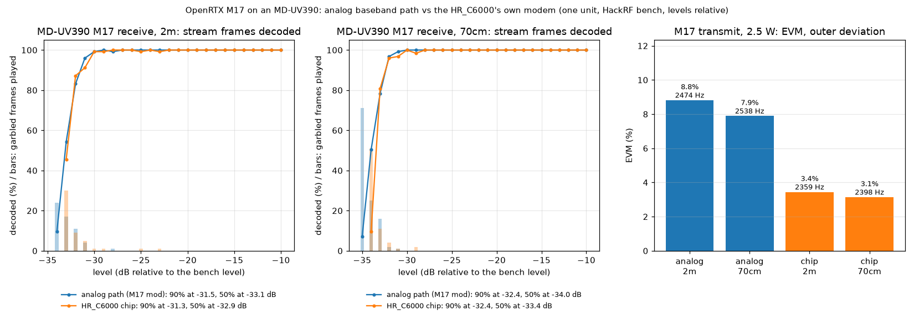
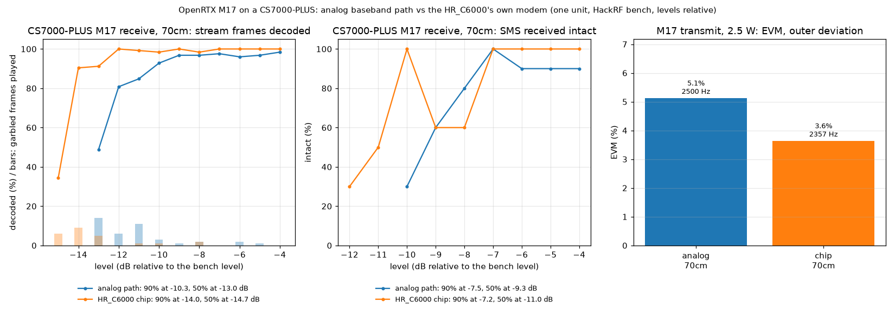

<!--
SPDX-FileCopyrightText: Copyright 2026 OpenRTX Contributors

SPDX-License-Identifier: GPL-3.0-or-later
-->

# M17 through the HR_C6000's own modem: as good as the analog path?

An experiment, November 2026, on one MD-UV390 and one CS7000-PLUS.

## The question

OpenRTX sends and receives M17 as baseband: the MCU's DAC drives the modulator and its ADC samples
the discriminator. On the MD-UV3x0 that path needs a hardware mod. The HR_C6000 in these radios can
do the job itself:

- **Transmit:** its physical-layer mode sends 4FSK symbols that the MCU writes into its RAM every
  timeslot. M17 symbols go in as DMR dibits.
- **Receive:** its FM receive copy leaves the demodulated audio in its RAM, 256 samples at 8 kHz per
  half. The MCU reads it over SPI and interpolates to the demodulator's 24 kHz.

Does that "chip mode" perform as well as the analog path, on receive and on transmit? Receive is
the doubtful one: the copy is 8 kHz audio, band-limited to about 3.4 kHz, while the analog path
samples at 24 kHz.

## Answer

Yes. On the MD-UV390 chip mode matches the analog path on receive and has cleaner transmit. On the
CS7000-PLUS it beats the analog path on receive and has cleaner transmit. Chip TX deviation comes
from each radio's own DMR calibration, with no per-unit tuning.

## Setup

- **Firmware:** the branch
  [turnrye/OpenRTX feat/m17-chip-modem](https://github.com/turnrye/OpenRTX/tree/feat/m17-chip-modem),
  plus a test-only console on the radio's USB serial port (the bench keys the radio, switches the
  modem, and reads a receive trace). The console is not on the branch. The CS7000-PLUS ran the
  final build (`c6000-bench-0066f6e2`). The MD-UV390 ran an earlier one (`c6000-bench-db1fdbbc`)
  first, then its chip receive again on the final one, after the FM copy read fix (below).
- **Setting:** M17 menu, "Modem: Analog / HR_C6000". The suites switch it over the console.
- **Bench:** a HackRF One through attenuators, both directions. Levels are relative to each radio's
  bench level, not absolute dBm, and the two radios have different bench levels (below).
- **Suites:** this repository's M17 `tx.robot`, `trace.robot` and `modulation.robot`, analog then
  chip, same session, same bench. Power 2.5 W.
- **Radios:** MD-UV390 2504BN02025 (with the PC3 mod, so both paths work), 2 m and 70 cm; a
  CS7000-PLUS, 70 cm only.

## MD-UV390

| | Analog | Chip, first build | Chip, read fix |
|---|---|---|---|
| TX 2 m: outer deviation, EVM | 2474 Hz, 8.8% | 2359 Hz, 3.4% | |
| TX 70 cm: outer deviation, EVM | 2538 Hz, 7.9% | 2398 Hz, 3.1% | |
| RX 2 m stream, 90% / 50% | -31.5 / -33.1 dB | -31.2 / -33.1 dB | -31.3 / -32.9 dB |
| RX 70 cm stream, 90% / 50% | -32.4 / -34.0 dB | -32.5 / -33.5 dB | -32.4 / -33.4 dB |
| Weak late join, 2 m: decoded, garbled played | 220/250, 20 | 172/250, 38 | 228/250, 16 |
| Weak late join, 70 cm: decoded, garbled played | 240/250, 6 | 201/250, 30 | 231/250, 13 |
| SMS 90%, 2 m / 70 cm | -28.2 / -18.3 dB | -10.0 / -16.0 dB | -28.0 / -30.2 dB |
| Bench level, 2 m / 70 cm | 250, 250; SMS 10, 10 | 249, 250; SMS 10, 9 | 250, 250; SMS 10, 10 |

The chart shows the analog path against the chip with the read fix. Receive sensitivity is the same
within half a dB. The first build lost a frame or an SMS now and then at full level and played more
garbled frames near threshold; with the read fix those losses are gone and it passes every receive
test the analog path passes. The analog 70 cm transmit failed this suite's 2280-2520 Hz limit by
18 Hz; chip transmit passed on both bands, closer to 2400 Hz.

## CS7000-PLUS

| | Analog | Chip |
|---|---|---|
| TX suite (6 tests; the power test needs a power meter) | 6/6 pass | 6/6 pass |
| TX outer deviation, EVM | 2500 Hz, 5.1% | 2357 Hz, 3.6% |
| RX stream, 90% / 50% | -10.3 / -13.0 dB | -14.0 / -14.7 dB |
| RX at strong levels | 96-98% | 100% |
| Weak late join, -11 dB: decoded, garbled played | 229/250, 12 | 249/250, 1 |
| 10 min soak at -11 dB: decoded, garbled played | 88.4%, 848 | 98.5%, 178 |
| SMS 50% | -9.3 dB | -11.0 dB |
| Modulation sweep best point vs the calibrated pair | | 2390 Hz vs 2357 Hz |

The SMS points are 10 messages each, so they move in steps of 10%; the dips in the chart are that.

## What the experiment found on the way

- **CS7000 transmit deviation.** The HR_C6000's two-point modulation needs both values of its
  modulation pair. OpenRTX never read the CS7000's DMR pair from calibration (0x10B4 and 0x10BC),
  so chip mode first sent 5.6 kHz. The stock firmware calibrates that pair at the factory for DMR's
  1944 Hz; scaled by 2400/1944 it gives 2357 Hz. The MD-UV3x0 uses the same scaling of its own DMR
  calibration.
- **FM copy read.** The first byte of every SPI read of the chip's RAM came back corrupt on the
  CS7000-PLUS, so each 32 ms block started with a bad sample. The driver now starts the read one
  word early and drops it. A model of the receive path (the real OpenRTX demodulator fed a
  simulated copy) pointed at this as the likely cause of the MD-UV390's losses at transmission
  starts, and the rerun with the fix confirmed it: those losses went, and garbled frames near
  threshold halved.
- **MD-UV3x0 VHF calibration.** The VHF calibration frequencies were read without their factor of
  ten, so every 2 m interpolation used the 174 MHz point. Fixed in OpenRTX/OpenRTX#588.

## Limits

- One unit of each radio, on one bench, with relative levels. No on-air test yet.
- The two radios' levels can't be compared directly. The CS7000-PLUS's bench level is about 18 dB
  above the MD-UV390's, and its thresholds sit 18-20 dB higher on top of that: its receiver is
  roughly 25-35 dB less sensitive on this bench, on both paths. Both radios deliver the same
  transmit level through the chain, so it is the radio, not the chain. It is unexplained.
- The CS7000-PLUS runs don't record its serial number.
- Both paths show no stack headroom on the 512-byte rtx thread (`trace.robot` M17-TRACE-9).
- Chip transmit accuracy depends on each radio's factory DMR calibration.

## Next

- The MD-UV390's microphone still reaches the MCU only through the M17 hardware mod (this unit has
  it). The microphone through the HR_C6000's codec, over I2S as on the MD-9600, is next.
- On-air checks against other M17 radios, both targets.
- Find the CS7000-PLUS sensitivity gap.

## Data

All runs are in `results/`, with the firmware and the suite commit they ran:

- MD-UV390: [`results/c6000-bench-db1fdbbc/mduv3x0-m17/`](../results/c6000-bench-db1fdbbc/mduv3x0-m17/),
  and the rerun with the read fix in
  [`results/c6000-bench-0066f6e2/mduv3x0-m17/`](../results/c6000-bench-0066f6e2/mduv3x0-m17/)
- CS7000-PLUS: [`results/c6000-bench-0066f6e2/cs7000p/`](../results/c6000-bench-0066f6e2/cs7000p/)
