# M17 microphone chain: emulator campaign

OpenRTX `v0.4.5-57-g506ae93de` (poc/m17-mic-agc), profile **cs7000p** (oversample 6, gain 32, 12-bit ADC, noise 2.0 LSB RMS). Run 2026-11-16T00:42:01+00:00 to 2026-11-16T01:05:55+00:00, suite `285528699d`.

How the bench works, what each metric means and its limits: [METHODS.md](METHODS.md). Raw tables are in `data/`, provenance in `run.json`.

Variants:

- **baseline**: no extra defines
- **full**: `-DMIC_EXP_PRIME_DC` `-DMIC_EXP_KEEP_SUM` `-DMIC_EXP_HPF` `-DMIC_EXP_AGC`
- **full_t27**: `-DMIC_EXP_PRIME_DC` `-DMIC_EXP_KEEP_SUM` `-DMIC_EXP_HPF` `-DMIC_EXP_AGC` `-DMIC_EXP_AGC_TARGET=-27.0f`
- **full_t24**: `-DMIC_EXP_PRIME_DC` `-DMIC_EXP_KEEP_SUM` `-DMIC_EXP_HPF` `-DMIC_EXP_AGC` `-DMIC_EXP_AGC_TARGET=-24.0f`
- **full_t18**: `-DMIC_EXP_PRIME_DC` `-DMIC_EXP_KEEP_SUM` `-DMIC_EXP_HPF` `-DMIC_EXP_AGC` `-DMIC_EXP_AGC_TARGET=-18.0f`
- **full_exp**: `-DMIC_EXP_PRIME_DC` `-DMIC_EXP_KEEP_SUM` `-DMIC_EXP_HPF` `-DMIC_EXP_AGC` `-DMIC_EXP_EXPANDER=20.0f`
- **full_sil**: `-DMIC_EXP_PRIME_DC` `-DMIC_EXP_KEEP_SUM` `-DMIC_EXP_HPF` `-DMIC_EXP_AGC` `-DMIC_EXP_SILENCE_FRAME`

## Headline

Δ columns are the variant minus baseline. Spread: active speech level, max − min over the input levels (lower is a steadier level), into codec2 (pre-codec, from the tap) and after it. Attack and release are from the pre-codec envelope. STOI deficit: codec-only (ideal) STOI minus the variant's, mean over takes (lower is better). Step and gate figures are described under their tests.

| variant | pre-codec spread dB | Δ | spread dB | Δ | STOI | Δ | STOI deficit | Δ | listening STOI worst | Δ | listening deficit worst | Δ | pre-codec onset dBFS | Δ | onset dBFS | Δ | pre-codec clip max % | attack s | release s | speech/pause dB | Δ | pause drift dB | Δ |
|---|---|---|---|---|---|---|---|---|---|---|---|---|---|---|---|---|---|---|---|---|---|---|---|
| baseline | 36.8 |  | 34.3 |  | 0.710 |  | 0.025 |  | 0.318 |  | 0.252 |  | 0.0 |  | -8.3 |  | 1.81 | 0.00 | 0.00 | 28.5 |  | 0.2 |  |
| full | 11.9 | -24.9 | 7.7 | -26.5 | 0.710 | +0.000 | 0.025 | -0.000 | 0.522 | +0.204 | 0.064 | -0.188 | -47.7 | -47.7 | -43.7 | -35.4 | 0.00 | 0.25 | 4.50 | 26.3 | -2.2 | 3.3 | +3.1 |
| full_t27 | 14.2 | -22.6 | 9.0 | -25.2 | 0.713 | +0.002 | 0.023 | -0.002 | 0.500 | +0.182 | 0.109 | -0.142 | -47.7 | -47.7 | -43.7 | -35.4 | 0.00 | 0.25 | 4.50 | 27.8 | -0.7 | 3.3 | +3.1 |
| full_t24 | 12.5 | -24.3 | 8.0 | -26.3 | 0.711 | +0.001 | 0.024 | -0.001 | 0.516 | +0.198 | 0.085 | -0.167 | -47.7 | -47.7 | -43.7 | -35.4 | 0.00 | 0.25 | 4.50 | 27.3 | -1.1 | 3.4 | +3.1 |
| full_t18 | 12.6 | -24.2 | 9.2 | -25.0 | 0.711 | +0.001 | 0.024 | -0.001 | 0.529 | +0.211 | 0.048 | -0.204 | -47.7 | -47.7 | -43.7 | -35.4 | 0.00 | 0.25 | 4.50 | 25.0 | -3.5 | 3.4 | +3.1 |
| full_exp | 10.7 | -26.1 | 6.3 | -27.9 | 0.711 | +0.000 | 0.024 | -0.000 | 0.509 | +0.191 | 0.061 | -0.191 | -47.7 | -47.7 | -43.7 | -35.4 | 0.00 | 0.25 | 4.50 | 33.9 | +5.4 | 2.7 | +2.5 |
| full_sil | 11.9 | -24.9 | 6.1 | -28.2 | 0.710 | -0.001 | 0.026 | +0.001 | 0.522 | +0.204 | 0.057 | -0.194 | -47.7 | -47.7 | -43.7 | -35.4 | 0.00 | 0.25 | 4.50 | 33.9 | +5.4 | 3.4 | +3.2 |

## Speech level sweep

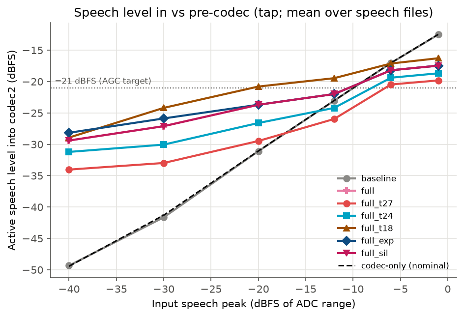

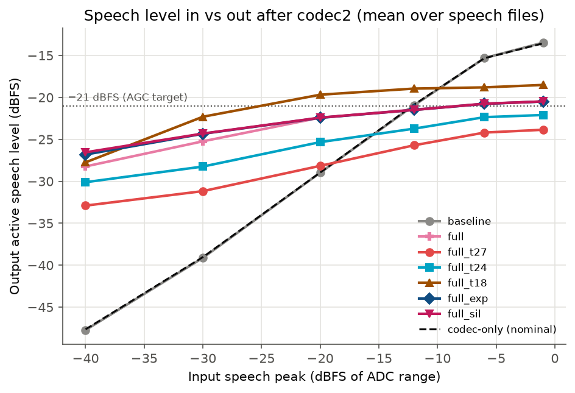

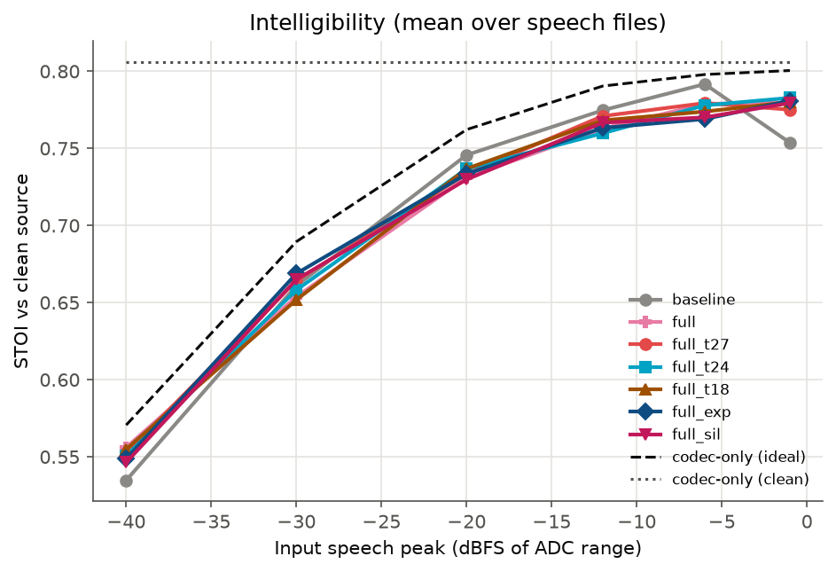

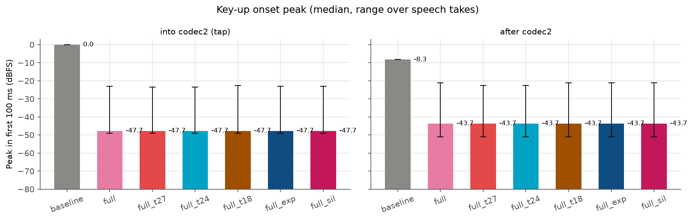

Pre-codec active level (dBFS, tap), mean over speech files, Δ vs baseline in brackets:

| variant | -40 dBFS | -30 dBFS | -20 dBFS | -12 dBFS | -6 dBFS | -1 dBFS |
|---|---|---|---|---|---|---|
| baseline | -49.3 | -41.6 | -31.1 | -23.1 | -17.1 | -12.5 |
| full | -29.4 (+19.9) | -27.1 (+14.5) | -23.7 (+7.4) | -22.0 (+1.1) | -18.2 (-1.2) | -17.5 (-5.0) |
| full_t27 | -34.0 (+15.3) | -33.0 (+8.7) | -29.5 (+1.6) | -26.0 (-2.9) | -20.5 (-3.4) | -19.8 (-7.3) |
| full_t24 | -31.2 (+18.1) | -30.1 (+11.6) | -26.6 (+4.5) | -24.2 (-1.1) | -19.4 (-2.3) | -18.7 (-6.2) |
| full_t18 | -28.9 (+20.4) | -24.2 (+17.4) | -20.8 (+10.3) | -19.5 (+3.6) | -17.1 (-0.1) | -16.3 (-3.8) |
| full_exp | -28.2 (+21.2) | -25.9 (+15.8) | -23.7 (+7.4) | -22.0 (+1.1) | -18.2 (-1.2) | -17.5 (-5.0) |
| full_sil | -29.4 (+19.9) | -27.1 (+14.5) | -23.7 (+7.4) | -22.0 (+1.1) | -18.2 (-1.2) | -17.5 (-5.0) |
| codec-only (nominal) | -49.4 | -41.3 | -31.1 | -23.0 | -17.0 | -12.5 |
| codec-only (ideal) | -23.6 | -21.7 | -21.0 | -21.0 | -21.0 | -21.0 |

Output active level (dBFS), mean over speech files, Δ vs baseline in brackets:

| variant | -40 dBFS | -30 dBFS | -20 dBFS | -12 dBFS | -6 dBFS | -1 dBFS |
|---|---|---|---|---|---|---|
| baseline | -47.7 | -39.1 | -29.0 | -20.9 | -15.3 | -13.5 |
| full | -28.2 (+19.5) | -25.2 (+13.9) | -22.4 (+6.6) | -21.5 (-0.5) | -20.7 (-5.4) | -20.5 (-7.0) |
| full_t27 | -32.9 (+14.8) | -31.2 (+8.0) | -28.2 (+0.8) | -25.7 (-4.8) | -24.2 (-8.9) | -23.9 (-10.4) |
| full_t24 | -30.1 (+17.6) | -28.2 (+10.9) | -25.3 (+3.6) | -23.7 (-2.8) | -22.4 (-7.0) | -22.1 (-8.6) |
| full_t18 | -27.7 (+20.0) | -22.3 (+16.8) | -19.7 (+9.3) | -18.9 (+2.0) | -18.8 (-3.5) | -18.5 (-5.0) |
| full_exp | -26.8 (+20.9) | -24.3 (+14.8) | -22.4 (+6.5) | -21.5 (-0.5) | -20.8 (-5.5) | -20.5 (-7.0) |
| full_sil | -26.5 (+21.2) | -24.3 (+14.8) | -22.4 (+6.6) | -21.5 (-0.5) | -20.8 (-5.4) | -20.5 (-7.0) |
| codec-only (nominal) | -47.6 | -39.0 | -29.0 | -20.9 | -15.3 | -13.6 |
| codec-only (ideal) | -22.6 | -19.0 | -18.8 | -18.9 | -18.9 | -18.9 |

STOI, mean over speech files, Δ vs baseline in brackets:

| variant | -40 dBFS | -30 dBFS | -20 dBFS | -12 dBFS | -6 dBFS | -1 dBFS |
|---|---|---|---|---|---|---|
| baseline | 0.535 | 0.661 | 0.746 | 0.775 | 0.792 | 0.754 |
| full | 0.556 (+0.021) | 0.654 (-0.007) | 0.731 (-0.015) | 0.763 (-0.012) | 0.779 (-0.013) | 0.780 (+0.026) |
| full_t27 | 0.552 (+0.018) | 0.664 (+0.003) | 0.733 (-0.012) | 0.771 (-0.004) | 0.779 (-0.012) | 0.775 (+0.021) |
| full_t24 | 0.551 (+0.016) | 0.658 (-0.003) | 0.737 (-0.009) | 0.760 (-0.015) | 0.778 (-0.014) | 0.783 (+0.029) |
| full_t18 | 0.555 (+0.020) | 0.652 (-0.009) | 0.737 (-0.009) | 0.768 (-0.007) | 0.774 (-0.018) | 0.780 (+0.026) |
| full_exp | 0.549 (+0.014) | 0.669 (+0.008) | 0.733 (-0.012) | 0.763 (-0.011) | 0.769 (-0.023) | 0.781 (+0.027) |
| full_sil | 0.546 (+0.012) | 0.665 (+0.004) | 0.730 (-0.016) | 0.767 (-0.008) | 0.770 (-0.022) | 0.779 (+0.026) |
| codec-only (nominal) | 0.573 | 0.682 | 0.759 | 0.789 | 0.795 | 0.757 |
| codec-only (ideal) | 0.571 | 0.689 | 0.762 | 0.790 | 0.798 | 0.800 |

Pre-codec clip, % of the samples codec2 receives at int16 full scale, measured at the tap (in brackets, the integer-chain model as a cross-check, where it applies):

| variant | -40 dBFS | -30 dBFS | -20 dBFS | -12 dBFS | -6 dBFS | -1 dBFS |
|---|---|---|---|---|---|---|
| baseline | 0.00 (0.00) | 0.00 (0.00) | 0.00 (0.00) | 0.00 (0.00) | 0.00 (0.00) | 0.77 (0.73) |
| full | 0.00 | 0.00 | 0.00 | 0.00 | 0.00 | 0.00 |
| full_t27 | 0.00 | 0.00 | 0.00 | 0.00 | 0.00 | 0.00 |
| full_t24 | 0.00 | 0.00 | 0.00 | 0.00 | 0.00 | 0.00 |
| full_t18 | 0.00 | 0.00 | 0.00 | 0.00 | 0.00 | 0.00 |
| full_exp | 0.00 | 0.00 | 0.00 | 0.00 | 0.00 | 0.00 |
| full_sil | 0.00 | 0.00 | 0.00 | 0.00 | 0.00 | 0.00 |
| codec-only (nominal) | 0.00 (0.00) | 0.00 (0.00) | 0.00 (0.00) | 0.00 (0.00) | 0.00 (0.00) | 0.78 (0.73) |

## Static level curve (tones)

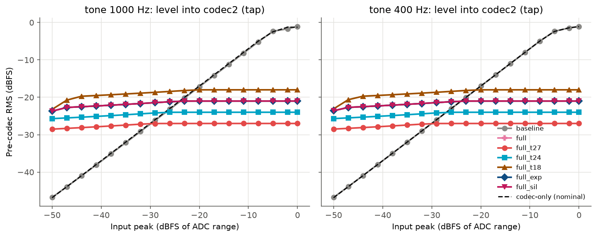

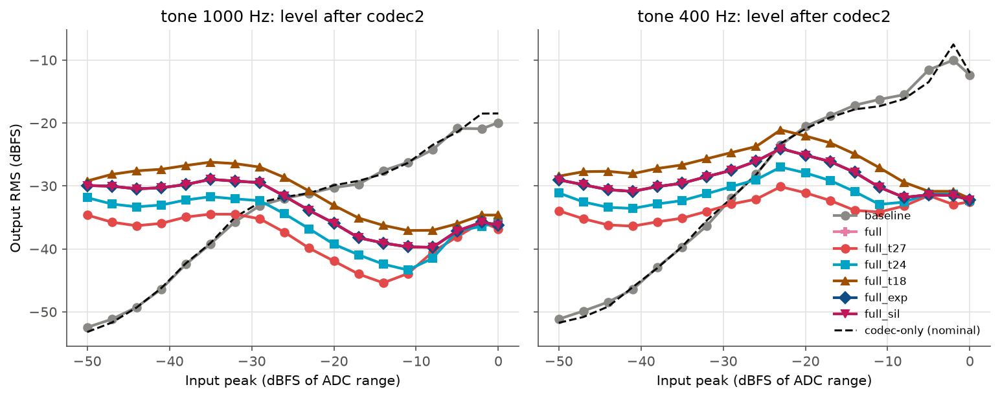

tone 1000 Hz: pre-codec RMS (dBFS, tap) by input peak (dBFS of ADC range).

| variant | -50 | -47 | -44 | -41 | -38 | -35 | -32 | -29 | -26 | -23 | -20 | -17 | -14 | -11 | -8 | -5 | -2 | +0 |
|---|---|---|---|---|---|---|---|---|---|---|---|---|---|---|---|---|---|---|
| baseline | -46.8 | -43.9 | -41.0 | -38.1 | -35.1 | -32.1 | -29.2 | -26.2 | -23.2 | -20.2 | -17.2 | -14.2 | -11.2 | -8.2 | -5.2 | -2.3 | -1.7 | -1.1 |
| full | -23.7 | -22.7 | -22.5 | -22.3 | -22.1 | -21.9 | -21.7 | -21.4 | -21.2 | -21.0 | -21.0 | -21.0 | -21.0 | -21.0 | -21.0 | -21.0 | -21.0 | -21.0 |
| full_t27 | -28.5 | -28.3 | -28.1 | -27.9 | -27.7 | -27.4 | -27.2 | -27.0 | -27.0 | -27.0 | -27.0 | -27.0 | -27.0 | -27.0 | -27.0 | -27.0 | -27.0 | -27.0 |
| full_t24 | -25.7 | -25.5 | -25.3 | -25.1 | -24.9 | -24.7 | -24.4 | -24.2 | -24.0 | -24.0 | -24.0 | -24.0 | -24.0 | -24.0 | -24.0 | -24.0 | -24.0 | -24.0 |
| full_t18 | -23.2 | -20.8 | -19.7 | -19.5 | -19.3 | -19.1 | -18.9 | -18.7 | -18.4 | -18.2 | -18.0 | -18.0 | -18.0 | -18.0 | -18.0 | -18.0 | -18.0 | -18.0 |
| full_exp | -23.7 | -22.7 | -22.5 | -22.3 | -22.1 | -21.9 | -21.7 | -21.4 | -21.2 | -21.0 | -21.0 | -21.0 | -21.0 | -21.0 | -21.0 | -21.0 | -21.0 | -21.0 |
| full_sil | -23.7 | -22.7 | -22.5 | -22.3 | -22.1 | -21.9 | -21.7 | -21.4 | -21.2 | -21.0 | -21.0 | -21.0 | -21.0 | -21.0 | -21.0 | -21.0 | -21.0 | -21.0 |
| codec-only (nominal) | -46.9 | -43.9 | -41.0 | -38.0 | -35.0 | -32.0 | -29.0 | -26.0 | -23.0 | -20.0 | -17.0 | -14.0 | -11.0 | -8.0 | -5.0 | -2.5 | -1.2 | -1.2 |

tone 1000 Hz: output RMS after codec2 (dBFS) by input peak (dBFS of ADC range). codec2 alone loses level on pure tones, so read the output against the codec-only row.

| variant | -50 | -47 | -44 | -41 | -38 | -35 | -32 | -29 | -26 | -23 | -20 | -17 | -14 | -11 | -8 | -5 | -2 | +0 |
|---|---|---|---|---|---|---|---|---|---|---|---|---|---|---|---|---|---|---|
| baseline | -52.5 | -51.2 | -49.3 | -46.4 | -42.4 | -39.2 | -35.7 | -33.1 | -32.0 | -31.2 | -30.3 | -29.7 | -27.6 | -26.2 | -24.3 | -20.9 | -20.9 | -19.9 |
| full | -29.9 | -30.0 | -30.5 | -30.3 | -29.8 | -29.0 | -29.2 | -29.5 | -31.6 | -33.9 | -35.9 | -38.2 | -39.1 | -39.7 | -39.8 | -37.1 | -35.7 | -36.2 |
| full_t27 | -34.6 | -35.8 | -36.3 | -35.9 | -34.9 | -34.5 | -34.5 | -35.2 | -37.4 | -39.9 | -41.9 | -44.0 | -45.4 | -43.9 | -40.5 | -38.1 | -35.8 | -36.8 |
| full_t24 | -31.9 | -32.9 | -33.3 | -33.0 | -32.2 | -31.7 | -32.1 | -32.3 | -34.4 | -36.8 | -39.3 | -40.9 | -42.4 | -43.4 | -41.5 | -37.2 | -36.4 | -35.7 |
| full_t18 | -29.2 | -28.2 | -27.6 | -27.4 | -26.8 | -26.2 | -26.5 | -27.0 | -28.7 | -30.8 | -33.1 | -35.1 | -36.3 | -37.1 | -37.0 | -36.0 | -34.6 | -34.6 |
| full_exp | -29.9 | -30.0 | -30.5 | -30.3 | -29.8 | -29.0 | -29.2 | -29.5 | -31.6 | -33.9 | -35.9 | -38.2 | -39.1 | -39.7 | -39.8 | -37.1 | -35.7 | -36.2 |
| full_sil | -29.9 | -30.0 | -30.5 | -30.3 | -29.8 | -29.0 | -29.2 | -29.5 | -31.6 | -33.9 | -35.9 | -38.2 | -39.1 | -39.7 | -39.8 | -37.1 | -35.7 | -36.2 |
| codec-only (nominal) | -53.2 | -51.7 | -49.3 | -46.2 | -42.3 | -39.1 | -34.9 | -32.6 | -31.8 | -31.1 | -29.9 | -29.2 | -28.1 | -26.3 | -23.5 | -21.4 | -18.5 | -18.5 |

tone 400 Hz: pre-codec RMS (dBFS, tap) by input peak (dBFS of ADC range).

| variant | -50 | -47 | -44 | -41 | -38 | -35 | -32 | -29 | -26 | -23 | -20 | -17 | -14 | -11 | -8 | -5 | -2 | +0 |
|---|---|---|---|---|---|---|---|---|---|---|---|---|---|---|---|---|---|---|
| baseline | -46.8 | -43.9 | -40.9 | -38.0 | -35.0 | -32.0 | -29.0 | -26.0 | -23.0 | -20.0 | -17.0 | -14.0 | -11.0 | -8.0 | -5.0 | -2.3 | -1.5 | -1.1 |
| full | -23.6 | -22.7 | -22.5 | -22.3 | -22.1 | -21.9 | -21.7 | -21.4 | -21.2 | -21.0 | -21.0 | -21.0 | -21.0 | -21.0 | -21.0 | -21.0 | -21.0 | -21.0 |
| full_t27 | -28.5 | -28.3 | -28.1 | -27.9 | -27.7 | -27.4 | -27.2 | -27.0 | -27.0 | -27.0 | -27.0 | -27.0 | -27.0 | -27.0 | -27.0 | -27.0 | -27.0 | -27.0 |
| full_t24 | -25.7 | -25.5 | -25.3 | -25.1 | -24.9 | -24.7 | -24.4 | -24.2 | -24.0 | -24.0 | -24.0 | -24.0 | -24.0 | -24.0 | -24.0 | -24.0 | -24.0 | -24.0 |
| full_t18 | -23.1 | -20.6 | -19.7 | -19.5 | -19.3 | -19.1 | -18.9 | -18.7 | -18.4 | -18.2 | -18.0 | -18.0 | -18.0 | -18.0 | -18.0 | -18.0 | -18.0 | -18.0 |
| full_exp | -23.6 | -22.7 | -22.5 | -22.3 | -22.1 | -21.9 | -21.7 | -21.4 | -21.2 | -21.0 | -21.0 | -21.0 | -21.0 | -21.0 | -21.0 | -21.0 | -21.0 | -21.0 |
| full_sil | -23.6 | -22.7 | -22.5 | -22.3 | -22.1 | -21.9 | -21.7 | -21.4 | -21.2 | -21.0 | -21.0 | -21.0 | -21.0 | -21.0 | -21.0 | -21.0 | -21.0 | -21.0 |
| codec-only (nominal) | -46.8 | -43.9 | -40.9 | -38.0 | -35.0 | -32.0 | -29.0 | -26.0 | -23.0 | -20.0 | -17.0 | -14.0 | -11.0 | -8.0 | -5.0 | -2.4 | -1.4 | -1.1 |

tone 400 Hz: output RMS after codec2 (dBFS) by input peak (dBFS of ADC range). codec2 alone loses level on pure tones, so read the output against the codec-only row.

| variant | -50 | -47 | -44 | -41 | -38 | -35 | -32 | -29 | -26 | -23 | -20 | -17 | -14 | -11 | -8 | -5 | -2 | +0 |
|---|---|---|---|---|---|---|---|---|---|---|---|---|---|---|---|---|---|---|
| baseline | -51.2 | -49.9 | -48.4 | -46.4 | -42.9 | -39.7 | -36.3 | -32.0 | -28.1 | -23.5 | -20.5 | -18.9 | -17.2 | -16.3 | -15.5 | -11.5 | -10.0 | -12.4 |
| full | -29.0 | -29.8 | -30.6 | -30.9 | -30.1 | -29.6 | -28.5 | -27.5 | -26.1 | -24.1 | -25.1 | -26.1 | -27.8 | -30.2 | -31.8 | -31.4 | -31.5 | -32.2 |
| full_t27 | -33.9 | -35.2 | -36.2 | -36.4 | -35.7 | -35.1 | -34.0 | -32.9 | -32.1 | -30.1 | -31.1 | -32.3 | -33.9 | -34.2 | -33.2 | -31.5 | -33.0 | -32.5 |
| full_t24 | -31.1 | -32.5 | -33.4 | -33.6 | -32.9 | -32.3 | -31.2 | -30.1 | -29.0 | -27.0 | -27.9 | -29.1 | -30.9 | -32.9 | -32.6 | -31.3 | -31.3 | -32.4 |
| full_t18 | -28.4 | -27.7 | -27.7 | -28.1 | -27.2 | -26.7 | -25.7 | -24.7 | -23.7 | -21.1 | -22.1 | -23.2 | -24.9 | -27.1 | -29.4 | -30.9 | -30.8 | -32.0 |
| full_exp | -29.0 | -29.8 | -30.6 | -30.9 | -30.1 | -29.6 | -28.5 | -27.5 | -26.1 | -24.1 | -25.1 | -26.1 | -27.8 | -30.2 | -31.8 | -31.4 | -31.5 | -32.2 |
| full_sil | -29.0 | -29.8 | -30.6 | -30.9 | -30.1 | -29.6 | -28.5 | -27.5 | -26.1 | -24.1 | -25.1 | -26.1 | -27.8 | -30.2 | -31.8 | -31.4 | -31.5 | -32.2 |
| codec-only (nominal) | -51.7 | -50.8 | -49.2 | -46.1 | -43.0 | -39.6 | -35.5 | -32.0 | -28.2 | -23.2 | -20.9 | -19.1 | -17.8 | -17.3 | -16.2 | -13.5 | -7.5 | -12.0 |

## Level step (AGC dynamics)

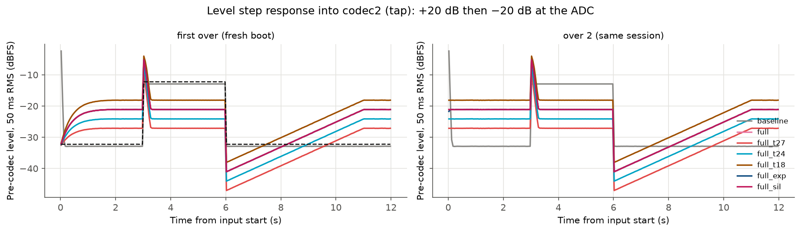

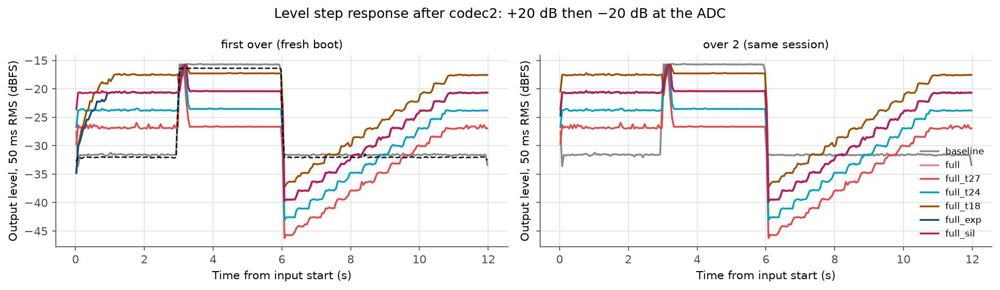

Settled levels are medians of the 50 ms envelope; attack and release are the time to stay within 2 dB of the settled level after each step; rise is the output step for the +20 dB input step (20 dB for a linear chain).

| variant | over | where | before dBFS | loud dBFS | after dBFS | rise dB | attack s | overshoot dB | release s | dip dB | release dB/s |
|---|---|---|---|---|---|---|---|---|---|---|---|
| baseline | 1 | pre-codec | -32.9 | -12.9 | -32.9 | 20.0 | 0.00 | 0.0 | 0.00 | 0.0 | — |
| baseline | 1 | output | -31.6 | -15.7 | -31.6 | 15.9 | 0.00 | 0.1 | 0.00 | 0.1 | — |
| full | 1 | pre-codec | -21.1 | -21.1 | -21.1 | 0.0 | 0.25 | 15.9 | 4.50 | 19.9 | 4.0 |
| full | 1 | output | -20.6 | -20.4 | -20.7 | 0.2 | 0.25 | 4.7 | 4.40 | 19.0 | 4.0 |
| full_t27 | 1 | pre-codec | -27.1 | -27.1 | -27.1 | 0.0 | 0.25 | 18.0 | 4.50 | 19.9 | 4.0 |
| full_t27 | 1 | output | -26.9 | -26.7 | -26.9 | 0.2 | 0.25 | 10.9 | 4.30 | 19.3 | 4.0 |
| full_t24 | 1 | pre-codec | -24.1 | -24.1 | -24.1 | 0.0 | 0.25 | 17.2 | 4.50 | 19.9 | 4.0 |
| full_t24 | 1 | output | -23.8 | -23.5 | -23.9 | 0.2 | 0.25 | 7.8 | 4.30 | 19.2 | 4.0 |
| full_t18 | 1 | pre-codec | -18.1 | -18.1 | -18.1 | 0.0 | 0.25 | 14.1 | 4.50 | 19.9 | 4.0 |
| full_t18 | 1 | output | -17.5 | -17.3 | -17.6 | 0.2 | 0.05 | 1.6 | 4.40 | 19.7 | 4.0 |
| full_exp | 1 | pre-codec | -21.1 | -21.1 | -21.1 | 0.0 | 0.25 | 15.9 | 4.50 | 19.9 | 4.0 |
| full_exp | 1 | output | -20.6 | -20.4 | -20.7 | 0.2 | 0.25 | 4.7 | 4.40 | 19.0 | 4.0 |
| full_sil | 1 | pre-codec | -21.1 | -21.1 | -21.1 | 0.0 | 0.25 | 15.9 | 4.50 | 19.9 | 4.0 |
| full_sil | 1 | output | -20.6 | -20.4 | -20.7 | 0.2 | 0.25 | 4.7 | 4.40 | 19.0 | 4.0 |
| codec-only (nominal) | 1 | pre-codec | -32.2 | -12.2 | -32.2 | 20.0 | 0.00 | 0.0 | 0.00 | 0.0 | — |
| codec-only (nominal) | 1 | output | -32.1 | -16.4 | -32.0 | 15.7 | 0.00 | 0.0 | 0.05 | 0.1 | — |
| baseline | 2 | pre-codec | -32.9 | -12.9 | -32.9 | 20.0 | 0.00 | 0.0 | 0.00 | 0.0 | — |
| baseline | 2 | output | -31.6 | -15.7 | -31.6 | 15.9 | 0.00 | 0.1 | 0.00 | 0.1 | — |
| full | 2 | pre-codec | -21.1 | -21.1 | -21.1 | 0.0 | 0.25 | 15.9 | 4.50 | 19.9 | 4.0 |
| full | 2 | output | -20.6 | -20.4 | -20.7 | 0.2 | 0.25 | 4.7 | 4.40 | 19.0 | 4.0 |
| full_t27 | 2 | pre-codec | -27.1 | -27.1 | -27.1 | 0.0 | 0.25 | 18.0 | 4.50 | 19.9 | 4.0 |
| full_t27 | 2 | output | -26.9 | -26.7 | -26.9 | 0.2 | 0.25 | 10.9 | 4.30 | 19.3 | 4.0 |
| full_t24 | 2 | pre-codec | -24.1 | -24.1 | -24.1 | 0.0 | 0.25 | 17.2 | 4.50 | 19.9 | 4.0 |
| full_t24 | 2 | output | -23.8 | -23.5 | -23.9 | 0.2 | 0.25 | 7.8 | 4.30 | 19.2 | 4.0 |
| full_t18 | 2 | pre-codec | -18.1 | -18.1 | -18.1 | 0.0 | 0.25 | 14.1 | 4.50 | 19.9 | 4.0 |
| full_t18 | 2 | output | -17.5 | -17.3 | -17.6 | 0.2 | 0.05 | 1.6 | 4.40 | 19.7 | 4.0 |
| full_exp | 2 | pre-codec | -21.1 | -21.1 | -21.1 | 0.0 | 0.25 | 15.9 | 4.50 | 19.9 | 4.0 |
| full_exp | 2 | output | -20.7 | -20.4 | -20.7 | 0.3 | 0.25 | 4.7 | 4.40 | 19.2 | 4.0 |
| full_sil | 2 | pre-codec | -21.1 | -21.1 | -21.1 | 0.0 | 0.25 | 15.9 | 4.50 | 19.9 | 4.0 |
| full_sil | 2 | output | -20.6 | -20.4 | -20.7 | 0.2 | 0.25 | 4.7 | 4.40 | 19.0 | 4.0 |

## Listening-condition intelligibility

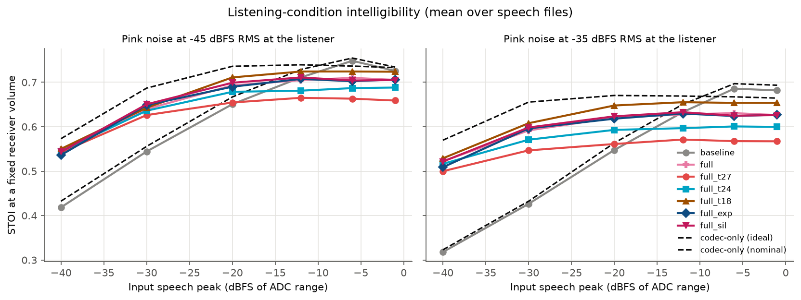

The speech sweep's decoded audio at its own level (a fixed receiver volume, no normalisation) with pink noise added at the listener, STOI against the clean source. Worst: the lowest mean STOI over the input and noise levels; deficit: codec-only (ideal) minus the variant in the same cell, at its largest.

| variant | mean STOI | Δ | worst STOI | at input / noise dBFS | Δ | worst deficit vs ideal |
|---|---|---|---|---|---|---|
| baseline | 0.591 |  | 0.318 | -40 / -35 |  | 0.252 |
| full | 0.635 | +0.044 | 0.522 | -40 / -35 | +0.204 | 0.064 |
| full_t27 | 0.594 | +0.003 | 0.500 | -40 / -35 | +0.182 | 0.109 |
| full_t24 | 0.616 | +0.025 | 0.516 | -40 / -35 | +0.198 | 0.085 |
| full_t18 | 0.652 | +0.061 | 0.529 | -40 / -35 | +0.211 | 0.048 |
| full_exp | 0.633 | +0.042 | 0.509 | -40 / -35 | +0.191 | 0.061 |
| full_sil | 0.637 | +0.046 | 0.522 | -40 / -35 | +0.204 | 0.057 |

Noise -45 dBFS: STOI by input peak, Δ vs baseline in brackets:

| variant | -40 dBFS | -30 dBFS | -20 dBFS | -12 dBFS | -6 dBFS | -1 dBFS |
|---|---|---|---|---|---|---|
| baseline | 0.418 | 0.544 | 0.651 | 0.711 | 0.748 | 0.726 |
| full | 0.548 (+0.129) | 0.640 (+0.096) | 0.693 (+0.042) | 0.705 (-0.006) | 0.710 (-0.038) | 0.705 (-0.020) |
| full_t27 | 0.542 (+0.124) | 0.626 (+0.082) | 0.655 (+0.004) | 0.665 (-0.046) | 0.663 (-0.085) | 0.659 (-0.067) |
| full_t24 | 0.545 (+0.126) | 0.636 (+0.092) | 0.679 (+0.028) | 0.681 (-0.030) | 0.687 (-0.061) | 0.688 (-0.037) |
| full_t18 | 0.550 (+0.132) | 0.643 (+0.098) | 0.711 (+0.060) | 0.724 (+0.013) | 0.724 (-0.024) | 0.724 (-0.002) |
| full_exp | 0.536 (+0.118) | 0.649 (+0.104) | 0.690 (+0.039) | 0.708 (-0.003) | 0.702 (-0.046) | 0.706 (-0.019) |
| full_sil | 0.543 (+0.125) | 0.650 (+0.106) | 0.699 (+0.048) | 0.711 (-0.000) | 0.704 (-0.044) | 0.705 (-0.020) |
| codec-only (ideal) | 0.573 | 0.687 | 0.736 | 0.739 | 0.736 | 0.733 |
| codec-only (nominal) | 0.432 | 0.556 | 0.667 | 0.729 | 0.755 | 0.734 |

Noise -35 dBFS: STOI by input peak, Δ vs baseline in brackets:

| variant | -40 dBFS | -30 dBFS | -20 dBFS | -12 dBFS | -6 dBFS | -1 dBFS |
|---|---|---|---|---|---|---|
| baseline | 0.318 | 0.426 | 0.548 | 0.633 | 0.686 | 0.682 |
| full | 0.522 (+0.204) | 0.592 (+0.165) | 0.621 (+0.073) | 0.628 (-0.005) | 0.631 (-0.055) | 0.626 (-0.055) |
| full_t27 | 0.500 (+0.182) | 0.547 (+0.120) | 0.561 (+0.013) | 0.571 (-0.062) | 0.568 (-0.118) | 0.567 (-0.115) |
| full_t24 | 0.516 (+0.198) | 0.571 (+0.144) | 0.593 (+0.045) | 0.597 (-0.036) | 0.601 (-0.085) | 0.600 (-0.082) |
| full_t18 | 0.529 (+0.211) | 0.608 (+0.182) | 0.648 (+0.100) | 0.655 (+0.022) | 0.654 (-0.032) | 0.654 (-0.028) |
| full_exp | 0.509 (+0.191) | 0.596 (+0.170) | 0.618 (+0.070) | 0.630 (-0.003) | 0.624 (-0.062) | 0.627 (-0.055) |
| full_sil | 0.522 (+0.204) | 0.598 (+0.172) | 0.623 (+0.076) | 0.633 (-0.000) | 0.625 (-0.061) | 0.626 (-0.056) |
| codec-only (ideal) | 0.570 | 0.655 | 0.670 | 0.669 | 0.667 | 0.664 |
| codec-only (nominal) | 0.323 | 0.432 | 0.563 | 0.650 | 0.697 | 0.693 |

## Silence and gate

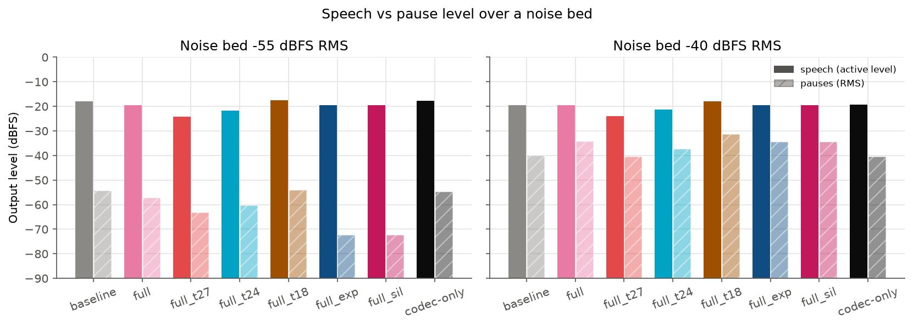

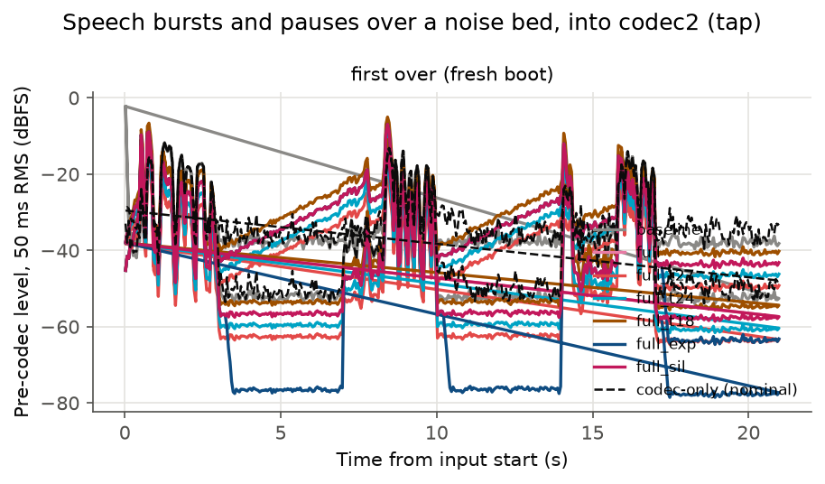

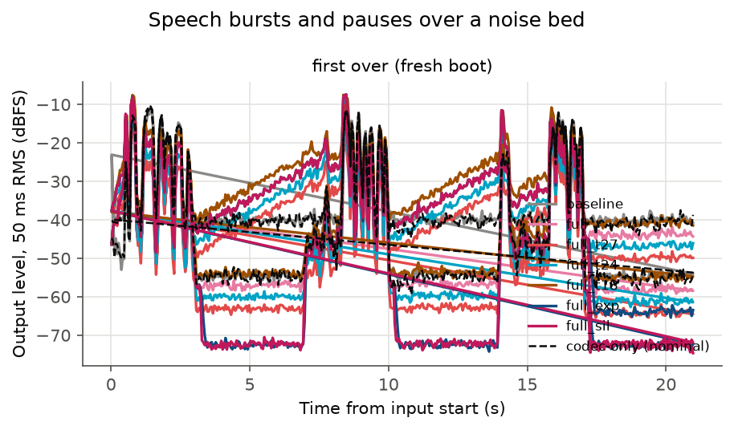

Pause level is the RMS in the pauses, 0.3 s in from each edge; drift is the last second of a pause against its first (positive: the noise is pumped up during the pause); trend is the last pause against the first.

| variant | noise dBFS | where | speech dBFS | pause dBFS | speech/pause dB | drift dB | worst drift dB | trend dB |
|---|---|---|---|---|---|---|---|---|
| baseline | -55 | pre-codec | -16.2 | -52.1 | 35.9 | -0.1 | 0.1 | -0.2 |
| baseline | -55 | output | -17.9 | -54.3 | 36.5 | 0.3 | 0.4 | 0.0 |
| full | -55 | pre-codec | -20.0 | -56.9 | 36.9 | 0.1 | 0.2 | -1.1 |
| full | -55 | output | -19.5 | -57.2 | 37.6 | 0.1 | 0.3 | -1.2 |
| full_t27 | -55 | pre-codec | -25.2 | -62.9 | 37.7 | 0.1 | 0.2 | -1.1 |
| full_t27 | -55 | output | -24.2 | -63.3 | 39.1 | 0.1 | 0.2 | -1.1 |
| full_t24 | -55 | pre-codec | -22.6 | -59.9 | 37.2 | 0.1 | 0.2 | -1.1 |
| full_t24 | -55 | output | -21.7 | -60.2 | 38.5 | 0.1 | 0.2 | -1.1 |
| full_t18 | -55 | pre-codec | -17.5 | -53.9 | 36.4 | 0.1 | 0.2 | -1.1 |
| full_t18 | -55 | output | -17.6 | -54.1 | 36.5 | 0.1 | 0.2 | -1.2 |
| full_exp | -55 | pre-codec | -20.0 | -76.1 | 56.1 | -2.0 | -1.7 | -1.4 |
| full_exp | -55 | output | -19.6 | -72.3 | 52.8 | -0.5 | -0.2 | -0.3 |
| full_sil | -55 | pre-codec | -20.0 | -56.9 | 36.9 | 0.1 | 0.2 | -1.1 |
| full_sil | -55 | output | -19.5 | -72.3 | 52.7 | 0.2 | 0.5 | 0.0 |
| codec-only (nominal) | -55 | pre-codec | -20.9 | -49.3 | 28.4 | -1.8 | -0.9 | 1.2 |
| codec-only (nominal) | -55 | output | -17.7 | -54.8 | 37.1 | 0.5 | 0.9 | -0.5 |
| baseline | -40 | pre-codec | -16.2 | -37.6 | 21.4 | -0.1 | 0.2 | -0.2 |
| baseline | -40 | output | -19.4 | -39.9 | 20.5 | 0.2 | 0.2 | 0.1 |
| full | -40 | pre-codec | -20.1 | -34.3 | 14.1 | 6.5 | 9.7 | -10.7 |
| full | -40 | output | -19.4 | -34.3 | 14.9 | 6.5 | 9.7 | -10.8 |
| full_t27 | -40 | pre-codec | -25.9 | -40.3 | 14.4 | 6.5 | 9.7 | -10.7 |
| full_t27 | -40 | output | -24.0 | -40.5 | 16.4 | 6.5 | 9.5 | -10.8 |
| full_t24 | -40 | pre-codec | -23.0 | -37.3 | 14.3 | 6.5 | 9.7 | -10.7 |
| full_t24 | -40 | output | -21.3 | -37.4 | 16.1 | 6.6 | 9.7 | -10.7 |
| full_t18 | -40 | pre-codec | -17.6 | -31.3 | 13.6 | 6.5 | 9.7 | -10.7 |
| full_t18 | -40 | output | -17.9 | -31.3 | 13.5 | 6.7 | 9.9 | -10.8 |
| full_exp | -40 | pre-codec | -20.1 | -34.4 | 14.3 | 5.9 | 9.7 | -30.1 |
| full_exp | -40 | output | -19.4 | -34.5 | 15.1 | 5.9 | 9.7 | -30.3 |
| full_sil | -40 | pre-codec | -20.1 | -34.3 | 14.1 | 6.5 | 9.7 | -10.7 |
| full_sil | -40 | output | -19.4 | -34.5 | 15.1 | 6.5 | 9.7 | -39.3 |
| codec-only (nominal) | -40 | pre-codec | -21.1 | -34.5 | 13.4 | -1.9 | -1.1 | 1.3 |
| codec-only (nominal) | -40 | output | -19.2 | -40.5 | 21.2 | 0.8 | 1.2 | -0.3 |

