# M17 microphone chain: emulator campaign

OpenRTX `v0.4.5-53-g7f9b6c2ad` (private/mic-exp), profile **cs7000p** (oversample 6, gain 32, 12-bit ADC, noise 2.0 LSB RMS). Run 2026-11-15T21:28:24+00:00 to 2026-11-15T21:28:55+00:00, suite `007c0aba8a`.

How the bench works, what each metric means and its limits: [METHODS.md](METHODS.md). Raw tables are in `data/`, provenance in `run.json`.

Variants:

- **full**: `-DMIC_EXP_PRIME_DC` `-DMIC_EXP_KEEP_SUM` `-DMIC_EXP_HPF` `-DMIC_EXP_AGC`

## Headline

Δ columns are the variant minus baseline. Spread: active speech level, max − min over the input levels (lower is a steadier level), into codec2 (pre-codec, from the tap) and after it. Attack and release are from the pre-codec envelope. STOI deficit: codec-only (ideal) STOI minus the variant's, mean over takes (lower is better). Step and gate figures are described under their tests.

| variant | pre-codec spread dB | Δ | spread dB | Δ | STOI | Δ | STOI deficit | Δ | listening STOI worst | Δ | listening deficit worst | Δ | pre-codec onset dBFS | Δ | onset dBFS | Δ | pre-codec clip max % | attack s | release s | speech/pause dB | Δ | pause drift dB | Δ |
|---|---|---|---|---|---|---|---|---|---|---|---|---|---|---|---|---|---|---|---|---|---|---|---|
| full | 11.9 |  | 7.7 |  | 0.710 |  | 0.025 |  | 0.522 |  | 0.064 |  | -47.7 |  | -43.7 |  | 0.00 | 0.25 | 4.50 | 26.3 |  | 3.3 |  |

## Speech level sweep

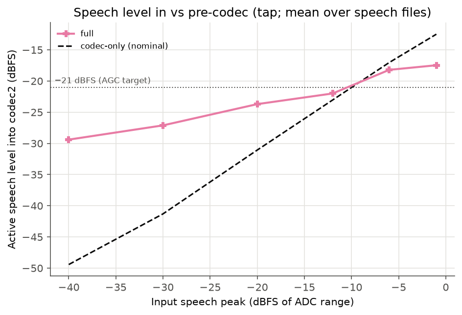

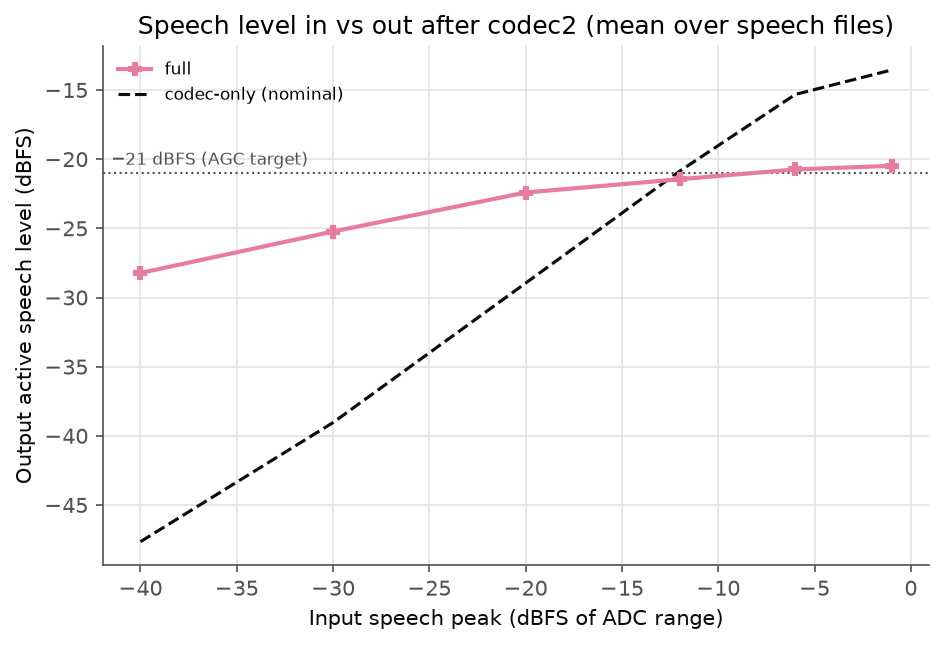

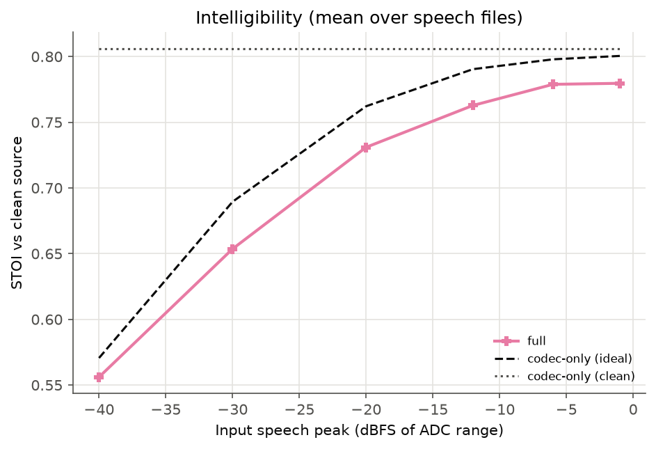

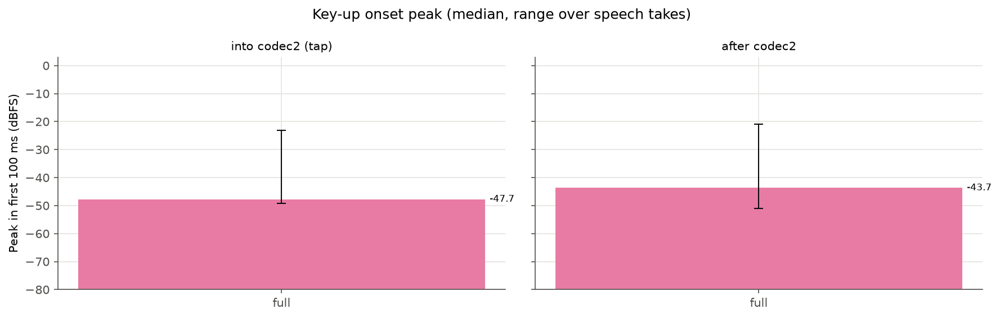

Pre-codec active level (dBFS, tap), mean over speech files, Δ vs baseline in brackets:

| variant | -40 dBFS | -30 dBFS | -20 dBFS | -12 dBFS | -6 dBFS | -1 dBFS |
|---|---|---|---|---|---|---|
| full | -29.4 | -27.1 | -23.7 | -22.0 | -18.2 | -17.5 |
| codec-only (nominal) | -49.4 | -41.3 | -31.1 | -23.0 | -17.0 | -12.5 |
| codec-only (ideal) | -23.6 | -21.7 | -21.0 | -21.0 | -21.0 | -21.0 |

Output active level (dBFS), mean over speech files, Δ vs baseline in brackets:

| variant | -40 dBFS | -30 dBFS | -20 dBFS | -12 dBFS | -6 dBFS | -1 dBFS |
|---|---|---|---|---|---|---|
| full | -28.2 | -25.2 | -22.4 | -21.5 | -20.7 | -20.5 |
| codec-only (nominal) | -47.6 | -39.0 | -29.0 | -20.9 | -15.3 | -13.6 |
| codec-only (ideal) | -22.6 | -19.0 | -18.8 | -18.9 | -18.9 | -18.9 |

STOI, mean over speech files, Δ vs baseline in brackets:

| variant | -40 dBFS | -30 dBFS | -20 dBFS | -12 dBFS | -6 dBFS | -1 dBFS |
|---|---|---|---|---|---|---|
| full | 0.556 | 0.654 | 0.731 | 0.763 | 0.779 | 0.780 |
| codec-only (nominal) | 0.573 | 0.682 | 0.759 | 0.789 | 0.795 | 0.757 |
| codec-only (ideal) | 0.571 | 0.689 | 0.762 | 0.790 | 0.798 | 0.800 |

Pre-codec clip, % of the samples codec2 receives at int16 full scale, measured at the tap (in brackets, the integer-chain model as a cross-check, where it applies):

| variant | -40 dBFS | -30 dBFS | -20 dBFS | -12 dBFS | -6 dBFS | -1 dBFS |
|---|---|---|---|---|---|---|
| full | 0.00 | 0.00 | 0.00 | 0.00 | 0.00 | 0.00 |
| codec-only (nominal) | 0.00 (0.00) | 0.00 (0.00) | 0.00 (0.00) | 0.00 (0.00) | 0.00 (0.00) | 0.78 (0.73) |

## Static level curve (tones)

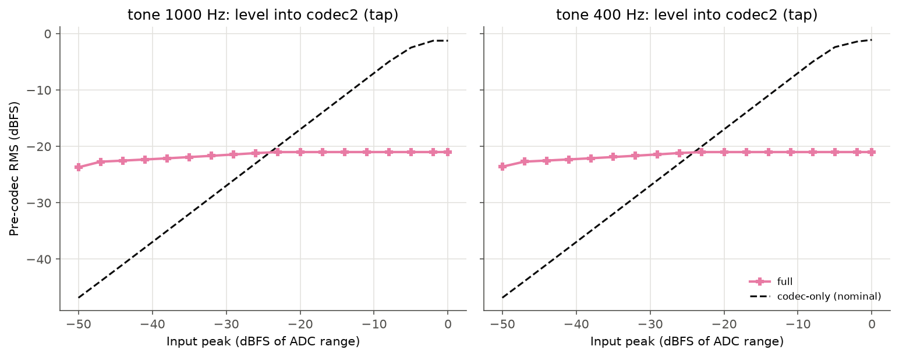

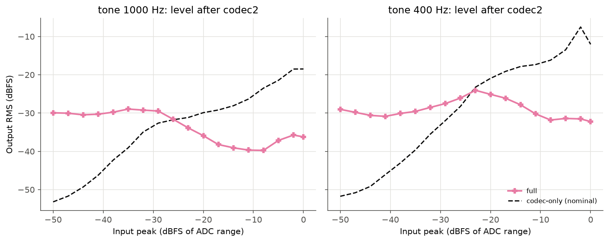

tone 1000 Hz: pre-codec RMS (dBFS, tap) by input peak (dBFS of ADC range).

| variant | -50 | -47 | -44 | -41 | -38 | -35 | -32 | -29 | -26 | -23 | -20 | -17 | -14 | -11 | -8 | -5 | -2 | +0 |
|---|---|---|---|---|---|---|---|---|---|---|---|---|---|---|---|---|---|---|
| full | -23.7 | -22.7 | -22.5 | -22.3 | -22.1 | -21.9 | -21.7 | -21.4 | -21.2 | -21.0 | -21.0 | -21.0 | -21.0 | -21.0 | -21.0 | -21.0 | -21.0 | -21.0 |
| codec-only (nominal) | -46.9 | -43.9 | -41.0 | -38.0 | -35.0 | -32.0 | -29.0 | -26.0 | -23.0 | -20.0 | -17.0 | -14.0 | -11.0 | -8.0 | -5.0 | -2.5 | -1.2 | -1.2 |

tone 1000 Hz: output RMS after codec2 (dBFS) by input peak (dBFS of ADC range). codec2 alone loses level on pure tones, so read the output against the codec-only row.

| variant | -50 | -47 | -44 | -41 | -38 | -35 | -32 | -29 | -26 | -23 | -20 | -17 | -14 | -11 | -8 | -5 | -2 | +0 |
|---|---|---|---|---|---|---|---|---|---|---|---|---|---|---|---|---|---|---|
| full | -29.9 | -30.0 | -30.5 | -30.3 | -29.8 | -29.0 | -29.2 | -29.5 | -31.6 | -33.9 | -35.9 | -38.2 | -39.1 | -39.7 | -39.8 | -37.1 | -35.7 | -36.2 |
| codec-only (nominal) | -53.2 | -51.7 | -49.3 | -46.2 | -42.3 | -39.1 | -34.9 | -32.6 | -31.8 | -31.1 | -29.9 | -29.2 | -28.1 | -26.3 | -23.5 | -21.4 | -18.5 | -18.5 |

tone 400 Hz: pre-codec RMS (dBFS, tap) by input peak (dBFS of ADC range).

| variant | -50 | -47 | -44 | -41 | -38 | -35 | -32 | -29 | -26 | -23 | -20 | -17 | -14 | -11 | -8 | -5 | -2 | +0 |
|---|---|---|---|---|---|---|---|---|---|---|---|---|---|---|---|---|---|---|
| full | -23.6 | -22.7 | -22.5 | -22.3 | -22.1 | -21.9 | -21.7 | -21.4 | -21.2 | -21.0 | -21.0 | -21.0 | -21.0 | -21.0 | -21.0 | -21.0 | -21.0 | -21.0 |
| codec-only (nominal) | -46.8 | -43.9 | -40.9 | -38.0 | -35.0 | -32.0 | -29.0 | -26.0 | -23.0 | -20.0 | -17.0 | -14.0 | -11.0 | -8.0 | -5.0 | -2.4 | -1.4 | -1.1 |

tone 400 Hz: output RMS after codec2 (dBFS) by input peak (dBFS of ADC range). codec2 alone loses level on pure tones, so read the output against the codec-only row.

| variant | -50 | -47 | -44 | -41 | -38 | -35 | -32 | -29 | -26 | -23 | -20 | -17 | -14 | -11 | -8 | -5 | -2 | +0 |
|---|---|---|---|---|---|---|---|---|---|---|---|---|---|---|---|---|---|---|
| full | -29.0 | -29.8 | -30.6 | -30.9 | -30.1 | -29.6 | -28.5 | -27.5 | -26.1 | -24.1 | -25.1 | -26.1 | -27.8 | -30.2 | -31.8 | -31.4 | -31.5 | -32.2 |
| codec-only (nominal) | -51.7 | -50.8 | -49.2 | -46.1 | -43.0 | -39.6 | -35.5 | -32.0 | -28.2 | -23.2 | -20.9 | -19.1 | -17.8 | -17.3 | -16.2 | -13.5 | -7.5 | -12.0 |

## Level step (AGC dynamics)

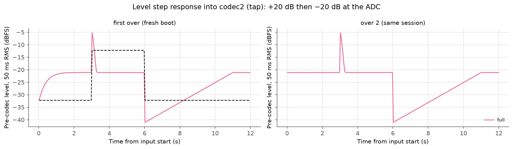

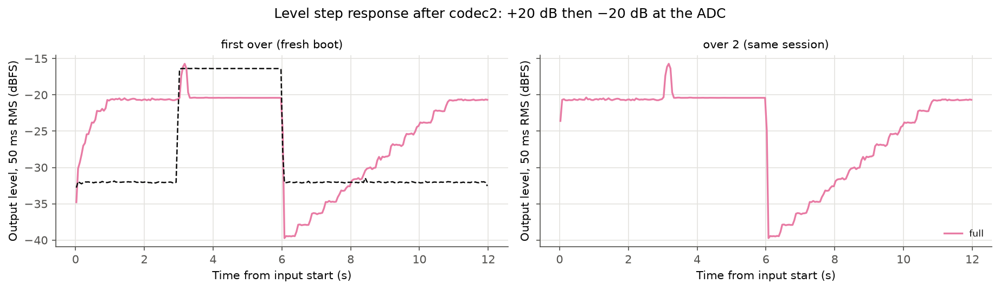

Settled levels are medians of the 50 ms envelope; attack and release are the time to stay within 2 dB of the settled level after each step; rise is the output step for the +20 dB input step (20 dB for a linear chain).

| variant | over | where | before dBFS | loud dBFS | after dBFS | rise dB | attack s | overshoot dB | release s | dip dB | release dB/s |
|---|---|---|---|---|---|---|---|---|---|---|---|
| full | 1 | pre-codec | -21.1 | -21.1 | -21.1 | 0.0 | 0.25 | 15.9 | 4.50 | 19.9 | 4.0 |
| full | 1 | output | -20.6 | -20.4 | -20.7 | 0.2 | 0.25 | 4.7 | 4.40 | 19.0 | 4.0 |
| codec-only (nominal) | 1 | pre-codec | -32.2 | -12.2 | -32.2 | 20.0 | 0.00 | 0.0 | 0.00 | 0.0 | — |
| codec-only (nominal) | 1 | output | -32.1 | -16.4 | -32.0 | 15.7 | 0.00 | 0.0 | 0.05 | 0.1 | — |
| full | 2 | pre-codec | -21.1 | -21.1 | -21.1 | 0.0 | 0.25 | 15.9 | 4.50 | 19.9 | 4.0 |
| full | 2 | output | -20.6 | -20.4 | -20.7 | 0.2 | 0.25 | 4.7 | 4.40 | 19.0 | 4.0 |

## Listening-condition intelligibility

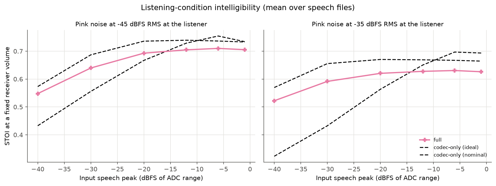

The speech sweep's decoded audio at its own level (a fixed receiver volume, no normalisation) with pink noise added at the listener, STOI against the clean source. Worst: the lowest mean STOI over the input and noise levels; deficit: codec-only (ideal) minus the variant in the same cell, at its largest.

| variant | mean STOI | Δ | worst STOI | at input / noise dBFS | Δ | worst deficit vs ideal |
|---|---|---|---|---|---|---|
| full | 0.635 |  | 0.522 | -40 / -35 |  | 0.064 |

Noise -45 dBFS: STOI by input peak, Δ vs baseline in brackets:

| variant | -40 dBFS | -30 dBFS | -20 dBFS | -12 dBFS | -6 dBFS | -1 dBFS |
|---|---|---|---|---|---|---|
| full | 0.548 | 0.640 | 0.693 | 0.705 | 0.710 | 0.705 |
| codec-only (ideal) | 0.573 | 0.687 | 0.736 | 0.739 | 0.736 | 0.733 |
| codec-only (nominal) | 0.432 | 0.556 | 0.667 | 0.729 | 0.755 | 0.734 |

Noise -35 dBFS: STOI by input peak, Δ vs baseline in brackets:

| variant | -40 dBFS | -30 dBFS | -20 dBFS | -12 dBFS | -6 dBFS | -1 dBFS |
|---|---|---|---|---|---|---|
| full | 0.522 | 0.592 | 0.621 | 0.628 | 0.631 | 0.626 |
| codec-only (ideal) | 0.570 | 0.655 | 0.670 | 0.669 | 0.667 | 0.664 |
| codec-only (nominal) | 0.323 | 0.432 | 0.563 | 0.650 | 0.697 | 0.693 |

## Silence and gate

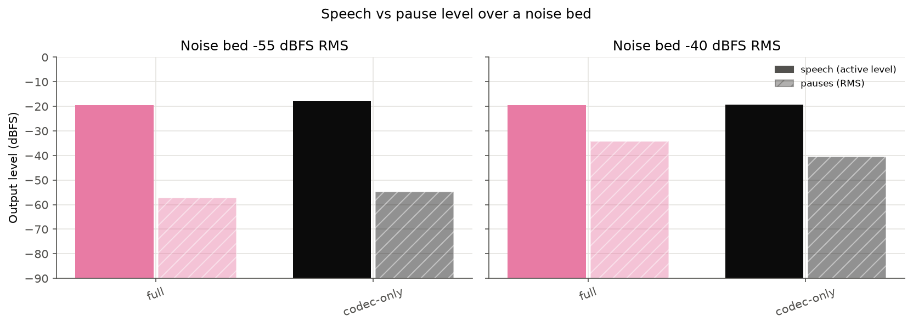

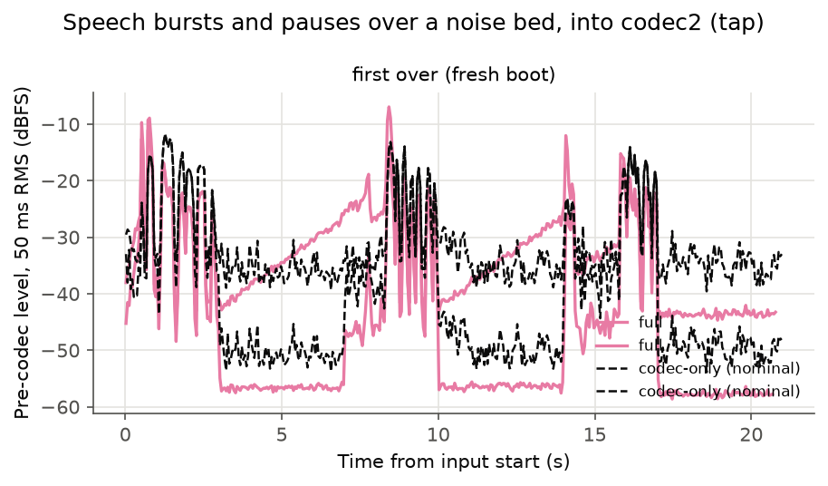

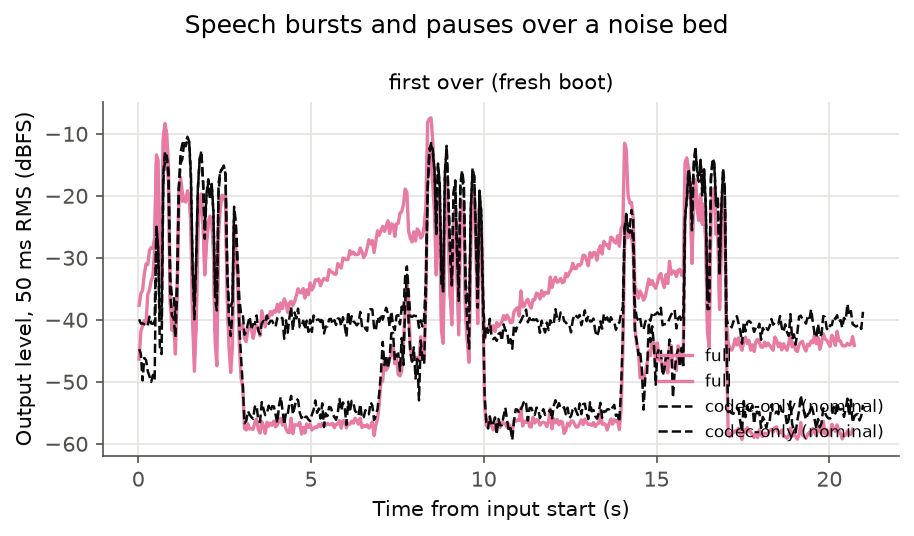

Pause level is the RMS in the pauses, 0.3 s in from each edge; drift is the last second of a pause against its first (positive: the noise is pumped up during the pause); trend is the last pause against the first.

| variant | noise dBFS | where | speech dBFS | pause dBFS | speech/pause dB | drift dB | worst drift dB | trend dB |
|---|---|---|---|---|---|---|---|---|
| full | -55 | pre-codec | -20.0 | -56.9 | 36.9 | 0.1 | 0.2 | -1.1 |
| full | -55 | output | -19.5 | -57.2 | 37.6 | 0.1 | 0.3 | -1.2 |
| codec-only (nominal) | -55 | pre-codec | -20.9 | -49.3 | 28.4 | -1.8 | -0.9 | 1.2 |
| codec-only (nominal) | -55 | output | -17.7 | -54.8 | 37.1 | 0.5 | 0.9 | -0.5 |
| full | -40 | pre-codec | -20.1 | -34.3 | 14.1 | 6.5 | 9.7 | -10.7 |
| full | -40 | output | -19.4 | -34.3 | 14.9 | 6.5 | 9.7 | -10.8 |
| codec-only (nominal) | -40 | pre-codec | -21.1 | -34.5 | 13.4 | -1.9 | -1.1 | 1.3 |
| codec-only (nominal) | -40 | output | -19.2 | -40.5 | 21.2 | 0.8 | 1.2 | -0.3 |

