# M17 microphone chain: emulator campaign

OpenRTX `v0.4.5-53-g7f9b6c2ad` (private/mic-exp), profile **cs7000p** (oversample 6, gain 32, 12-bit ADC, noise 2.0 LSB RMS). Run 2026-11-15T21:25:22+00:00 to 2026-11-15T21:30:07+00:00, suite `007c0aba8a`.

How the bench works, what each metric means and its limits: [METHODS.md](METHODS.md). Raw tables are in `data/`, provenance in `run.json`.

Variants:

- **baseline**: no extra defines
- **prime_dc**: `-DMIC_EXP_PRIME_DC`
- **keep_sum**: `-DMIC_EXP_KEEP_SUM`
- **hpf**: `-DMIC_EXP_HPF`
- **agc**: `-DMIC_EXP_AGC`
- **full**: `-DMIC_EXP_PRIME_DC` `-DMIC_EXP_KEEP_SUM` `-DMIC_EXP_HPF` `-DMIC_EXP_AGC`
- **agc_slow**: `-DMIC_EXP_AGC` `-DMIC_EXP_AGC_FASTDOWN=0.0f` `-DMIC_EXP_AGC_ATTACK=0.1f`
- **agc_mid**: `-DMIC_EXP_AGC` `-DMIC_EXP_AGC_FASTDOWN=0.0f` `-DMIC_EXP_AGC_ATTACK=0.3f` `-DMIC_EXP_AGC_KNEE=-3.0f`

## Headline

Δ columns are the variant minus baseline. Spread: active speech level, max − min over the input levels (lower is a steadier level), into codec2 (pre-codec, from the tap) and after it. Attack and release are from the pre-codec envelope. STOI deficit: codec-only (ideal) STOI minus the variant's, mean over takes (lower is better). Step and gate figures are described under their tests.

| variant | pre-codec spread dB | Δ | spread dB | Δ | STOI | Δ | STOI deficit | Δ | listening STOI worst | Δ | listening deficit worst | Δ | pre-codec onset dBFS | Δ | onset dBFS | Δ | pre-codec clip max % | attack s | release s | speech/pause dB | Δ | pause drift dB | Δ |
|---|---|---|---|---|---|---|---|---|---|---|---|---|---|---|---|---|---|---|---|---|---|---|---|
| baseline | 36.8 |  | 34.2 |  | 0.710 |  | 0.025 |  | 0.318 |  | 0.252 |  | 0.0 |  | -8.3 |  | 1.73 | 0.00 | 0.00 | 28.5 |  | 0.2 |  |
| prime_dc | 37.8 | +1.0 | 34.2 | -0.0 | 0.715 | +0.005 | 0.020 | -0.005 | 0.321 | +0.003 | 0.249 | -0.003 | -42.2 | -42.2 | -47.2 | -38.9 | 1.81 | 0.00 | 0.00 | 28.5 | -0.0 | 0.1 | -0.0 |
| keep_sum | 35.9 | -0.8 | 34.3 | +0.0 | 0.716 | +0.005 | 0.020 | -0.005 | 0.315 | -0.003 | 0.254 | +0.003 | 0.0 | +0.0 | -8.3 | +0.0 | 1.81 | 0.00 | 0.00 | 28.5 | +0.0 | 0.2 | -0.0 |
| hpf | 38.4 | +1.6 | 34.4 | +0.1 | 0.714 | +0.003 | 0.022 | -0.003 | 0.321 | +0.003 | 0.248 | -0.003 | 0.0 | +0.0 | -11.0 | -2.7 | 1.67 | 0.00 | 0.00 | 28.9 | +0.4 | 0.1 | -0.1 |
| agc | 8.5 | -28.3 | 7.1 | -27.1 | 0.704 | -0.006 | 0.031 | +0.006 | 0.496 | +0.178 | 0.076 | -0.176 | -1.0 | -1.0 | -8.3 | +0.0 | 0.00 | 0.15 | 4.50 | 24.5 | -4.0 | 4.0 | +3.8 |
| full | 11.9 | -24.9 | 7.7 | -26.5 | 0.710 | +0.000 | 0.025 | -0.000 | 0.522 | +0.204 | 0.064 | -0.188 | -47.7 | -47.7 | -43.7 | -35.4 | 0.00 | 0.25 | 4.50 | 26.3 | -2.2 | 3.3 | +3.1 |
| agc_slow | 16.9 | -19.9 | 13.8 | -20.4 | 0.696 | -0.014 | 0.039 | +0.014 | 0.506 | +0.188 | 0.064 | -0.188 | -1.0 | -1.0 | -8.3 | +0.0 | 0.00 | did not settle | 3.45 | 27.0 | -1.5 | 3.8 | +3.6 |
| agc_mid | 13.2 | -23.6 | 10.6 | -23.6 | 0.705 | -0.005 | 0.030 | +0.005 | 0.505 | +0.187 | 0.066 | -0.185 | -1.0 | -1.0 | -8.3 | +0.0 | 0.00 | 1.20 | 4.50 | 28.1 | -0.4 | 4.0 | +3.9 |

## Speech level sweep

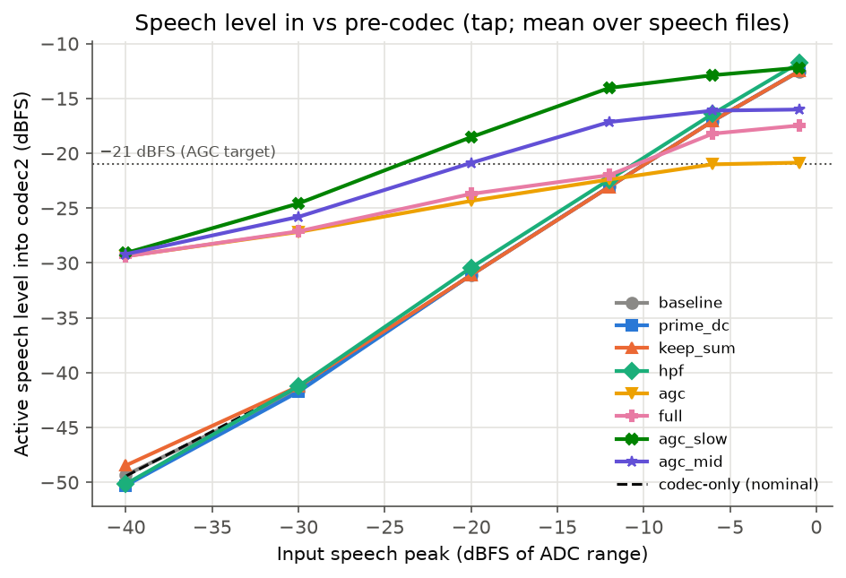

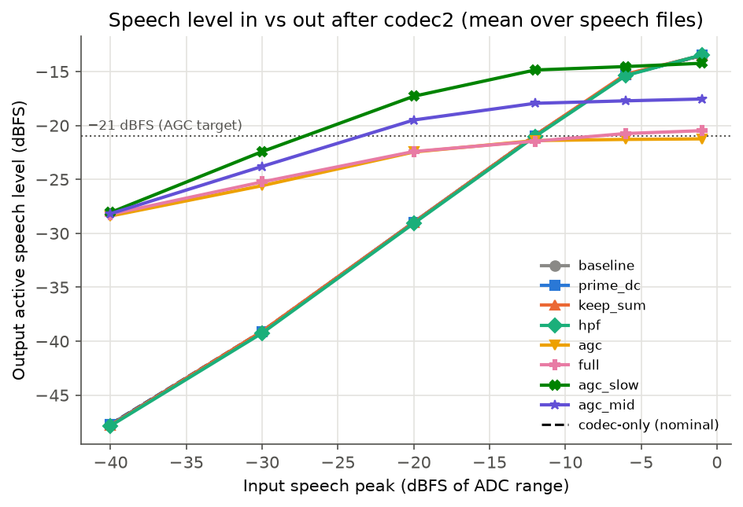

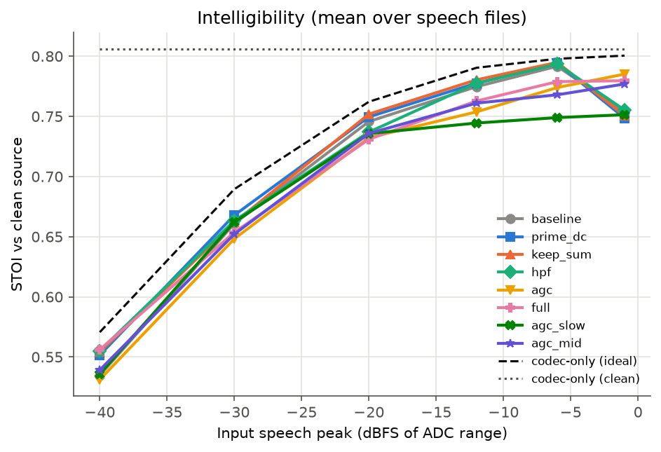

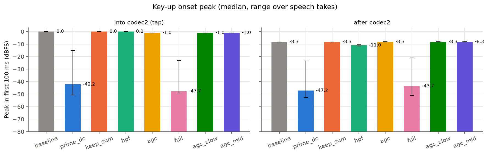

Pre-codec active level (dBFS, tap), mean over speech files, Δ vs baseline in brackets:

| variant | -40 dBFS | -30 dBFS | -20 dBFS | -12 dBFS | -6 dBFS | -1 dBFS |
|---|---|---|---|---|---|---|
| baseline | -49.3 | -41.6 | -31.1 | -23.1 | -17.1 | -12.5 |
| prime_dc | -50.3 (-0.9) | -41.7 (-0.1) | -31.1 (+0.0) | -23.0 (+0.0) | -17.0 (+0.0) | -12.5 (+0.0) |
| keep_sum | -48.5 (+0.9) | -41.2 (+0.4) | -31.1 (-0.0) | -23.1 (-0.0) | -17.1 (-0.0) | -12.5 (+0.0) |
| hpf | -50.1 (-0.8) | -41.2 (+0.4) | -30.4 (+0.7) | -22.4 (+0.7) | -16.4 (+0.6) | -11.7 (+0.8) |
| agc | -29.4 (+20.0) | -27.2 (+14.5) | -24.3 (+6.8) | -22.4 (+0.7) | -21.0 (-4.0) | -20.9 (-8.3) |
| full | -29.4 (+19.9) | -27.1 (+14.5) | -23.7 (+7.4) | -22.0 (+1.1) | -18.2 (-1.2) | -17.5 (-4.9) |
| agc_slow | -29.1 (+20.2) | -24.6 (+17.1) | -18.5 (+12.6) | -14.0 (+9.0) | -12.9 (+4.2) | -12.2 (+0.4) |
| agc_mid | -29.2 (+20.1) | -25.8 (+15.8) | -20.9 (+10.2) | -17.2 (+5.9) | -16.1 (+0.9) | -16.0 (-3.5) |
| codec-only (nominal) | -49.4 | -41.3 | -31.1 | -23.0 | -17.0 | -12.5 |
| codec-only (ideal) | -23.6 | -21.7 | -21.0 | -21.0 | -21.0 | -21.0 |

Output active level (dBFS), mean over speech files, Δ vs baseline in brackets:

| variant | -40 dBFS | -30 dBFS | -20 dBFS | -12 dBFS | -6 dBFS | -1 dBFS |
|---|---|---|---|---|---|---|
| baseline | -47.7 | -39.1 | -29.0 | -20.9 | -15.3 | -13.5 |
| prime_dc | -47.7 (+0.0) | -39.1 (+0.0) | -29.0 (+0.0) | -20.9 (+0.0) | -15.3 (+0.0) | -13.5 (-0.0) |
| keep_sum | -47.8 (-0.0) | -39.1 (+0.1) | -29.0 (+0.0) | -20.9 (+0.0) | -15.2 (+0.1) | -13.5 (-0.0) |
| hpf | -47.8 (-0.1) | -39.2 (-0.1) | -29.1 (-0.1) | -21.0 (-0.1) | -15.4 (-0.1) | -13.5 (+0.0) |
| agc | -28.4 (+19.3) | -25.6 (+13.5) | -22.5 (+6.5) | -21.4 (-0.5) | -21.3 (-6.0) | -21.2 (-7.7) |
| full | -28.2 (+19.5) | -25.2 (+13.9) | -22.4 (+6.6) | -21.5 (-0.5) | -20.7 (-5.4) | -20.5 (-7.0) |
| agc_slow | -28.1 (+19.7) | -22.4 (+16.7) | -17.3 (+11.7) | -14.9 (+6.1) | -14.5 (+0.8) | -14.2 (-0.7) |
| agc_mid | -28.2 (+19.6) | -23.8 (+15.3) | -19.5 (+9.5) | -17.9 (+3.0) | -17.7 (-2.4) | -17.5 (-4.1) |
| codec-only (nominal) | -47.6 | -39.0 | -29.0 | -20.9 | -15.3 | -13.6 |
| codec-only (ideal) | -22.6 | -19.0 | -18.8 | -18.9 | -18.9 | -18.9 |

STOI, mean over speech files, Δ vs baseline in brackets:

| variant | -40 dBFS | -30 dBFS | -20 dBFS | -12 dBFS | -6 dBFS | -1 dBFS |
|---|---|---|---|---|---|---|
| baseline | 0.535 | 0.661 | 0.746 | 0.775 | 0.792 | 0.753 |
| prime_dc | 0.552 (+0.017) | 0.668 (+0.007) | 0.750 (+0.004) | 0.778 (+0.003) | 0.794 (+0.002) | 0.749 (-0.005) |
| keep_sum | 0.554 (+0.019) | 0.662 (+0.001) | 0.752 (+0.006) | 0.780 (+0.006) | 0.795 (+0.003) | 0.751 (-0.003) |
| hpf | 0.555 (+0.020) | 0.663 (+0.002) | 0.737 (-0.009) | 0.777 (+0.003) | 0.793 (+0.002) | 0.755 (+0.002) |
| agc | 0.531 (-0.004) | 0.648 (-0.013) | 0.732 (-0.013) | 0.754 (-0.021) | 0.774 (-0.018) | 0.785 (+0.032) |
| full | 0.556 (+0.021) | 0.654 (-0.007) | 0.731 (-0.015) | 0.763 (-0.012) | 0.779 (-0.013) | 0.780 (+0.026) |
| agc_slow | 0.536 (+0.001) | 0.662 (+0.001) | 0.736 (-0.010) | 0.744 (-0.030) | 0.749 (-0.043) | 0.751 (-0.002) |
| agc_mid | 0.539 (+0.004) | 0.652 (-0.009) | 0.736 (-0.010) | 0.761 (-0.014) | 0.768 (-0.024) | 0.777 (+0.023) |
| codec-only (nominal) | 0.573 | 0.682 | 0.759 | 0.789 | 0.795 | 0.757 |
| codec-only (ideal) | 0.571 | 0.689 | 0.762 | 0.790 | 0.798 | 0.800 |

Pre-codec clip, % of the samples codec2 receives at int16 full scale, measured at the tap (in brackets, the integer-chain model as a cross-check, where it applies):

| variant | -40 dBFS | -30 dBFS | -20 dBFS | -12 dBFS | -6 dBFS | -1 dBFS |
|---|---|---|---|---|---|---|
| baseline | 0.00 (0.00) | 0.00 (0.00) | 0.00 (0.00) | 0.00 (0.00) | 0.00 (0.00) | 0.75 (0.73) |
| prime_dc | 0.00 (0.00) | 0.00 (0.00) | 0.00 (0.00) | 0.00 (0.00) | 0.00 (0.00) | 0.77 (0.73) |
| keep_sum | 0.00 (0.00) | 0.00 (0.00) | 0.00 (0.00) | 0.00 (0.00) | 0.00 (0.00) | 0.77 (0.73) |
| hpf | 0.00 | 0.00 | 0.00 | 0.00 | 0.00 | 0.65 |
| agc | 0.00 | 0.00 | 0.00 | 0.00 | 0.00 | 0.00 |
| full | 0.00 | 0.00 | 0.00 | 0.00 | 0.00 | 0.00 |
| agc_slow | 0.00 | 0.00 | 0.00 | 0.00 | 0.00 | 0.00 |
| agc_mid | 0.00 | 0.00 | 0.00 | 0.00 | 0.00 | 0.00 |
| codec-only (nominal) | 0.00 (0.00) | 0.00 (0.00) | 0.00 (0.00) | 0.00 (0.00) | 0.00 (0.00) | 0.78 (0.73) |

## Static level curve (tones)

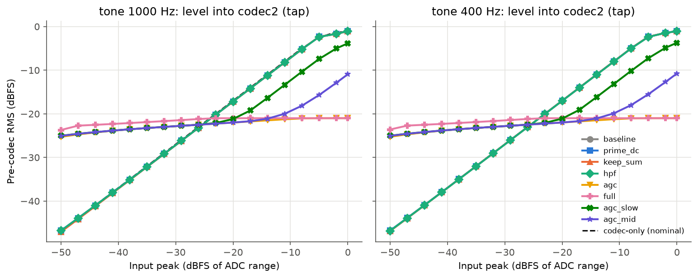

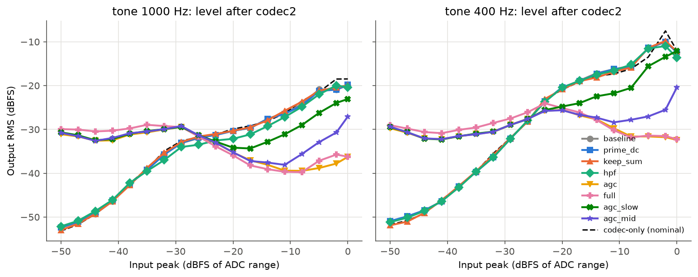

tone 1000 Hz: pre-codec RMS (dBFS, tap) by input peak (dBFS of ADC range).

| variant | -50 | -47 | -44 | -41 | -38 | -35 | -32 | -29 | -26 | -23 | -20 | -17 | -14 | -11 | -8 | -5 | -2 | +0 |
|---|---|---|---|---|---|---|---|---|---|---|---|---|---|---|---|---|---|---|
| baseline | -46.8 | -43.9 | -41.0 | -38.1 | -35.1 | -32.1 | -29.2 | -26.2 | -23.2 | -20.2 | -17.2 | -14.2 | -11.2 | -8.2 | -5.2 | -2.3 | -1.7 | -1.1 |
| prime_dc | -46.8 | -43.9 | -41.0 | -38.1 | -35.1 | -32.1 | -29.2 | -26.2 | -23.2 | -20.2 | -17.2 | -14.2 | -11.2 | -8.2 | -5.2 | -2.3 | -1.7 | -1.1 |
| keep_sum | -47.1 | -44.1 | -41.2 | -38.2 | -35.2 | -32.2 | -29.2 | -26.2 | -23.2 | -20.2 | -17.2 | -14.2 | -11.2 | -8.2 | -5.2 | -2.3 | -1.7 | -1.1 |
| hpf | -46.8 | -43.9 | -41.0 | -38.1 | -35.1 | -32.1 | -29.2 | -26.2 | -23.2 | -20.2 | -17.2 | -14.2 | -11.2 | -8.2 | -5.2 | -2.4 | -1.7 | -1.0 |
| agc | -25.3 | -24.7 | -24.3 | -23.9 | -23.5 | -23.3 | -23.0 | -22.7 | -22.5 | -22.3 | -22.0 | -21.7 | -21.5 | -21.2 | -21.1 | -21.0 | -21.0 | -21.0 |
| full | -23.7 | -22.7 | -22.5 | -22.3 | -22.1 | -21.9 | -21.7 | -21.4 | -21.2 | -21.0 | -21.0 | -21.0 | -21.0 | -21.0 | -21.0 | -21.0 | -21.0 | -21.0 |
| agc_slow | -25.0 | -24.6 | -24.2 | -23.8 | -23.5 | -23.3 | -23.0 | -22.7 | -22.5 | -22.1 | -21.2 | -19.2 | -16.3 | -13.3 | -10.3 | -7.4 | -5.0 | -3.8 |
| agc_mid | -25.1 | -24.6 | -24.2 | -23.8 | -23.5 | -23.3 | -23.0 | -22.7 | -22.5 | -22.3 | -22.0 | -21.7 | -21.1 | -20.0 | -18.1 | -15.7 | -12.9 | -10.9 |
| codec-only (nominal) | -46.9 | -43.9 | -41.0 | -38.0 | -35.0 | -32.0 | -29.0 | -26.0 | -23.0 | -20.0 | -17.0 | -14.0 | -11.0 | -8.0 | -5.0 | -2.5 | -1.2 | -1.2 |

tone 1000 Hz: output RMS after codec2 (dBFS) by input peak (dBFS of ADC range). codec2 alone loses level on pure tones, so read the output against the codec-only row.

| variant | -50 | -47 | -44 | -41 | -38 | -35 | -32 | -29 | -26 | -23 | -20 | -17 | -14 | -11 | -8 | -5 | -2 | +0 |
|---|---|---|---|---|---|---|---|---|---|---|---|---|---|---|---|---|---|---|
| baseline | -52.5 | -51.2 | -49.3 | -46.4 | -42.4 | -39.2 | -35.7 | -33.1 | -32.0 | -31.2 | -30.3 | -29.7 | -27.6 | -26.2 | -24.3 | -20.9 | -20.9 | -19.9 |
| prime_dc | -52.4 | -51.0 | -49.1 | -46.3 | -42.5 | -39.3 | -35.8 | -33.1 | -31.9 | -31.3 | -30.3 | -29.6 | -27.7 | -26.4 | -24.5 | -21.2 | -20.9 | -19.8 |
| keep_sum | -53.0 | -51.5 | -49.3 | -46.4 | -42.7 | -38.8 | -35.4 | -32.9 | -31.6 | -31.0 | -30.3 | -29.5 | -27.9 | -25.7 | -23.7 | -21.1 | -20.4 | -19.9 |
| hpf | -52.1 | -50.9 | -48.6 | -46.1 | -42.2 | -39.5 | -37.0 | -34.0 | -33.5 | -32.5 | -32.1 | -31.1 | -29.3 | -27.2 | -24.8 | -22.0 | -20.0 | -20.4 |
| agc | -31.1 | -31.6 | -32.6 | -32.5 | -31.2 | -30.7 | -30.0 | -29.4 | -31.5 | -33.1 | -35.3 | -37.1 | -38.1 | -39.4 | -39.5 | -38.8 | -37.8 | -36.3 |
| full | -29.9 | -30.0 | -30.5 | -30.3 | -29.8 | -29.0 | -29.2 | -29.5 | -31.6 | -33.9 | -35.9 | -38.2 | -39.1 | -39.7 | -39.8 | -37.1 | -35.7 | -36.2 |
| agc_slow | -30.7 | -31.3 | -32.5 | -32.2 | -31.0 | -30.4 | -29.9 | -29.4 | -31.3 | -32.8 | -34.2 | -34.4 | -32.8 | -31.1 | -29.0 | -26.2 | -24.0 | -23.1 |
| agc_mid | -30.8 | -31.6 | -32.6 | -31.9 | -30.9 | -30.5 | -29.9 | -29.2 | -31.4 | -33.0 | -35.2 | -37.2 | -37.6 | -38.1 | -35.6 | -32.9 | -30.7 | -27.1 |
| codec-only (nominal) | -53.2 | -51.7 | -49.3 | -46.2 | -42.3 | -39.1 | -34.9 | -32.6 | -31.8 | -31.1 | -29.9 | -29.2 | -28.1 | -26.3 | -23.5 | -21.4 | -18.5 | -18.5 |

tone 400 Hz: pre-codec RMS (dBFS, tap) by input peak (dBFS of ADC range).

| variant | -50 | -47 | -44 | -41 | -38 | -35 | -32 | -29 | -26 | -23 | -20 | -17 | -14 | -11 | -8 | -5 | -2 | +0 |
|---|---|---|---|---|---|---|---|---|---|---|---|---|---|---|---|---|---|---|
| baseline | -46.8 | -43.9 | -40.9 | -38.0 | -35.0 | -32.0 | -29.0 | -26.0 | -23.0 | -20.0 | -17.0 | -14.0 | -11.0 | -8.0 | -5.0 | -2.3 | -1.5 | -1.1 |
| prime_dc | -46.8 | -43.9 | -40.9 | -38.0 | -35.0 | -32.0 | -29.0 | -26.0 | -23.0 | -20.0 | -17.0 | -14.0 | -11.0 | -8.0 | -5.0 | -2.3 | -1.5 | -1.1 |
| keep_sum | -46.9 | -43.9 | -41.0 | -38.0 | -35.0 | -32.0 | -29.0 | -26.0 | -23.0 | -20.0 | -17.0 | -14.0 | -11.0 | -8.0 | -5.0 | -2.3 | -1.5 | -1.1 |
| hpf | -46.8 | -43.9 | -41.0 | -38.0 | -35.0 | -32.0 | -29.0 | -26.0 | -23.0 | -20.0 | -17.0 | -14.0 | -11.0 | -8.0 | -5.0 | -2.4 | -1.4 | -1.1 |
| agc | -25.3 | -24.7 | -24.2 | -23.9 | -23.5 | -23.2 | -23.0 | -22.7 | -22.5 | -22.2 | -22.0 | -21.7 | -21.5 | -21.2 | -21.1 | -21.0 | -21.0 | -21.0 |
| full | -23.6 | -22.7 | -22.5 | -22.3 | -22.1 | -21.9 | -21.7 | -21.4 | -21.2 | -21.0 | -21.0 | -21.0 | -21.0 | -21.0 | -21.0 | -21.0 | -21.0 | -21.0 |
| agc_slow | -25.0 | -24.6 | -24.2 | -23.8 | -23.5 | -23.2 | -23.0 | -22.7 | -22.5 | -22.1 | -21.1 | -19.1 | -16.2 | -13.2 | -10.2 | -7.3 | -4.9 | -3.7 |
| agc_mid | -25.1 | -24.6 | -24.2 | -23.8 | -23.5 | -23.2 | -23.0 | -22.7 | -22.5 | -22.2 | -22.0 | -21.7 | -21.1 | -19.9 | -18.0 | -15.5 | -12.7 | -10.7 |
| codec-only (nominal) | -46.8 | -43.9 | -40.9 | -38.0 | -35.0 | -32.0 | -29.0 | -26.0 | -23.0 | -20.0 | -17.0 | -14.0 | -11.0 | -8.0 | -5.0 | -2.4 | -1.4 | -1.1 |

tone 400 Hz: output RMS after codec2 (dBFS) by input peak (dBFS of ADC range). codec2 alone loses level on pure tones, so read the output against the codec-only row.

| variant | -50 | -47 | -44 | -41 | -38 | -35 | -32 | -29 | -26 | -23 | -20 | -17 | -14 | -11 | -8 | -5 | -2 | +0 |
|---|---|---|---|---|---|---|---|---|---|---|---|---|---|---|---|---|---|---|
| baseline | -51.2 | -49.9 | -48.4 | -46.4 | -42.9 | -39.7 | -36.3 | -32.0 | -28.1 | -23.5 | -20.5 | -18.9 | -17.2 | -16.3 | -15.5 | -11.5 | -10.0 | -12.4 |
| prime_dc | -50.9 | -49.8 | -48.5 | -46.4 | -43.0 | -39.7 | -36.4 | -32.1 | -28.1 | -23.6 | -20.4 | -19.0 | -17.3 | -16.2 | -15.7 | -11.4 | -10.0 | -12.4 |
| keep_sum | -51.9 | -51.1 | -49.0 | -46.2 | -42.9 | -39.6 | -35.8 | -32.0 | -28.2 | -23.0 | -20.9 | -19.0 | -18.2 | -16.8 | -15.9 | -11.4 | -9.8 | -12.2 |
| hpf | -51.2 | -50.2 | -48.6 | -46.4 | -43.2 | -39.7 | -36.4 | -32.1 | -27.9 | -23.7 | -20.5 | -18.9 | -17.5 | -16.6 | -15.2 | -11.5 | -11.0 | -13.6 |
| agc | -29.7 | -30.8 | -32.1 | -32.2 | -31.6 | -31.0 | -30.6 | -29.0 | -27.6 | -25.8 | -25.5 | -26.8 | -27.7 | -29.7 | -31.6 | -31.6 | -31.8 | -32.4 |
| full | -29.0 | -29.8 | -30.6 | -30.9 | -30.1 | -29.6 | -28.5 | -27.5 | -26.1 | -24.1 | -25.1 | -26.1 | -27.8 | -30.2 | -31.8 | -31.4 | -31.5 | -32.2 |
| agc_slow | -29.5 | -30.6 | -32.1 | -32.3 | -31.6 | -31.0 | -30.5 | -29.0 | -27.7 | -25.6 | -24.8 | -24.0 | -22.4 | -21.8 | -20.5 | -15.6 | -13.4 | -12.1 |
| agc_mid | -29.4 | -30.7 | -32.0 | -32.2 | -31.5 | -31.1 | -30.5 | -29.0 | -27.6 | -25.8 | -25.6 | -26.7 | -27.3 | -28.4 | -27.8 | -27.0 | -25.5 | -20.4 |
| codec-only (nominal) | -51.7 | -50.8 | -49.2 | -46.1 | -43.0 | -39.6 | -35.5 | -32.0 | -28.2 | -23.2 | -20.9 | -19.1 | -17.8 | -17.3 | -16.2 | -13.5 | -7.5 | -12.0 |

## Level step (AGC dynamics)

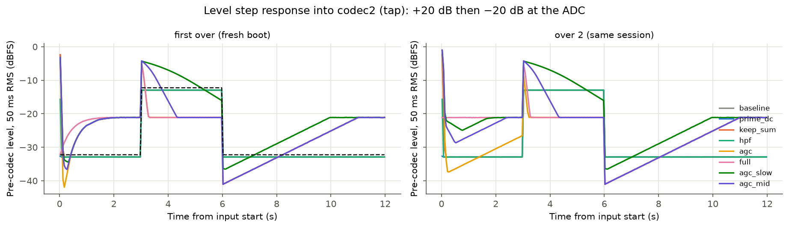

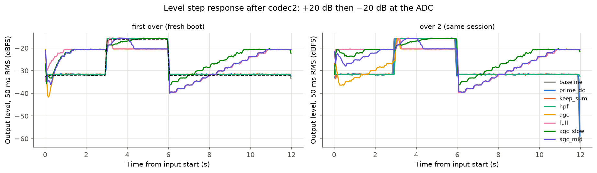

Settled levels are medians of the 50 ms envelope; attack and release are the time to stay within 2 dB of the settled level after each step; rise is the output step for the +20 dB input step (20 dB for a linear chain).

| variant | over | where | before dBFS | loud dBFS | after dBFS | rise dB | attack s | overshoot dB | release s | dip dB | release dB/s |
|---|---|---|---|---|---|---|---|---|---|---|---|
| baseline | 1 | pre-codec | -32.9 | -12.9 | -32.9 | 20.0 | 0.00 | 0.0 | 0.00 | 0.0 | — |
| baseline | 1 | output | -31.6 | -15.7 | -31.6 | 15.9 | 0.00 | 0.1 | 0.00 | 0.1 | — |
| prime_dc | 1 | pre-codec | -32.9 | -12.9 | -32.9 | 20.0 | 0.00 | 0.0 | 0.00 | 0.0 | — |
| prime_dc | 1 | output | -31.6 | -15.7 | -31.6 | 15.9 | 0.00 | 0.1 | 0.05 | 0.1 | — |
| keep_sum | 1 | pre-codec | -32.9 | -12.9 | -32.9 | 20.0 | 0.00 | 0.0 | 0.00 | 0.0 | — |
| keep_sum | 1 | output | -31.6 | -15.7 | -31.6 | 15.9 | 0.00 | 0.1 | 0.00 | 0.1 | — |
| hpf | 1 | pre-codec | -32.9 | -12.9 | -32.9 | 20.0 | 0.00 | 0.0 | 0.00 | 0.0 | — |
| hpf | 1 | output | -31.6 | -15.7 | -31.6 | 15.9 | 0.00 | 0.0 | 0.05 | 0.1 | — |
| agc | 1 | pre-codec | -21.1 | -21.1 | -21.1 | 0.0 | 0.25 | 16.0 | 4.50 | 19.9 | 4.0 |
| agc | 1 | output | -20.6 | -20.4 | -20.7 | 0.3 | 0.25 | 4.7 | 4.35 | 18.8 | 4.0 |
| full | 1 | pre-codec | -21.1 | -21.1 | -21.1 | 0.0 | 0.25 | 15.9 | 4.50 | 19.9 | 4.0 |
| full | 1 | output | -20.6 | -20.4 | -20.7 | 0.2 | 0.25 | 4.7 | 4.40 | 19.0 | 4.0 |
| agc_slow | 1 | pre-codec | -21.1 | -13.4 | -21.1 | 7.7 | did not settle | 9.1 | 3.45 | 15.4 | 4.0 |
| agc_slow | 1 | output | -20.6 | -15.7 | -20.7 | 4.9 | 0.65 | -1.2 | 3.30 | 15.6 | 4.0 |
| agc_mid | 1 | pre-codec | -21.1 | -21.1 | -21.1 | 0.0 | 1.20 | 16.9 | 4.50 | 19.9 | 4.0 |
| agc_mid | 1 | output | -20.6 | -20.4 | -20.7 | 0.2 | 1.20 | 4.8 | 4.35 | 19.3 | 4.0 |
| codec-only (nominal) | 1 | pre-codec | -32.2 | -12.2 | -32.2 | 20.0 | 0.00 | 0.0 | 0.00 | 0.0 | — |
| codec-only (nominal) | 1 | output | -32.1 | -16.4 | -32.0 | 15.7 | 0.00 | 0.0 | 0.05 | 0.1 | — |
| baseline | 2 | pre-codec | -32.9 | -12.9 | -32.9 | 20.0 | 0.00 | 0.0 | 0.00 | 0.0 | — |
| baseline | 2 | output | -31.6 | -15.7 | -31.6 | 15.9 | 0.00 | 0.0 | 0.00 | 0.1 | — |
| prime_dc | 2 | pre-codec | -32.9 | -12.9 | -32.9 | 20.0 | 0.00 | 0.0 | 0.00 | 0.0 | — |
| prime_dc | 2 | output | -31.6 | -15.7 | -31.6 | 15.9 | 0.00 | 0.0 | 0.00 | 0.1 | — |
| keep_sum | 2 | pre-codec | -32.9 | -12.9 | -32.9 | 20.0 | 0.00 | 0.0 | 0.00 | 0.0 | — |
| keep_sum | 2 | output | -31.6 | -15.7 | -31.6 | 15.9 | 0.00 | 0.1 | 0.00 | 0.1 | — |
| hpf | 2 | pre-codec | -32.9 | -12.9 | -32.9 | 20.0 | 0.00 | 0.0 | 0.00 | 0.0 | — |
| hpf | 2 | output | -31.6 | -15.7 | -31.6 | 15.9 | 0.00 | 0.0 | 0.05 | 0.1 | — |
| agc | 2 | pre-codec | -28.6 | -21.1 | -21.1 | 7.5 | 0.15 | 12.6 | 4.50 | 19.9 | 4.0 |
| agc | 2 | output | -28.0 | -20.4 | -20.7 | 7.6 | 0.20 | 4.7 | 4.35 | 19.1 | 4.0 |
| full | 2 | pre-codec | -21.1 | -21.1 | -21.1 | 0.0 | 0.25 | 15.9 | 4.50 | 19.9 | 4.0 |
| full | 2 | output | -20.6 | -20.4 | -20.7 | 0.2 | 0.25 | 4.7 | 4.40 | 19.0 | 4.0 |
| agc_slow | 2 | pre-codec | -21.1 | -13.4 | -21.1 | 7.7 | did not settle | 9.1 | 3.45 | 15.4 | 4.0 |
| agc_slow | 2 | output | -20.6 | -15.7 | -20.7 | 4.9 | 0.55 | -1.2 | 3.30 | 15.6 | 4.0 |
| agc_mid | 2 | pre-codec | -21.1 | -21.1 | -21.1 | 0.0 | 1.20 | 16.9 | 4.50 | 19.9 | 4.0 |
| agc_mid | 2 | output | -20.7 | -20.4 | -20.7 | 0.3 | 1.20 | 4.7 | 4.35 | 18.8 | 4.0 |

## Listening-condition intelligibility

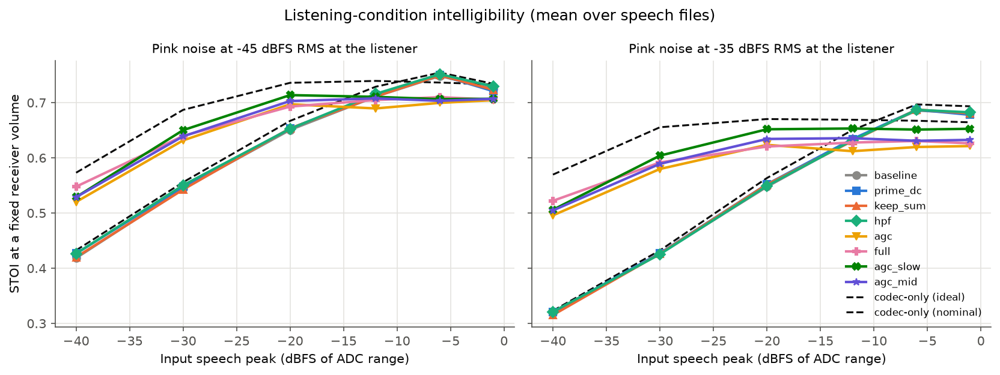

The speech sweep's decoded audio at its own level (a fixed receiver volume, no normalisation) with pink noise added at the listener, STOI against the clean source. Worst: the lowest mean STOI over the input and noise levels; deficit: codec-only (ideal) minus the variant in the same cell, at its largest.

| variant | mean STOI | Δ | worst STOI | at input / noise dBFS | Δ | worst deficit vs ideal |
|---|---|---|---|---|---|---|
| baseline | 0.591 |  | 0.318 | -40 / -35 |  | 0.252 |
| prime_dc | 0.593 | +0.002 | 0.321 | -40 / -35 | +0.003 | 0.249 |
| keep_sum | 0.591 | +0.000 | 0.315 | -40 / -35 | -0.003 | 0.254 |
| hpf | 0.594 | +0.003 | 0.321 | -40 / -35 | +0.003 | 0.248 |
| agc | 0.625 | +0.034 | 0.496 | -40 / -35 | +0.178 | 0.076 |
| full | 0.635 | +0.044 | 0.522 | -40 / -35 | +0.204 | 0.064 |
| agc_slow | 0.645 | +0.054 | 0.506 | -40 / -35 | +0.188 | 0.064 |
| agc_mid | 0.635 | +0.044 | 0.505 | -40 / -35 | +0.187 | 0.066 |

Noise -45 dBFS: STOI by input peak, Δ vs baseline in brackets:

| variant | -40 dBFS | -30 dBFS | -20 dBFS | -12 dBFS | -6 dBFS | -1 dBFS |
|---|---|---|---|---|---|---|
| baseline | 0.418 | 0.544 | 0.651 | 0.711 | 0.748 | 0.725 |
| prime_dc | 0.427 (+0.008) | 0.547 (+0.003) | 0.653 (+0.002) | 0.714 (+0.003) | 0.750 (+0.001) | 0.721 (-0.004) |
| keep_sum | 0.420 (+0.002) | 0.543 (-0.002) | 0.654 (+0.003) | 0.711 (+0.000) | 0.750 (+0.001) | 0.723 (-0.002) |
| hpf | 0.427 (+0.008) | 0.550 (+0.006) | 0.653 (+0.002) | 0.716 (+0.005) | 0.752 (+0.003) | 0.729 (+0.004) |
| agc | 0.520 (+0.102) | 0.632 (+0.087) | 0.697 (+0.046) | 0.690 (-0.021) | 0.700 (-0.049) | 0.705 (-0.021) |
| full | 0.548 (+0.129) | 0.640 (+0.095) | 0.693 (+0.042) | 0.705 (-0.006) | 0.710 (-0.038) | 0.705 (-0.020) |
| agc_slow | 0.529 (+0.110) | 0.650 (+0.106) | 0.714 (+0.063) | 0.710 (-0.000) | 0.706 (-0.042) | 0.707 (-0.018) |
| agc_mid | 0.529 (+0.110) | 0.639 (+0.095) | 0.703 (+0.052) | 0.708 (-0.003) | 0.703 (-0.045) | 0.707 (-0.018) |
| codec-only (ideal) | 0.573 | 0.687 | 0.736 | 0.739 | 0.736 | 0.733 |
| codec-only (nominal) | 0.432 | 0.556 | 0.667 | 0.729 | 0.755 | 0.734 |

Noise -35 dBFS: STOI by input peak, Δ vs baseline in brackets:

| variant | -40 dBFS | -30 dBFS | -20 dBFS | -12 dBFS | -6 dBFS | -1 dBFS |
|---|---|---|---|---|---|---|
| baseline | 0.318 | 0.426 | 0.548 | 0.633 | 0.686 | 0.681 |
| prime_dc | 0.321 (+0.003) | 0.427 (+0.001) | 0.552 (+0.005) | 0.634 (+0.001) | 0.687 (+0.001) | 0.678 (-0.003) |
| keep_sum | 0.315 (-0.003) | 0.426 (+0.000) | 0.552 (+0.004) | 0.631 (-0.002) | 0.688 (+0.002) | 0.680 (-0.001) |
| hpf | 0.321 (+0.003) | 0.425 (-0.001) | 0.549 (+0.002) | 0.632 (-0.001) | 0.687 (+0.001) | 0.682 (+0.001) |
| agc | 0.496 (+0.178) | 0.580 (+0.153) | 0.624 (+0.076) | 0.612 (-0.021) | 0.620 (-0.066) | 0.621 (-0.060) |
| full | 0.522 (+0.204) | 0.592 (+0.165) | 0.621 (+0.073) | 0.628 (-0.005) | 0.631 (-0.055) | 0.626 (-0.055) |
| agc_slow | 0.506 (+0.188) | 0.604 (+0.178) | 0.652 (+0.104) | 0.653 (+0.020) | 0.651 (-0.035) | 0.653 (-0.028) |
| agc_mid | 0.505 (+0.187) | 0.589 (+0.163) | 0.634 (+0.087) | 0.636 (+0.003) | 0.631 (-0.055) | 0.633 (-0.048) |
| codec-only (ideal) | 0.570 | 0.655 | 0.670 | 0.669 | 0.667 | 0.664 |
| codec-only (nominal) | 0.323 | 0.432 | 0.563 | 0.650 | 0.697 | 0.693 |

## Silence and gate

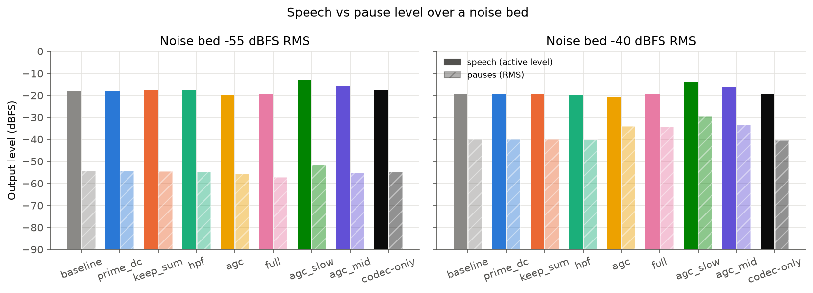

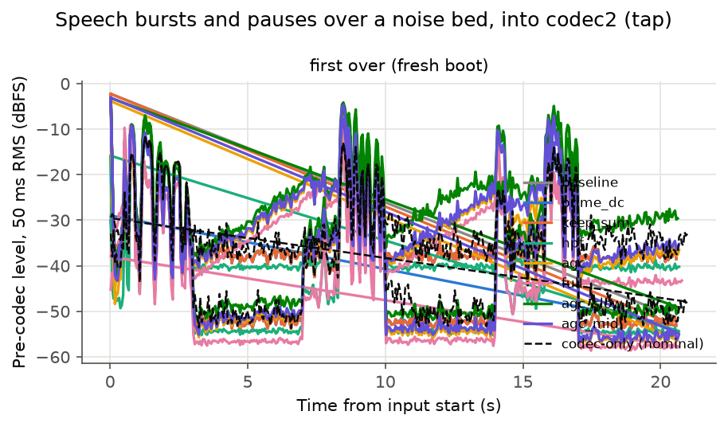

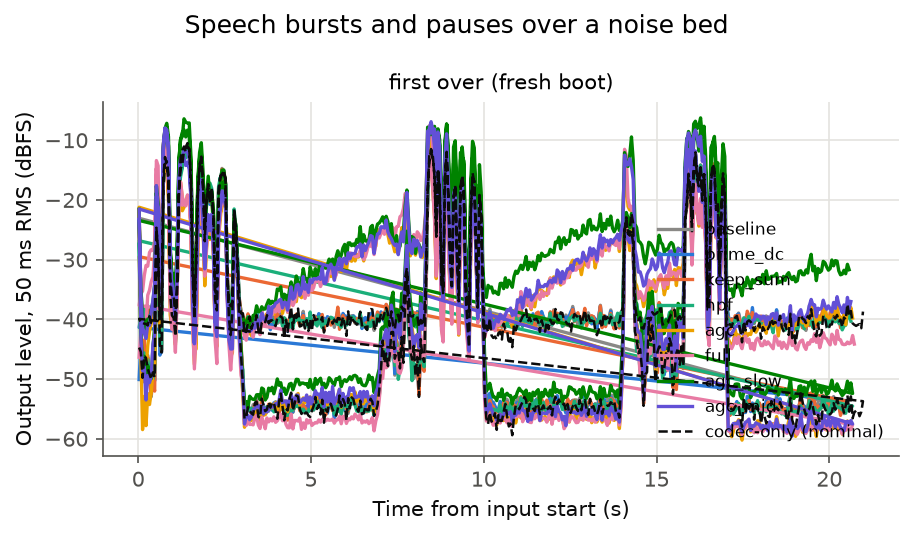

Pause level is the RMS in the pauses, 0.3 s in from each edge; drift is the last second of a pause against its first (positive: the noise is pumped up during the pause); trend is the last pause against the first.

| variant | noise dBFS | where | speech dBFS | pause dBFS | speech/pause dB | drift dB | worst drift dB | trend dB |
|---|---|---|---|---|---|---|---|---|
| baseline | -55 | pre-codec | -16.2 | -52.1 | 35.9 | -0.1 | 0.1 | -0.2 |
| baseline | -55 | output | -17.9 | -54.3 | 36.5 | 0.2 | 0.3 | 0.0 |
| prime_dc | -55 | pre-codec | -20.9 | -52.1 | 31.3 | -0.1 | 0.1 | -0.2 |
| prime_dc | -55 | output | -17.9 | -54.4 | 36.4 | 0.2 | 0.3 | 0.1 |
| keep_sum | -55 | pre-codec | -16.2 | -52.2 | 36.0 | 0.0 | 0.1 | -0.2 |
| keep_sum | -55 | output | -17.8 | -54.4 | 36.6 | 0.2 | 0.3 | 0.1 |
| hpf | -55 | pre-codec | -19.2 | -54.3 | 35.1 | 0.1 | 0.2 | -0.1 |
| hpf | -55 | output | -17.6 | -54.8 | 37.1 | 0.1 | 0.2 | -0.1 |
| agc | -55 | pre-codec | -18.9 | -53.5 | 34.6 | 0.5 | 1.5 | -4.2 |
| agc | -55 | output | -19.9 | -55.7 | 35.8 | 0.7 | 1.9 | -4.1 |
| full | -55 | pre-codec | -20.0 | -56.9 | 36.9 | 0.1 | 0.2 | -1.1 |
| full | -55 | output | -19.5 | -57.2 | 37.6 | 0.1 | 0.3 | -1.2 |
| agc_slow | -55 | pre-codec | -13.5 | -49.4 | 35.9 | 0.5 | 1.6 | -1.1 |
| agc_slow | -55 | output | -13.1 | -51.6 | 38.5 | 0.8 | 1.8 | -0.9 |
| agc_mid | -55 | pre-codec | -15.8 | -52.9 | 37.2 | 0.5 | 1.6 | -4.4 |
| agc_mid | -55 | output | -16.0 | -55.2 | 39.1 | 0.7 | 1.7 | -4.3 |
| codec-only (nominal) | -55 | pre-codec | -20.9 | -49.3 | 28.4 | -1.8 | -0.9 | 1.2 |
| codec-only (nominal) | -55 | output | -17.7 | -54.8 | 37.1 | 0.5 | 0.9 | -0.5 |
| baseline | -40 | pre-codec | -16.2 | -37.6 | 21.4 | -0.1 | 0.1 | -0.2 |
| baseline | -40 | output | -19.4 | -39.9 | 20.5 | 0.1 | 0.2 | 0.1 |
| prime_dc | -40 | pre-codec | -21.2 | -37.6 | 16.4 | -0.1 | 0.1 | -0.2 |
| prime_dc | -40 | output | -19.4 | -39.9 | 20.5 | 0.1 | 0.2 | 0.1 |
| keep_sum | -40 | pre-codec | -16.2 | -37.6 | 21.4 | -0.1 | 0.1 | -0.2 |
| keep_sum | -40 | output | -19.5 | -40.0 | 20.5 | 0.1 | 0.3 | 0.1 |
| hpf | -40 | pre-codec | -21.4 | -40.2 | 18.8 | 0.1 | 0.2 | 0.0 |
| hpf | -40 | output | -19.7 | -40.3 | 20.6 | 0.1 | 0.2 | -0.2 |
| agc | -40 | pre-codec | -19.4 | -31.7 | 12.3 | 7.1 | 9.4 | -7.7 |
| agc | -40 | output | -20.8 | -34.0 | 13.1 | 7.4 | 9.8 | -7.4 |
| full | -40 | pre-codec | -20.1 | -34.3 | 14.1 | 6.5 | 9.7 | -10.7 |
| full | -40 | output | -19.4 | -34.3 | 14.9 | 6.5 | 9.7 | -10.8 |
| agc_slow | -40 | pre-codec | -13.1 | -27.4 | 14.2 | 6.6 | 9.3 | -1.8 |
| agc_slow | -40 | output | -14.1 | -29.6 | 15.5 | 6.8 | 9.6 | -1.6 |
| agc_mid | -40 | pre-codec | -15.1 | -31.0 | 15.9 | 7.1 | 9.4 | -7.0 |
| agc_mid | -40 | output | -16.3 | -33.3 | 17.0 | 7.3 | 9.8 | -6.7 |
| codec-only (nominal) | -40 | pre-codec | -21.1 | -34.5 | 13.4 | -1.9 | -1.1 | 1.3 |
| codec-only (nominal) | -40 | output | -19.2 | -40.5 | 21.2 | 0.8 | 1.2 | -0.3 |

