# M17 microphone chain: emulator campaign

OpenRTX `v0.4.5-53-g7f9b6c2ad` (private/mic-exp), profile **emulator-bare** (oversample 1, gain 1, 16-bit ADC, noise 0.0 LSB RMS). Run 2026-11-15T21:28:50+00:00 to 2026-11-15T21:29:19+00:00, suite `007c0aba8a`.

How the bench works, what each metric means and its limits: [METHODS.md](METHODS.md). Raw tables are in `data/`, provenance in `run.json`.

Variants:

- **agc_slow**: `-DMIC_EXP_AGC` `-DMIC_EXP_AGC_FASTDOWN=0.0f` `-DMIC_EXP_AGC_ATTACK=0.1f`

## Headline

Δ columns are the variant minus baseline. Spread: active speech level, max − min over the input levels (lower is a steadier level), into codec2 (pre-codec, from the tap) and after it. Attack and release are from the pre-codec envelope. STOI deficit: codec-only (ideal) STOI minus the variant's, mean over takes (lower is better). Step and gate figures are described under their tests.

| variant | pre-codec spread dB | Δ | spread dB | Δ | STOI | Δ | STOI deficit | Δ | listening STOI worst | Δ | listening deficit worst | Δ | pre-codec onset dBFS | Δ | onset dBFS | Δ | pre-codec clip max % | attack s | release s | speech/pause dB | Δ | pause drift dB | Δ |
|---|---|---|---|---|---|---|---|---|---|---|---|---|---|---|---|---|---|---|---|---|---|---|---|
| agc_slow | 21.8 |  | 17.2 |  | 0.783 |  | 0.023 |  | 0.515 |  | 0.118 |  | -49.0 |  | -51.7 |  | 0.00 | did not settle | 3.45 | 28.2 |  | 2.9 |  |

## Speech level sweep

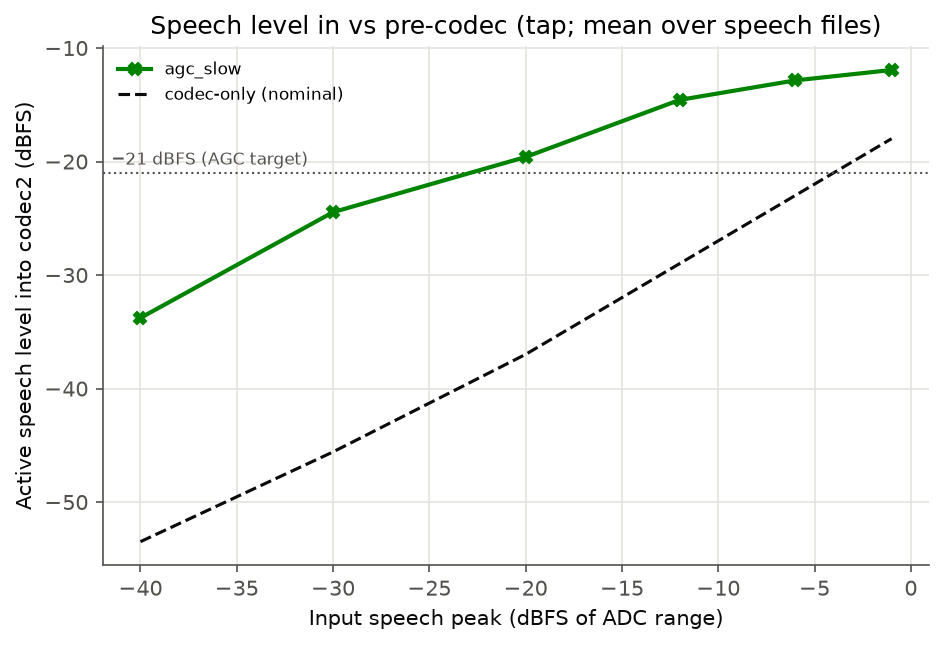

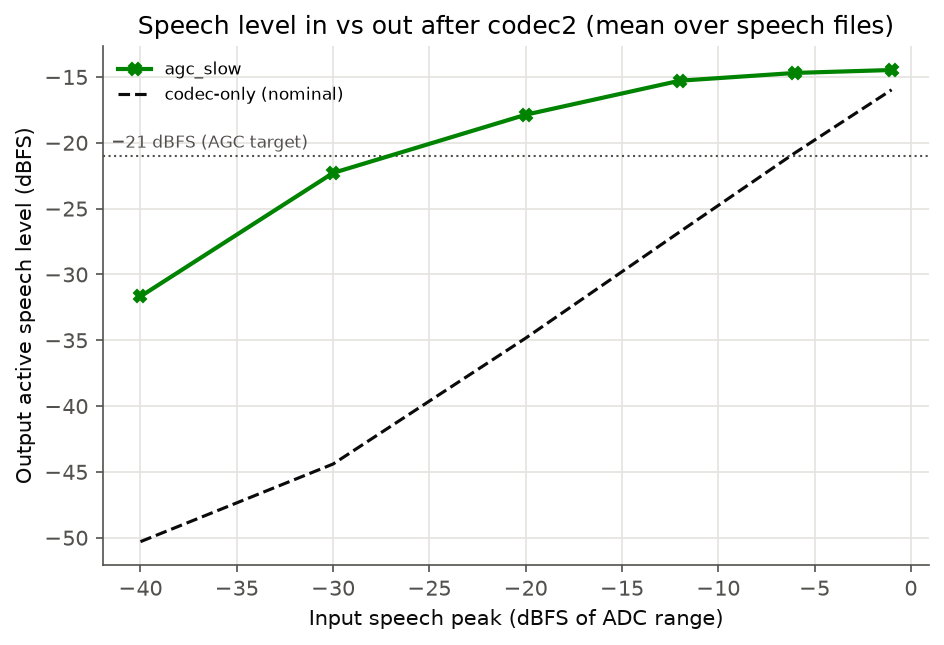

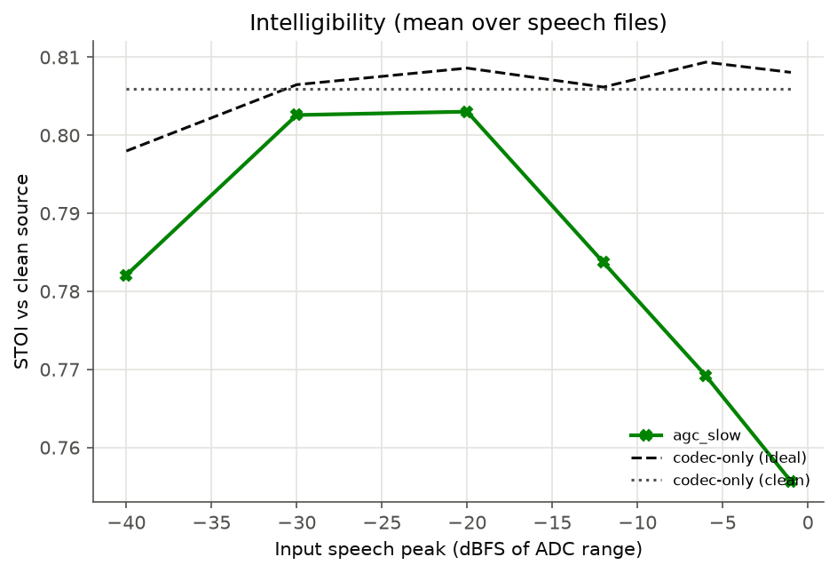

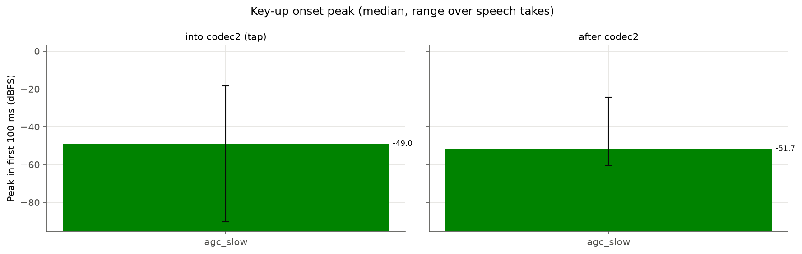

Pre-codec active level (dBFS, tap), mean over speech files, Δ vs baseline in brackets:

| variant | -40 dBFS | -30 dBFS | -20 dBFS | -12 dBFS | -6 dBFS | -1 dBFS |
|---|---|---|---|---|---|---|
| agc_slow | -33.8 | -24.5 | -19.6 | -14.6 | -12.9 | -11.9 |
| codec-only (nominal) | -53.5 | -45.6 | -37.0 | -29.0 | -23.0 | -18.0 |
| codec-only (ideal) | -24.5 | -22.4 | -21.0 | -21.0 | -21.0 | -21.0 |

Output active level (dBFS), mean over speech files, Δ vs baseline in brackets:

| variant | -40 dBFS | -30 dBFS | -20 dBFS | -12 dBFS | -6 dBFS | -1 dBFS |
|---|---|---|---|---|---|---|
| agc_slow | -31.7 | -22.3 | -17.9 | -15.3 | -14.7 | -14.5 |
| codec-only (nominal) | -50.3 | -44.4 | -34.8 | -26.8 | -20.7 | -16.0 |
| codec-only (ideal) | -22.4 | -20.2 | -18.7 | -18.8 | -18.8 | -18.8 |

STOI, mean over speech files, Δ vs baseline in brackets:

| variant | -40 dBFS | -30 dBFS | -20 dBFS | -12 dBFS | -6 dBFS | -1 dBFS |
|---|---|---|---|---|---|---|
| agc_slow | 0.782 | 0.803 | 0.803 | 0.784 | 0.769 | 0.756 |
| codec-only (nominal) | 0.627 | 0.752 | 0.798 | 0.806 | 0.807 | 0.806 |
| codec-only (ideal) | 0.798 | 0.806 | 0.809 | 0.806 | 0.809 | 0.808 |

Pre-codec clip, % of the samples codec2 receives at int16 full scale, measured at the tap (in brackets, the integer-chain model as a cross-check, where it applies):

| variant | -40 dBFS | -30 dBFS | -20 dBFS | -12 dBFS | -6 dBFS | -1 dBFS |
|---|---|---|---|---|---|---|
| agc_slow | 0.00 | 0.00 | 0.00 | 0.00 | 0.00 | 0.00 |
| codec-only (nominal) | 0.00 (0.00) | 0.00 (0.00) | 0.00 (0.00) | 0.00 (0.00) | 0.00 (0.00) | 0.00 (0.00) |

## Static level curve (tones)

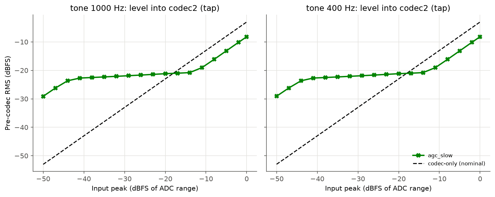

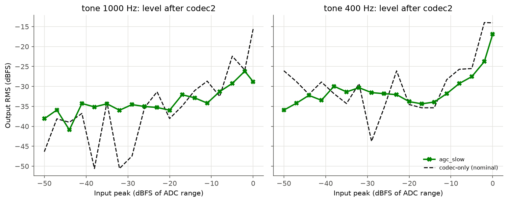

tone 1000 Hz: pre-codec RMS (dBFS, tap) by input peak (dBFS of ADC range).

| variant | -50 | -47 | -44 | -41 | -38 | -35 | -32 | -29 | -26 | -23 | -20 | -17 | -14 | -11 | -8 | -5 | -2 | +0 |
|---|---|---|---|---|---|---|---|---|---|---|---|---|---|---|---|---|---|---|
| agc_slow | -29.1 | -26.2 | -23.7 | -22.7 | -22.5 | -22.3 | -22.1 | -21.9 | -21.7 | -21.4 | -21.2 | -21.0 | -20.8 | -19.0 | -16.1 | -13.1 | -10.2 | -8.2 |
| codec-only (nominal) | -53.0 | -50.0 | -47.0 | -44.0 | -41.0 | -38.0 | -35.0 | -32.0 | -29.0 | -26.0 | -23.0 | -20.0 | -17.0 | -14.0 | -11.0 | -8.0 | -5.0 | -3.0 |

tone 1000 Hz: output RMS after codec2 (dBFS) by input peak (dBFS of ADC range). codec2 alone loses level on pure tones, so read the output against the codec-only row.

| variant | -50 | -47 | -44 | -41 | -38 | -35 | -32 | -29 | -26 | -23 | -20 | -17 | -14 | -11 | -8 | -5 | -2 | +0 |
|---|---|---|---|---|---|---|---|---|---|---|---|---|---|---|---|---|---|---|
| agc_slow | -38.1 | -35.9 | -40.9 | -34.3 | -35.1 | -34.4 | -36.0 | -34.6 | -35.0 | -35.3 | -36.0 | -32.1 | -32.9 | -34.2 | -31.3 | -29.2 | -26.2 | -28.8 |
| codec-only (nominal) | -46.4 | -38.1 | -39.0 | -36.8 | -50.6 | -34.0 | -50.6 | -47.4 | -35.3 | -31.4 | -38.0 | -34.9 | -31.0 | -28.7 | -32.5 | -22.4 | -25.9 | -15.6 |

tone 400 Hz: pre-codec RMS (dBFS, tap) by input peak (dBFS of ADC range).

| variant | -50 | -47 | -44 | -41 | -38 | -35 | -32 | -29 | -26 | -23 | -20 | -17 | -14 | -11 | -8 | -5 | -2 | +0 |
|---|---|---|---|---|---|---|---|---|---|---|---|---|---|---|---|---|---|---|
| agc_slow | -29.1 | -26.2 | -23.7 | -22.7 | -22.5 | -22.3 | -22.1 | -21.9 | -21.7 | -21.4 | -21.2 | -21.0 | -20.8 | -19.0 | -16.2 | -13.2 | -10.2 | -8.2 |
| codec-only (nominal) | -53.0 | -50.0 | -47.0 | -44.0 | -41.0 | -38.0 | -35.0 | -32.0 | -29.0 | -26.0 | -23.0 | -20.0 | -17.0 | -14.0 | -11.0 | -8.0 | -5.0 | -3.0 |

tone 400 Hz: output RMS after codec2 (dBFS) by input peak (dBFS of ADC range). codec2 alone loses level on pure tones, so read the output against the codec-only row.

| variant | -50 | -47 | -44 | -41 | -38 | -35 | -32 | -29 | -26 | -23 | -20 | -17 | -14 | -11 | -8 | -5 | -2 | +0 |
|---|---|---|---|---|---|---|---|---|---|---|---|---|---|---|---|---|---|---|
| agc_slow | -35.9 | -34.2 | -32.2 | -33.5 | -29.9 | -31.4 | -30.3 | -31.5 | -31.8 | -32.1 | -33.8 | -34.4 | -33.9 | -31.8 | -29.3 | -27.5 | -23.8 | -16.9 |
| codec-only (nominal) | -26.1 | -28.8 | -32.0 | -28.9 | -31.8 | -34.3 | -29.3 | -43.8 | -35.4 | -26.1 | -34.5 | -35.4 | -35.4 | -28.3 | -25.7 | -25.5 | -14.0 | -14.1 |

## Level step (AGC dynamics)

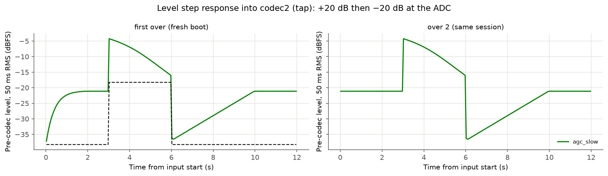

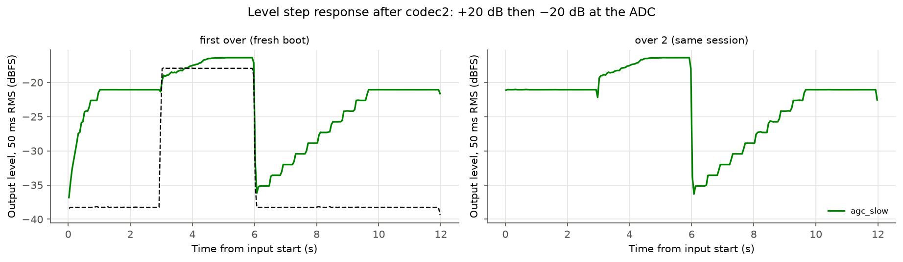

Settled levels are medians of the 50 ms envelope; attack and release are the time to stay within 2 dB of the settled level after each step; rise is the output step for the +20 dB input step (20 dB for a linear chain).

| variant | over | where | before dBFS | loud dBFS | after dBFS | rise dB | attack s | overshoot dB | release s | dip dB | release dB/s |
|---|---|---|---|---|---|---|---|---|---|---|---|
| agc_slow | 1 | pre-codec | -21.1 | -13.4 | -21.1 | 7.7 | did not settle | 9.2 | 3.45 | 15.4 | 4.0 |
| agc_slow | 1 | output | -21.1 | -16.4 | -21.1 | 4.7 | 0.50 | -1.2 | 3.25 | 15.1 | 4.0 |
| codec-only (nominal) | 1 | pre-codec | -38.3 | -18.3 | -38.3 | 20.0 | 0.00 | 0.0 | 0.00 | 0.0 | — |
| codec-only (nominal) | 1 | output | -38.3 | -17.9 | -38.3 | 20.3 | 0.00 | 0.1 | 0.05 | 0.0 | — |
| agc_slow | 2 | pre-codec | -21.1 | -13.4 | -21.1 | 7.7 | did not settle | 9.2 | 3.45 | 15.4 | 4.0 |
| agc_slow | 2 | output | -21.1 | -16.4 | -21.1 | 4.7 | 0.50 | -1.2 | 3.25 | 15.3 | 4.0 |

## Listening-condition intelligibility

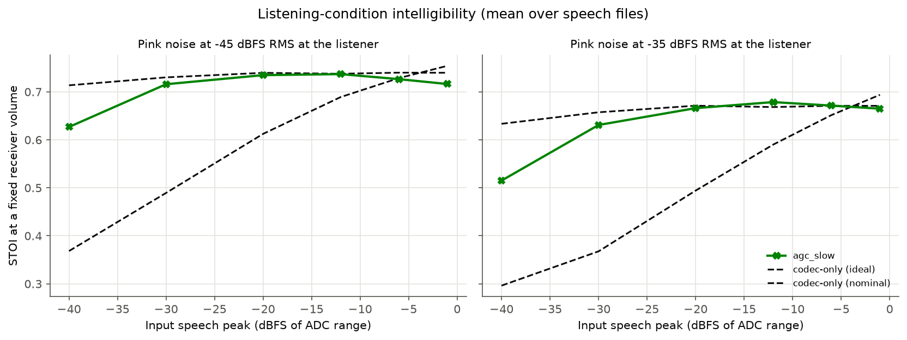

The speech sweep's decoded audio at its own level (a fixed receiver volume, no normalisation) with pink noise added at the listener, STOI against the clean source. Worst: the lowest mean STOI over the input and noise levels; deficit: codec-only (ideal) minus the variant in the same cell, at its largest.

| variant | mean STOI | Δ | worst STOI | at input / noise dBFS | Δ | worst deficit vs ideal |
|---|---|---|---|---|---|---|
| agc_slow | 0.674 |  | 0.515 | -40 / -35 |  | 0.118 |

Noise -45 dBFS: STOI by input peak, Δ vs baseline in brackets:

| variant | -40 dBFS | -30 dBFS | -20 dBFS | -12 dBFS | -6 dBFS | -1 dBFS |
|---|---|---|---|---|---|---|
| agc_slow | 0.627 | 0.716 | 0.735 | 0.737 | 0.726 | 0.716 |
| codec-only (ideal) | 0.714 | 0.730 | 0.740 | 0.738 | 0.740 | 0.740 |
| codec-only (nominal) | 0.368 | 0.489 | 0.612 | 0.689 | 0.729 | 0.754 |

Noise -35 dBFS: STOI by input peak, Δ vs baseline in brackets:

| variant | -40 dBFS | -30 dBFS | -20 dBFS | -12 dBFS | -6 dBFS | -1 dBFS |
|---|---|---|---|---|---|---|
| agc_slow | 0.515 | 0.631 | 0.666 | 0.679 | 0.671 | 0.665 |
| codec-only (ideal) | 0.633 | 0.657 | 0.671 | 0.668 | 0.671 | 0.671 |
| codec-only (nominal) | 0.296 | 0.368 | 0.494 | 0.590 | 0.652 | 0.694 |

## Silence and gate

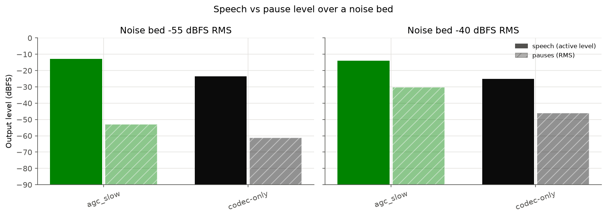

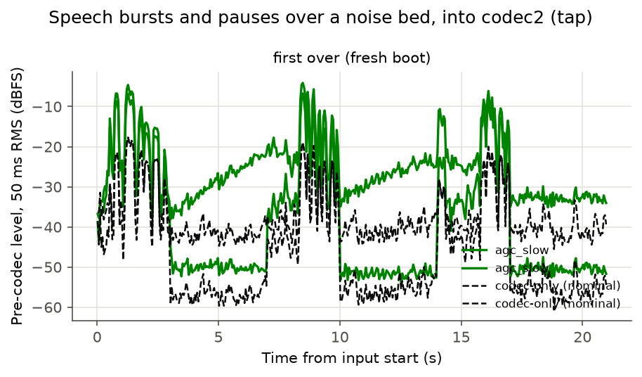

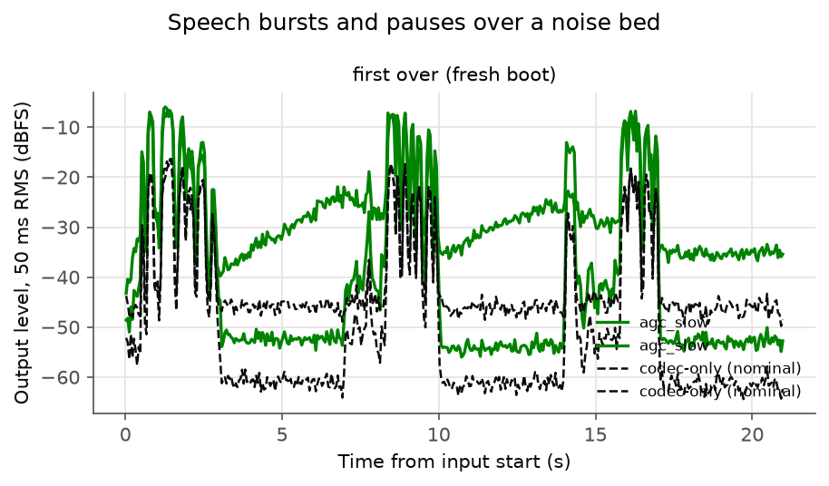

Pause level is the RMS in the pauses, 0.3 s in from each edge; drift is the last second of a pause against its first (positive: the noise is pumped up during the pause); trend is the last pause against the first.

| variant | noise dBFS | where | speech dBFS | pause dBFS | speech/pause dB | drift dB | worst drift dB | trend dB |
|---|---|---|---|---|---|---|---|---|
| agc_slow | -55 | pre-codec | -14.2 | -50.5 | 36.3 | 0.0 | 0.3 | -0.3 |
| agc_slow | -55 | output | -12.8 | -53.0 | 40.2 | 0.3 | 0.7 | -0.5 |
| codec-only (nominal) | -55 | pre-codec | -26.7 | -55.3 | 28.6 | 0.3 | 1.2 | 1.9 |
| codec-only (nominal) | -55 | output | -23.4 | -61.1 | 37.7 | 0.1 | 0.5 | -0.5 |
| agc_slow | -40 | pre-codec | -14.0 | -28.0 | 14.0 | 5.3 | 9.4 | -5.5 |
| agc_slow | -40 | output | -14.0 | -30.3 | 16.3 | 5.5 | 9.5 | -6.1 |
| codec-only (nominal) | -40 | pre-codec | -26.9 | -40.3 | 13.4 | 0.4 | 1.3 | 1.9 |
| codec-only (nominal) | -40 | output | -25.0 | -46.0 | 21.0 | 0.2 | 0.5 | -0.3 |

