# M17 microphone chain: emulator campaign

OpenRTX `v0.4.5-53-g7f9b6c2ad` (private/mic-exp), profile **emulator-bare** (oversample 1, gain 1, 16-bit ADC, noise 0.0 LSB RMS). Run 2026-11-15T21:25:22+00:00 to 2026-11-15T21:29:54+00:00, suite `007c0aba8a`.

How the bench works, what each metric means and its limits: [METHODS.md](METHODS.md). Raw tables are in `data/`, provenance in `run.json`.

Variants:

- **baseline**: no extra defines
- **prime_dc**: `-DMIC_EXP_PRIME_DC`
- **keep_sum**: `-DMIC_EXP_KEEP_SUM`
- **hpf**: `-DMIC_EXP_HPF`
- **agc**: `-DMIC_EXP_AGC`
- **full**: `-DMIC_EXP_PRIME_DC` `-DMIC_EXP_KEEP_SUM` `-DMIC_EXP_HPF` `-DMIC_EXP_AGC`
- **agc_slow**: `-DMIC_EXP_AGC` `-DMIC_EXP_AGC_FASTDOWN=0.0f` `-DMIC_EXP_AGC_ATTACK=0.1f`
- **agc_mid**: `-DMIC_EXP_AGC` `-DMIC_EXP_AGC_FASTDOWN=0.0f` `-DMIC_EXP_AGC_ATTACK=0.3f` `-DMIC_EXP_AGC_KNEE=-3.0f`

## Headline

Δ columns are the variant minus baseline. Spread: active speech level, max − min over the input levels (lower is a steadier level), into codec2 (pre-codec, from the tap) and after it. Attack and release are from the pre-codec envelope. STOI deficit: codec-only (ideal) STOI minus the variant's, mean over takes (lower is better). Step and gate figures are described under their tests.

| variant | pre-codec spread dB | Δ | spread dB | Δ | STOI | Δ | STOI deficit | Δ | listening STOI worst | Δ | listening deficit worst | Δ | pre-codec onset dBFS | Δ | onset dBFS | Δ | pre-codec clip max % | attack s | release s | speech/pause dB | Δ | pause drift dB | Δ |
|---|---|---|---|---|---|---|---|---|---|---|---|---|---|---|---|---|---|---|---|---|---|---|---|
| baseline | 35.5 |  | 34.7 |  | 0.768 |  | 0.038 |  | 0.293 |  | 0.347 |  | -49.0 |  | -51.7 |  | 0.00 | 0.00 | 0.00 | 28.6 |  | 0.1 |  |
| prime_dc | 35.5 | -0.0 | 34.5 | -0.1 | 0.768 | -0.000 | 0.038 | +0.000 | 0.293 | +0.000 | 0.347 | -0.000 | -50.6 | -1.6 | -54.3 | -2.6 | 0.00 | 0.00 | 0.00 | 28.6 | -0.0 | 0.3 | +0.2 |
| keep_sum | 35.5 | -0.0 | 34.6 | -0.0 | 0.768 | +0.000 | 0.038 | -0.000 | 0.293 | +0.000 | 0.347 | -0.000 | -49.0 | +0.0 | -51.7 | +0.0 | 0.00 | 0.00 | 0.00 | 28.6 | +0.0 | 0.1 | +0.0 |
| hpf | 36.3 | +0.8 | 34.7 | +0.1 | 0.769 | +0.001 | 0.037 | -0.001 | 0.291 | -0.002 | 0.349 | +0.002 | -50.2 | -1.2 | -50.4 | +1.2 | 0.00 | 0.00 | 0.00 | 28.8 | +0.2 | 0.2 | +0.1 |
| agc | 13.2 | -22.3 | 10.3 | -24.3 | 0.790 | +0.022 | 0.016 | -0.022 | 0.515 | +0.222 | 0.119 | -0.228 | -49.0 | +0.0 | -51.7 | +0.0 | 0.00 | 0.25 | 4.50 | 25.6 | -3.0 | 2.9 | +2.7 |
| full | 13.5 | -22.1 | 10.8 | -23.8 | 0.796 | +0.027 | 0.010 | -0.027 | 0.516 | +0.223 | 0.117 | -0.230 | -54.5 | -5.6 | -51.9 | -0.2 | 0.00 | 0.25 | 4.50 | 27.3 | -1.3 | 1.8 | +1.6 |
| agc_slow | 21.8 | -13.7 | 17.2 | -17.5 | 0.783 | +0.014 | 0.023 | -0.014 | 0.515 | +0.222 | 0.118 | -0.229 | -49.0 | +0.0 | -51.7 | +0.0 | 0.00 | did not settle | 3.45 | 28.2 | -0.4 | 2.9 | +2.8 |
| agc_mid | 18.4 | -17.1 | 14.0 | -20.7 | 0.790 | +0.021 | 0.016 | -0.021 | 0.515 | +0.222 | 0.118 | -0.229 | -49.0 | +0.0 | -51.7 | +0.0 | 0.00 | 1.20 | 4.50 | 28.7 | +0.1 | 2.8 | +2.7 |

## Speech level sweep

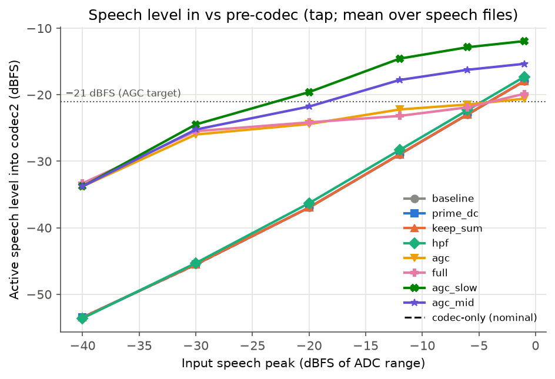

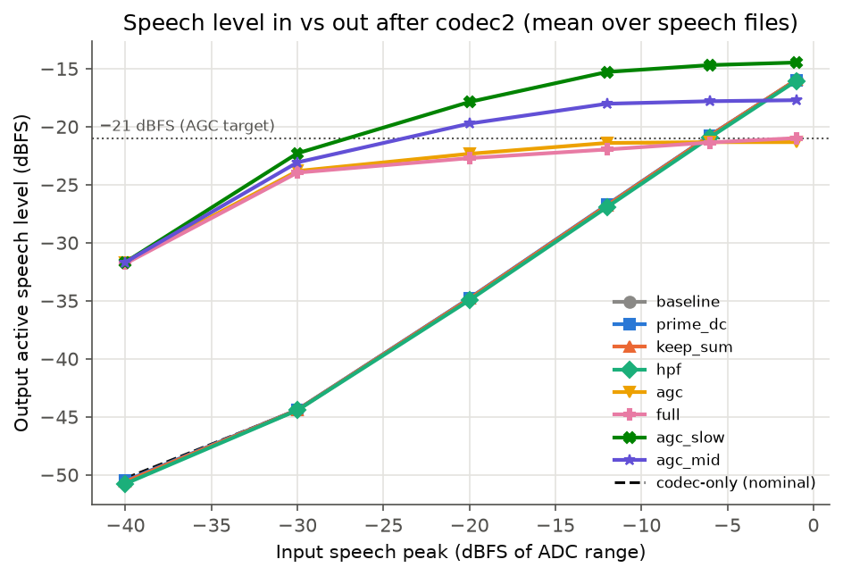

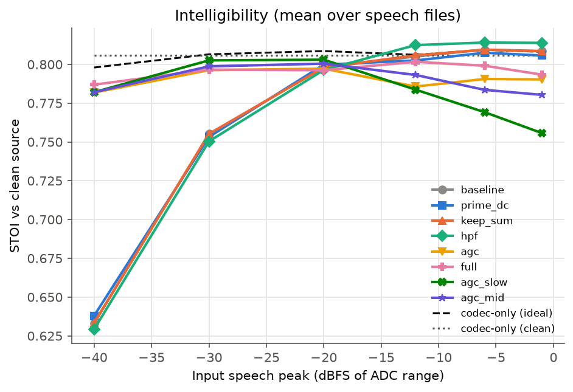

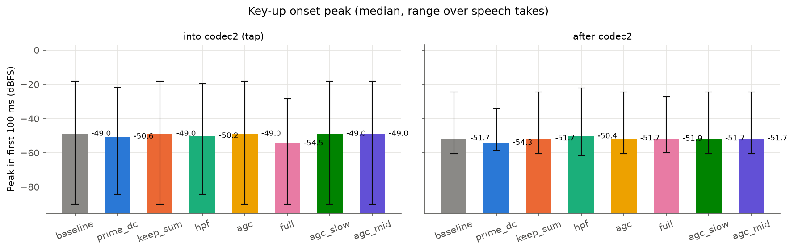

Pre-codec active level (dBFS, tap), mean over speech files, Δ vs baseline in brackets:

| variant | -40 dBFS | -30 dBFS | -20 dBFS | -12 dBFS | -6 dBFS | -1 dBFS |
|---|---|---|---|---|---|---|
| baseline | -53.5 | -45.5 | -37.0 | -29.0 | -23.0 | -18.0 |
| prime_dc | -53.5 (+0.0) | -45.5 (+0.0) | -37.0 (+0.0) | -29.0 (+0.0) | -23.0 (+0.0) | -18.0 (-0.0) |
| keep_sum | -53.5 (+0.0) | -45.5 (+0.0) | -37.0 (+0.0) | -28.9 (+0.0) | -22.9 (+0.0) | -18.0 (-0.0) |
| hpf | -53.6 (-0.1) | -45.3 (+0.2) | -36.3 (+0.7) | -28.3 (+0.7) | -22.3 (+0.6) | -17.3 (+0.6) |
| agc | -33.8 (+19.7) | -26.0 (+19.5) | -24.4 (+12.6) | -22.2 (+6.7) | -21.5 (+1.5) | -20.6 (-2.6) |
| full | -33.3 (+20.2) | -25.5 (+20.0) | -24.1 (+12.8) | -23.2 (+5.8) | -21.9 (+1.1) | -19.9 (-1.9) |
| agc_slow | -33.8 (+19.7) | -24.5 (+21.0) | -19.6 (+17.4) | -14.6 (+14.4) | -12.9 (+10.1) | -11.9 (+6.0) |
| agc_mid | -33.8 (+19.7) | -25.2 (+20.3) | -21.8 (+15.2) | -17.8 (+11.2) | -16.2 (+6.7) | -15.3 (+2.6) |
| codec-only (nominal) | -53.5 | -45.6 | -37.0 | -29.0 | -23.0 | -18.0 |
| codec-only (ideal) | -24.5 | -22.4 | -21.0 | -21.0 | -21.0 | -21.0 |

Output active level (dBFS), mean over speech files, Δ vs baseline in brackets:

| variant | -40 dBFS | -30 dBFS | -20 dBFS | -12 dBFS | -6 dBFS | -1 dBFS |
|---|---|---|---|---|---|---|
| baseline | -50.6 | -44.4 | -34.8 | -26.8 | -20.8 | -16.0 |
| prime_dc | -50.5 (+0.1) | -44.4 (+0.0) | -34.8 (+0.0) | -26.7 (+0.1) | -20.7 (+0.0) | -16.0 (-0.0) |
| keep_sum | -50.6 (+0.0) | -44.4 (-0.0) | -34.8 (+0.0) | -26.8 (+0.0) | -20.8 (+0.0) | -16.0 (+0.0) |
| hpf | -50.8 (-0.1) | -44.4 (-0.0) | -35.0 (-0.1) | -26.9 (-0.1) | -20.9 (-0.1) | -16.1 (-0.1) |
| agc | -31.7 (+18.9) | -23.8 (+20.6) | -22.3 (+12.5) | -21.4 (+5.4) | -21.3 (-0.6) | -21.3 (-5.4) |
| full | -31.8 (+18.8) | -24.0 (+20.4) | -22.7 (+12.1) | -22.0 (+4.8) | -21.4 (-0.6) | -21.0 (-5.0) |
| agc_slow | -31.7 (+18.9) | -22.3 (+22.1) | -17.9 (+16.9) | -15.3 (+11.5) | -14.7 (+6.1) | -14.5 (+1.5) |
| agc_mid | -31.7 (+18.9) | -23.1 (+21.3) | -19.7 (+15.1) | -18.0 (+8.8) | -17.8 (+3.0) | -17.7 (-1.7) |
| codec-only (nominal) | -50.3 | -44.4 | -34.8 | -26.8 | -20.7 | -16.0 |
| codec-only (ideal) | -22.4 | -20.2 | -18.7 | -18.8 | -18.8 | -18.8 |

STOI, mean over speech files, Δ vs baseline in brackets:

| variant | -40 dBFS | -30 dBFS | -20 dBFS | -12 dBFS | -6 dBFS | -1 dBFS |
|---|---|---|---|---|---|---|
| baseline | 0.633 | 0.755 | 0.798 | 0.805 | 0.810 | 0.809 |
| prime_dc | 0.638 (+0.005) | 0.753 (-0.002) | 0.800 (+0.002) | 0.803 (-0.003) | 0.807 (-0.002) | 0.806 (-0.003) |
| keep_sum | 0.633 (+0.000) | 0.755 (-0.000) | 0.798 (+0.000) | 0.806 (+0.001) | 0.809 (-0.000) | 0.808 (-0.000) |
| hpf | 0.629 (-0.004) | 0.750 (-0.005) | 0.796 (-0.002) | 0.812 (+0.007) | 0.814 (+0.005) | 0.814 (+0.005) |
| agc | 0.782 (+0.149) | 0.796 (+0.041) | 0.797 (-0.001) | 0.786 (-0.019) | 0.791 (-0.019) | 0.790 (-0.018) |
| full | 0.787 (+0.154) | 0.797 (+0.041) | 0.796 (-0.002) | 0.802 (-0.003) | 0.799 (-0.010) | 0.793 (-0.015) |
| agc_slow | 0.782 (+0.149) | 0.803 (+0.047) | 0.803 (+0.005) | 0.784 (-0.021) | 0.769 (-0.040) | 0.756 (-0.053) |
| agc_mid | 0.782 (+0.149) | 0.799 (+0.044) | 0.800 (+0.002) | 0.793 (-0.012) | 0.784 (-0.026) | 0.780 (-0.028) |
| codec-only (nominal) | 0.627 | 0.752 | 0.798 | 0.806 | 0.807 | 0.806 |
| codec-only (ideal) | 0.798 | 0.806 | 0.809 | 0.806 | 0.809 | 0.808 |

Pre-codec clip, % of the samples codec2 receives at int16 full scale, measured at the tap (in brackets, the integer-chain model as a cross-check, where it applies):

| variant | -40 dBFS | -30 dBFS | -20 dBFS | -12 dBFS | -6 dBFS | -1 dBFS |
|---|---|---|---|---|---|---|
| baseline | 0.00 (0.00) | 0.00 (0.00) | 0.00 (0.00) | 0.00 (0.00) | 0.00 (0.00) | 0.00 (0.00) |
| prime_dc | 0.00 (0.00) | 0.00 (0.00) | 0.00 (0.00) | 0.00 (0.00) | 0.00 (0.00) | 0.00 (0.00) |
| keep_sum | 0.00 (0.00) | 0.00 (0.00) | 0.00 (0.00) | 0.00 (0.00) | 0.00 (0.00) | 0.00 (0.00) |
| hpf | 0.00 | 0.00 | 0.00 | 0.00 | 0.00 | 0.00 |
| agc | 0.00 | 0.00 | 0.00 | 0.00 | 0.00 | 0.00 |
| full | 0.00 | 0.00 | 0.00 | 0.00 | 0.00 | 0.00 |
| agc_slow | 0.00 | 0.00 | 0.00 | 0.00 | 0.00 | 0.00 |
| agc_mid | 0.00 | 0.00 | 0.00 | 0.00 | 0.00 | 0.00 |
| codec-only (nominal) | 0.00 (0.00) | 0.00 (0.00) | 0.00 (0.00) | 0.00 (0.00) | 0.00 (0.00) | 0.00 (0.00) |

## Static level curve (tones)

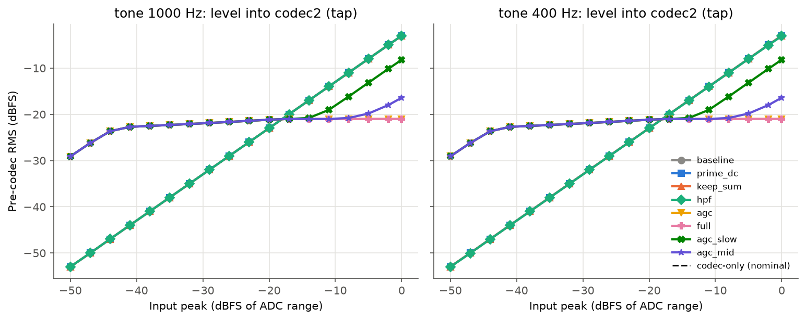

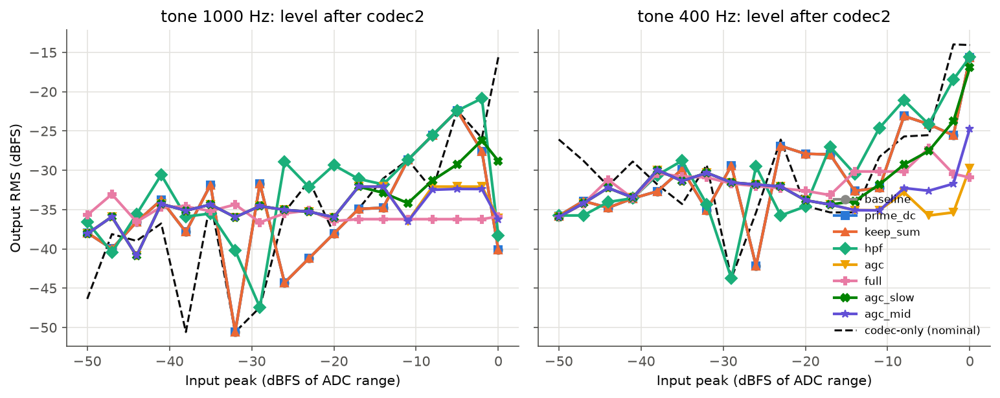

tone 1000 Hz: pre-codec RMS (dBFS, tap) by input peak (dBFS of ADC range).

| variant | -50 | -47 | -44 | -41 | -38 | -35 | -32 | -29 | -26 | -23 | -20 | -17 | -14 | -11 | -8 | -5 | -2 | +0 |
|---|---|---|---|---|---|---|---|---|---|---|---|---|---|---|---|---|---|---|
| baseline | -53.0 | -50.0 | -47.0 | -44.0 | -41.0 | -38.0 | -35.0 | -32.0 | -29.0 | -26.0 | -23.0 | -20.0 | -17.0 | -14.0 | -11.0 | -8.0 | -5.0 | -3.0 |
| prime_dc | -53.0 | -50.0 | -47.0 | -44.0 | -41.0 | -38.0 | -35.0 | -32.0 | -29.0 | -26.0 | -23.0 | -20.0 | -17.0 | -14.0 | -11.0 | -8.0 | -5.0 | -3.0 |
| keep_sum | -53.0 | -50.0 | -47.0 | -44.0 | -41.0 | -38.0 | -35.0 | -32.0 | -29.0 | -26.0 | -23.0 | -20.0 | -17.0 | -14.0 | -11.0 | -8.0 | -5.0 | -3.0 |
| hpf | -53.0 | -50.0 | -47.0 | -44.0 | -41.0 | -38.0 | -35.0 | -32.0 | -29.0 | -26.0 | -23.0 | -20.0 | -17.0 | -14.0 | -11.0 | -8.0 | -5.0 | -3.0 |
| agc | -29.1 | -26.2 | -23.7 | -22.7 | -22.5 | -22.3 | -22.1 | -21.9 | -21.7 | -21.4 | -21.2 | -21.0 | -21.0 | -21.0 | -21.0 | -21.0 | -21.0 | -21.0 |
| full | -29.1 | -26.2 | -23.7 | -22.7 | -22.5 | -22.3 | -22.1 | -21.9 | -21.7 | -21.4 | -21.2 | -21.0 | -21.0 | -21.0 | -21.0 | -21.0 | -21.0 | -21.0 |
| agc_slow | -29.1 | -26.2 | -23.7 | -22.7 | -22.5 | -22.3 | -22.1 | -21.9 | -21.7 | -21.4 | -21.2 | -21.0 | -20.8 | -19.0 | -16.1 | -13.1 | -10.2 | -8.2 |
| agc_mid | -29.1 | -26.2 | -23.7 | -22.7 | -22.5 | -22.3 | -22.1 | -21.9 | -21.7 | -21.4 | -21.2 | -21.0 | -21.0 | -21.0 | -20.8 | -19.8 | -18.0 | -16.4 |
| codec-only (nominal) | -53.0 | -50.0 | -47.0 | -44.0 | -41.0 | -38.0 | -35.0 | -32.0 | -29.0 | -26.0 | -23.0 | -20.0 | -17.0 | -14.0 | -11.0 | -8.0 | -5.0 | -3.0 |

tone 1000 Hz: output RMS after codec2 (dBFS) by input peak (dBFS of ADC range). codec2 alone loses level on pure tones, so read the output against the codec-only row.

| variant | -50 | -47 | -44 | -41 | -38 | -35 | -32 | -29 | -26 | -23 | -20 | -17 | -14 | -11 | -8 | -5 | -2 | +0 |
|---|---|---|---|---|---|---|---|---|---|---|---|---|---|---|---|---|---|---|
| baseline | -37.9 | -40.0 | -36.6 | -33.8 | -37.8 | -31.8 | -50.6 | -31.7 | -44.3 | -41.2 | -38.1 | -34.9 | -34.8 | -28.7 | -25.5 | -22.4 | -27.6 | -40.1 |
| prime_dc | -37.9 | -40.0 | -36.6 | -33.8 | -37.8 | -31.8 | -50.6 | -31.7 | -44.3 | -41.2 | -38.1 | -34.9 | -34.8 | -28.7 | -25.5 | -22.4 | -27.6 | -40.1 |
| keep_sum | -37.9 | -40.0 | -36.6 | -33.8 | -37.8 | -31.8 | -50.6 | -31.7 | -44.3 | -41.2 | -38.1 | -34.9 | -34.8 | -28.7 | -25.5 | -22.4 | -27.6 | -40.1 |
| hpf | -36.6 | -40.5 | -35.6 | -30.6 | -35.9 | -35.5 | -40.2 | -47.4 | -28.9 | -32.2 | -29.3 | -31.1 | -31.8 | -28.7 | -25.5 | -22.4 | -20.9 | -38.3 |
| agc | -38.1 | -35.9 | -40.9 | -34.3 | -35.1 | -34.4 | -36.0 | -34.6 | -35.0 | -35.3 | -36.0 | -32.1 | -32.1 | -36.5 | -32.1 | -32.1 | -32.1 | -36.1 |
| full | -35.7 | -33.0 | -36.6 | -34.7 | -34.6 | -35.2 | -34.4 | -36.6 | -35.5 | -35.1 | -36.5 | -36.2 | -36.2 | -36.2 | -36.2 | -36.2 | -36.2 | -35.9 |
| agc_slow | -38.1 | -35.9 | -40.9 | -34.3 | -35.1 | -34.4 | -36.0 | -34.6 | -35.0 | -35.3 | -36.0 | -32.1 | -32.9 | -34.2 | -31.3 | -29.2 | -26.2 | -28.8 |
| agc_mid | -38.1 | -35.9 | -40.9 | -34.3 | -35.1 | -34.4 | -36.0 | -34.6 | -35.0 | -35.3 | -36.0 | -32.1 | -32.1 | -36.5 | -32.5 | -32.4 | -32.4 | -36.3 |
| codec-only (nominal) | -46.4 | -38.1 | -39.0 | -36.8 | -50.6 | -34.0 | -50.6 | -47.4 | -35.3 | -31.4 | -38.0 | -34.9 | -31.0 | -28.7 | -32.5 | -22.4 | -25.9 | -15.6 |

tone 400 Hz: pre-codec RMS (dBFS, tap) by input peak (dBFS of ADC range).

| variant | -50 | -47 | -44 | -41 | -38 | -35 | -32 | -29 | -26 | -23 | -20 | -17 | -14 | -11 | -8 | -5 | -2 | +0 |
|---|---|---|---|---|---|---|---|---|---|---|---|---|---|---|---|---|---|---|
| baseline | -53.0 | -50.0 | -47.0 | -44.0 | -41.0 | -38.0 | -35.0 | -32.0 | -29.0 | -26.0 | -23.0 | -20.0 | -17.0 | -14.0 | -11.0 | -8.0 | -5.0 | -3.0 |
| prime_dc | -53.0 | -50.0 | -47.0 | -44.0 | -41.0 | -38.0 | -35.0 | -32.0 | -29.0 | -26.0 | -23.0 | -20.0 | -17.0 | -14.0 | -11.0 | -8.0 | -5.0 | -3.0 |
| keep_sum | -53.0 | -50.0 | -47.0 | -44.0 | -41.0 | -38.0 | -35.0 | -32.0 | -29.0 | -26.0 | -23.0 | -20.0 | -17.0 | -14.0 | -11.0 | -8.0 | -5.0 | -3.0 |
| hpf | -53.0 | -50.0 | -47.0 | -44.0 | -41.0 | -38.0 | -35.0 | -32.0 | -29.0 | -26.0 | -23.0 | -20.0 | -17.0 | -14.0 | -11.0 | -8.0 | -5.0 | -3.1 |
| agc | -29.1 | -26.2 | -23.7 | -22.7 | -22.5 | -22.3 | -22.1 | -21.9 | -21.7 | -21.4 | -21.2 | -21.0 | -21.0 | -21.0 | -21.0 | -21.0 | -21.0 | -21.0 |
| full | -29.1 | -26.2 | -23.7 | -22.7 | -22.5 | -22.3 | -22.1 | -21.9 | -21.7 | -21.4 | -21.2 | -21.0 | -21.0 | -21.0 | -21.0 | -21.0 | -21.0 | -21.0 |
| agc_slow | -29.1 | -26.2 | -23.7 | -22.7 | -22.5 | -22.3 | -22.1 | -21.9 | -21.7 | -21.4 | -21.2 | -21.0 | -20.8 | -19.0 | -16.2 | -13.2 | -10.2 | -8.2 |
| agc_mid | -29.1 | -26.2 | -23.7 | -22.7 | -22.5 | -22.3 | -22.1 | -21.9 | -21.7 | -21.4 | -21.2 | -21.0 | -21.0 | -21.0 | -20.8 | -19.8 | -18.0 | -16.4 |
| codec-only (nominal) | -53.0 | -50.0 | -47.0 | -44.0 | -41.0 | -38.0 | -35.0 | -32.0 | -29.0 | -26.0 | -23.0 | -20.0 | -17.0 | -14.0 | -11.0 | -8.0 | -5.0 | -3.0 |

tone 400 Hz: output RMS after codec2 (dBFS) by input peak (dBFS of ADC range). codec2 alone loses level on pure tones, so read the output against the codec-only row.

| variant | -50 | -47 | -44 | -41 | -38 | -35 | -32 | -29 | -26 | -23 | -20 | -17 | -14 | -11 | -8 | -5 | -2 | +0 |
|---|---|---|---|---|---|---|---|---|---|---|---|---|---|---|---|---|---|---|
| baseline | -35.8 | -33.9 | -34.8 | -33.6 | -32.7 | -29.9 | -35.1 | -29.4 | -42.2 | -26.9 | -27.9 | -28.0 | -32.6 | -32.2 | -23.1 | -24.1 | -25.6 | -15.6 |
| prime_dc | -35.8 | -33.9 | -34.8 | -33.6 | -32.7 | -29.9 | -35.1 | -29.4 | -42.2 | -26.9 | -27.9 | -28.0 | -32.6 | -32.2 | -23.1 | -24.1 | -25.6 | -15.6 |
| keep_sum | -35.8 | -33.9 | -34.8 | -33.6 | -32.7 | -29.9 | -35.1 | -29.4 | -42.2 | -26.9 | -27.9 | -28.0 | -32.6 | -32.2 | -23.1 | -24.1 | -25.6 | -15.6 |
| hpf | -35.8 | -35.7 | -34.0 | -33.6 | -30.6 | -28.8 | -34.3 | -43.8 | -29.5 | -35.8 | -34.6 | -27.0 | -30.5 | -24.6 | -21.1 | -24.1 | -18.5 | -15.6 |
| agc | -35.9 | -34.2 | -32.2 | -33.5 | -29.9 | -31.4 | -30.3 | -31.5 | -31.8 | -32.1 | -33.8 | -34.4 | -35.1 | -35.1 | -32.8 | -35.8 | -35.4 | -29.7 |
| full | -36.0 | -34.2 | -31.2 | -33.6 | -30.4 | -30.8 | -30.9 | -31.7 | -32.0 | -32.3 | -32.6 | -33.2 | -30.2 | -30.2 | -30.2 | -27.2 | -30.5 | -30.9 |
| agc_slow | -35.9 | -34.2 | -32.2 | -33.5 | -29.9 | -31.4 | -30.3 | -31.5 | -31.8 | -32.1 | -33.8 | -34.4 | -33.9 | -31.8 | -29.3 | -27.5 | -23.8 | -16.9 |
| agc_mid | -35.9 | -34.2 | -32.2 | -33.5 | -29.9 | -31.4 | -30.3 | -31.5 | -31.8 | -32.1 | -33.8 | -34.4 | -35.1 | -35.1 | -32.3 | -32.6 | -31.7 | -24.7 |
| codec-only (nominal) | -26.1 | -28.8 | -32.0 | -28.9 | -31.8 | -34.3 | -29.3 | -43.8 | -35.4 | -26.1 | -34.5 | -35.4 | -35.4 | -28.3 | -25.7 | -25.5 | -14.0 | -14.1 |

## Level step (AGC dynamics)

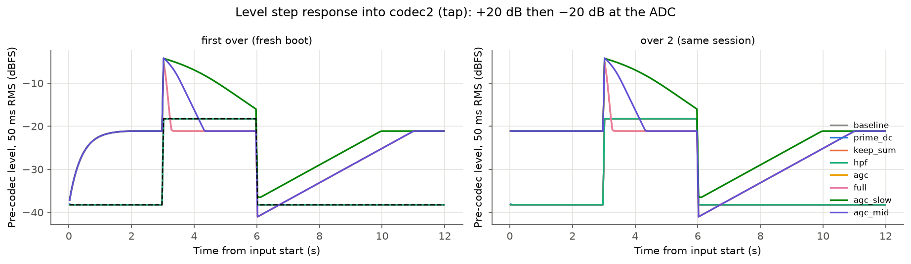

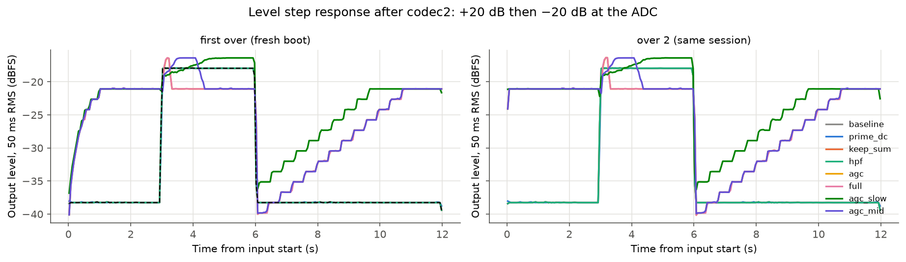

Settled levels are medians of the 50 ms envelope; attack and release are the time to stay within 2 dB of the settled level after each step; rise is the output step for the +20 dB input step (20 dB for a linear chain).

| variant | over | where | before dBFS | loud dBFS | after dBFS | rise dB | attack s | overshoot dB | release s | dip dB | release dB/s |
|---|---|---|---|---|---|---|---|---|---|---|---|
| baseline | 1 | pre-codec | -38.2 | -18.2 | -38.2 | 20.0 | 0.00 | 0.0 | 0.00 | 0.0 | — |
| baseline | 1 | output | -38.3 | -17.9 | -38.3 | 20.3 | 0.00 | 0.1 | 0.05 | 0.0 | — |
| prime_dc | 1 | pre-codec | -38.2 | -18.2 | -38.2 | 20.0 | 0.00 | 0.0 | 0.00 | 0.0 | — |
| prime_dc | 1 | output | -38.3 | -17.9 | -38.3 | 20.3 | 0.00 | 0.0 | 0.05 | 0.0 | — |
| keep_sum | 1 | pre-codec | -38.2 | -18.2 | -38.2 | 20.0 | 0.00 | 0.0 | 0.00 | 0.0 | — |
| keep_sum | 1 | output | -38.3 | -17.9 | -38.3 | 20.3 | 0.00 | 0.1 | 0.05 | 0.0 | — |
| hpf | 1 | pre-codec | -38.2 | -18.2 | -38.2 | 20.0 | 0.00 | 0.0 | 0.00 | 0.0 | — |
| hpf | 1 | output | -38.3 | -17.9 | -38.3 | 20.3 | 0.00 | 0.1 | 0.05 | 0.0 | — |
| agc | 1 | pre-codec | -21.1 | -21.1 | -21.1 | 0.0 | 0.25 | 16.1 | 4.50 | 19.9 | 4.0 |
| agc | 1 | output | -21.1 | -21.1 | -21.1 | 0.0 | 0.30 | 4.7 | 4.30 | 18.9 | 4.0 |
| full | 1 | pre-codec | -21.1 | -21.1 | -21.1 | 0.0 | 0.25 | 16.0 | 4.50 | 19.9 | 4.0 |
| full | 1 | output | -21.1 | -21.1 | -21.1 | 0.0 | 0.30 | 4.7 | 4.30 | 18.9 | 4.0 |
| agc_slow | 1 | pre-codec | -21.1 | -13.4 | -21.1 | 7.7 | did not settle | 9.2 | 3.45 | 15.4 | 4.0 |
| agc_slow | 1 | output | -21.1 | -16.4 | -21.1 | 4.7 | 0.50 | -1.2 | 3.25 | 15.1 | 4.0 |
| agc_mid | 1 | pre-codec | -21.1 | -21.1 | -21.1 | 0.0 | 1.20 | 17.0 | 4.50 | 19.9 | 4.0 |
| agc_mid | 1 | output | -21.1 | -21.1 | -21.1 | 0.0 | 1.25 | 4.7 | 4.30 | 18.8 | 4.0 |
| codec-only (nominal) | 1 | pre-codec | -38.3 | -18.3 | -38.3 | 20.0 | 0.00 | 0.0 | 0.00 | 0.0 | — |
| codec-only (nominal) | 1 | output | -38.3 | -17.9 | -38.3 | 20.3 | 0.00 | 0.1 | 0.05 | 0.0 | — |
| baseline | 2 | pre-codec | -38.2 | -18.2 | -38.2 | 20.0 | 0.00 | 0.0 | 0.00 | 0.0 | — |
| baseline | 2 | output | -38.3 | -17.9 | -38.3 | 20.3 | 0.00 | 0.1 | 0.05 | 0.0 | — |
| prime_dc | 2 | pre-codec | -38.2 | -18.2 | -38.2 | 20.0 | 0.00 | 0.0 | 0.00 | 0.0 | — |
| prime_dc | 2 | output | -38.3 | -17.9 | -38.3 | 20.3 | 0.00 | 0.0 | 0.05 | 0.0 | — |
| keep_sum | 2 | pre-codec | -38.2 | -18.2 | -38.2 | 20.0 | 0.00 | 0.0 | 0.00 | 0.0 | — |
| keep_sum | 2 | output | -38.3 | -17.9 | -38.3 | 20.3 | 0.00 | 0.1 | 0.05 | 0.0 | — |
| hpf | 2 | pre-codec | -38.2 | -18.2 | -38.2 | 20.0 | 0.00 | 0.0 | 0.00 | 0.0 | — |
| hpf | 2 | output | -38.3 | -17.9 | -38.3 | 20.3 | 0.00 | 0.1 | 0.05 | 0.0 | — |
| agc | 2 | pre-codec | -21.1 | -21.1 | -21.1 | 0.0 | 0.25 | 16.1 | 4.50 | 19.9 | 4.0 |
| agc | 2 | output | -21.1 | -21.1 | -21.1 | 0.0 | 0.30 | 4.7 | 4.30 | 19.1 | 4.0 |
| full | 2 | pre-codec | -21.1 | -21.1 | -21.1 | 0.0 | 0.25 | 16.0 | 4.50 | 19.9 | 4.0 |
| full | 2 | output | -21.1 | -21.1 | -21.1 | 0.0 | 0.30 | 4.7 | 4.30 | 19.1 | 4.0 |
| agc_slow | 2 | pre-codec | -21.1 | -13.4 | -21.1 | 7.7 | did not settle | 9.2 | 3.45 | 15.4 | 4.0 |
| agc_slow | 2 | output | -21.1 | -16.4 | -21.1 | 4.7 | 0.50 | -1.2 | 3.25 | 15.3 | 4.0 |
| agc_mid | 2 | pre-codec | -21.1 | -21.1 | -21.1 | 0.0 | 1.20 | 17.0 | 4.50 | 19.9 | 4.0 |
| agc_mid | 2 | output | -21.1 | -21.1 | -21.1 | 0.0 | 1.25 | 4.7 | 4.30 | 18.9 | 4.0 |

## Listening-condition intelligibility

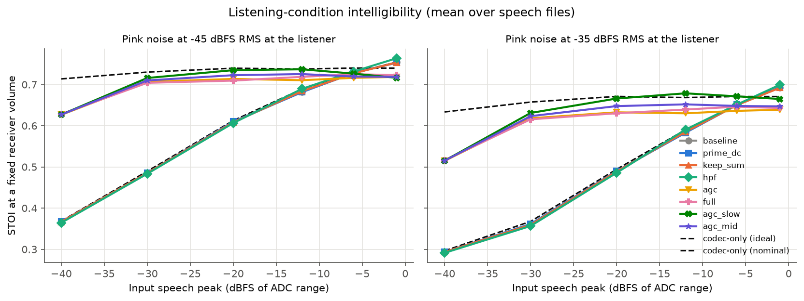

The speech sweep's decoded audio at its own level (a fixed receiver volume, no normalisation) with pink noise added at the listener, STOI against the clean source. Worst: the lowest mean STOI over the input and noise levels; deficit: codec-only (ideal) minus the variant in the same cell, at its largest.

| variant | mean STOI | Δ | worst STOI | at input / noise dBFS | Δ | worst deficit vs ideal |
|---|---|---|---|---|---|---|
| baseline | 0.558 |  | 0.293 | -40 / -35 |  | 0.347 |
| prime_dc | 0.558 | +0.000 | 0.293 | -40 / -35 | +0.000 | 0.347 |
| keep_sum | 0.558 | +0.000 | 0.293 | -40 / -35 | +0.000 | 0.347 |
| hpf | 0.559 | +0.002 | 0.291 | -40 / -35 | -0.002 | 0.349 |
| agc | 0.655 | +0.098 | 0.515 | -40 / -35 | +0.222 | 0.119 |
| full | 0.658 | +0.101 | 0.516 | -40 / -35 | +0.223 | 0.117 |
| agc_slow | 0.674 | +0.116 | 0.515 | -40 / -35 | +0.222 | 0.118 |
| agc_mid | 0.663 | +0.105 | 0.515 | -40 / -35 | +0.222 | 0.118 |

Noise -45 dBFS: STOI by input peak, Δ vs baseline in brackets:

| variant | -40 dBFS | -30 dBFS | -20 dBFS | -12 dBFS | -6 dBFS | -1 dBFS |
|---|---|---|---|---|---|---|
| baseline | 0.367 | 0.485 | 0.608 | 0.682 | 0.727 | 0.754 |
| prime_dc | 0.367 (+0.000) | 0.485 (-0.000) | 0.610 (+0.002) | 0.681 (-0.001) | 0.728 (+0.001) | 0.753 (-0.001) |
| keep_sum | 0.367 (+0.000) | 0.485 (-0.000) | 0.608 (+0.000) | 0.684 (+0.002) | 0.727 (-0.000) | 0.753 (-0.000) |
| hpf | 0.364 (-0.002) | 0.483 (-0.002) | 0.606 (-0.002) | 0.690 (+0.007) | 0.732 (+0.004) | 0.764 (+0.010) |
| agc | 0.626 (+0.260) | 0.706 (+0.221) | 0.714 (+0.105) | 0.711 (+0.028) | 0.716 (-0.011) | 0.719 (-0.035) |
| full | 0.628 (+0.262) | 0.704 (+0.219) | 0.710 (+0.101) | 0.719 (+0.036) | 0.725 (-0.002) | 0.723 (-0.031) |
| agc_slow | 0.627 (+0.260) | 0.716 (+0.231) | 0.735 (+0.126) | 0.737 (+0.055) | 0.726 (-0.001) | 0.716 (-0.038) |
| agc_mid | 0.627 (+0.260) | 0.710 (+0.225) | 0.723 (+0.114) | 0.725 (+0.043) | 0.719 (-0.008) | 0.718 (-0.035) |
| codec-only (ideal) | 0.714 | 0.730 | 0.740 | 0.738 | 0.740 | 0.740 |
| codec-only (nominal) | 0.368 | 0.489 | 0.612 | 0.689 | 0.729 | 0.754 |

Noise -35 dBFS: STOI by input peak, Δ vs baseline in brackets:

| variant | -40 dBFS | -30 dBFS | -20 dBFS | -12 dBFS | -6 dBFS | -1 dBFS |
|---|---|---|---|---|---|---|
| baseline | 0.293 | 0.360 | 0.489 | 0.584 | 0.650 | 0.693 |
| prime_dc | 0.293 (+0.000) | 0.361 (+0.002) | 0.490 (+0.001) | 0.583 (-0.001) | 0.651 (+0.001) | 0.693 (+0.000) |
| keep_sum | 0.293 (+0.000) | 0.359 (-0.000) | 0.489 (+0.000) | 0.585 (+0.001) | 0.650 (-0.000) | 0.692 (-0.001) |
| hpf | 0.291 (-0.002) | 0.356 (-0.003) | 0.486 (-0.003) | 0.590 (+0.007) | 0.651 (+0.001) | 0.700 (+0.007) |
| agc | 0.515 (+0.222) | 0.618 (+0.258) | 0.633 (+0.144) | 0.630 (+0.046) | 0.636 (-0.014) | 0.639 (-0.054) |
| full | 0.516 (+0.223) | 0.616 (+0.256) | 0.630 (+0.141) | 0.639 (+0.056) | 0.646 (-0.004) | 0.643 (-0.050) |
| agc_slow | 0.515 (+0.222) | 0.631 (+0.271) | 0.666 (+0.177) | 0.679 (+0.095) | 0.671 (+0.021) | 0.665 (-0.028) |
| agc_mid | 0.515 (+0.222) | 0.623 (+0.264) | 0.648 (+0.159) | 0.652 (+0.068) | 0.648 (-0.002) | 0.647 (-0.046) |
| codec-only (ideal) | 0.633 | 0.657 | 0.671 | 0.668 | 0.671 | 0.671 |
| codec-only (nominal) | 0.296 | 0.368 | 0.494 | 0.590 | 0.652 | 0.694 |

## Silence and gate

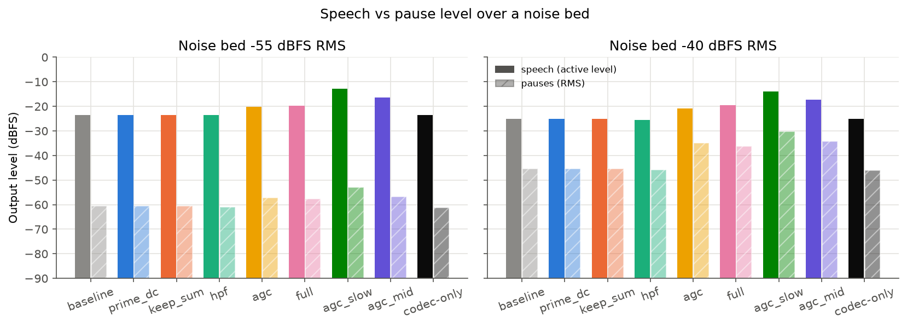

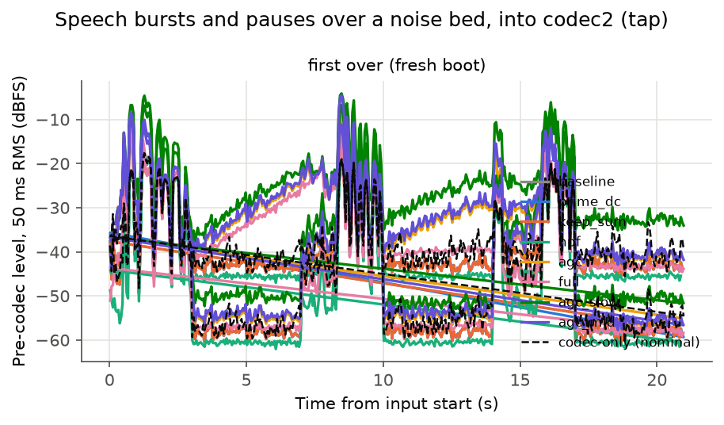

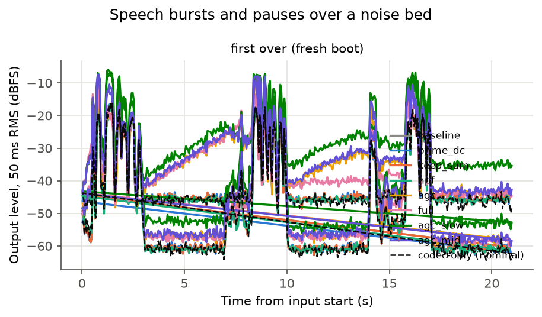

Pause level is the RMS in the pauses, 0.3 s in from each edge; drift is the last second of a pause against its first (positive: the noise is pumped up during the pause); trend is the last pause against the first.

| variant | noise dBFS | where | speech dBFS | pause dBFS | speech/pause dB | drift dB | worst drift dB | trend dB |
|---|---|---|---|---|---|---|---|---|
| baseline | -55 | pre-codec | -26.6 | -58.0 | 31.3 | 0.0 | 0.3 | 0.2 |
| baseline | -55 | output | -23.5 | -60.6 | 37.1 | 0.0 | 0.3 | -0.1 |
| prime_dc | -55 | pre-codec | -26.6 | -58.0 | 31.4 | 0.0 | 0.3 | 0.2 |
| prime_dc | -55 | output | -23.5 | -60.6 | 37.0 | 0.2 | 0.7 | -0.1 |
| keep_sum | -55 | pre-codec | -26.6 | -58.0 | 31.3 | 0.0 | 0.3 | 0.2 |
| keep_sum | -55 | output | -23.5 | -60.6 | 37.1 | 0.0 | 0.3 | -0.1 |
| hpf | -55 | pre-codec | -25.2 | -60.6 | 35.4 | 0.1 | 0.4 | 0.0 |
| hpf | -55 | output | -23.6 | -61.0 | 37.4 | 0.1 | 0.3 | 0.0 |
| agc | -55 | pre-codec | -23.2 | -54.8 | 31.5 | 0.0 | 0.3 | -0.9 |
| agc | -55 | output | -20.1 | -57.3 | 37.2 | 0.2 | 0.6 | -1.1 |
| full | -55 | pre-codec | -20.4 | -57.2 | 36.8 | 0.1 | 0.4 | -0.9 |
| full | -55 | output | -19.7 | -57.6 | 37.9 | 0.0 | 0.4 | -0.9 |
| agc_slow | -55 | pre-codec | -14.2 | -50.5 | 36.3 | 0.0 | 0.3 | -0.3 |
| agc_slow | -55 | output | -12.8 | -53.0 | 40.2 | 0.3 | 0.7 | -0.5 |
| agc_mid | -55 | pre-codec | -18.9 | -54.2 | 35.3 | 0.0 | 0.3 | -1.2 |
| agc_mid | -55 | output | -16.4 | -56.7 | 40.4 | 0.1 | 0.5 | -1.4 |
| codec-only (nominal) | -55 | pre-codec | -26.7 | -55.3 | 28.6 | 0.3 | 1.2 | 1.9 |
| codec-only (nominal) | -55 | output | -23.4 | -61.1 | 37.7 | 0.1 | 0.5 | -0.5 |
| baseline | -40 | pre-codec | -27.0 | -43.0 | 15.9 | 0.0 | 0.3 | 0.2 |
| baseline | -40 | output | -25.2 | -45.4 | 20.2 | 0.2 | 0.7 | -0.1 |
| prime_dc | -40 | pre-codec | -27.0 | -43.0 | 15.9 | 0.0 | 0.3 | 0.2 |
| prime_dc | -40 | output | -25.1 | -45.4 | 20.2 | 0.4 | 1.0 | 0.1 |
| keep_sum | -40 | pre-codec | -27.0 | -43.0 | 15.9 | 0.0 | 0.3 | 0.2 |
| keep_sum | -40 | output | -25.2 | -45.4 | 20.2 | 0.2 | 0.7 | -0.1 |
| hpf | -40 | pre-codec | -27.3 | -45.6 | 18.2 | 0.1 | 0.4 | 0.0 |
| hpf | -40 | output | -25.5 | -45.9 | 20.3 | 0.2 | 0.5 | -0.1 |
| agc | -40 | pre-codec | -22.0 | -32.6 | 10.6 | 5.3 | 9.4 | -10.6 |
| agc | -40 | output | -20.9 | -34.9 | 14.0 | 5.5 | 9.6 | -11.1 |
| full | -40 | pre-codec | -20.3 | -36.1 | 15.8 | 3.5 | 9.6 | -11.1 |
| full | -40 | output | -19.6 | -36.3 | 16.8 | 3.5 | 9.7 | -11.3 |
| agc_slow | -40 | pre-codec | -14.0 | -28.0 | 14.0 | 5.3 | 9.4 | -5.5 |
| agc_slow | -40 | output | -14.0 | -30.3 | 16.3 | 5.5 | 9.5 | -6.1 |
| agc_mid | -40 | pre-codec | -17.3 | -32.0 | 14.7 | 5.3 | 9.4 | -10.8 |
| agc_mid | -40 | output | -17.2 | -34.3 | 17.1 | 5.6 | 9.5 | -11.2 |
| codec-only (nominal) | -40 | pre-codec | -26.9 | -40.3 | 13.4 | 0.4 | 1.3 | 1.9 |
| codec-only (nominal) | -40 | output | -25.0 | -46.0 | 21.0 | 0.2 | 0.5 | -0.3 |

