# M17 microphone chain: emulator campaign

OpenRTX `v0.4.5-54-gf50482756` (private/mic-exp), profile **mduv3x0** (oversample 8, gain 32, 12-bit ADC, noise 2.0 LSB RMS). Run 2026-11-15T22:27:36+00:00 to 2026-11-15T22:31:07+00:00, suite `0dd602b9be`.

How the bench works, what each metric means and its limits: [METHODS.md](METHODS.md). Raw tables are in `data/`, provenance in `run.json`.

Variants:

- **baseline**: no extra defines

## Headline

Δ columns are the variant minus baseline. Spread: active speech level, max − min over the input levels (lower is a steadier level), into codec2 (pre-codec, from the tap) and after it. Attack and release are from the pre-codec envelope. STOI deficit: codec-only (ideal) STOI minus the variant's, mean over takes (lower is better). Step and gate figures are described under their tests.

| variant | pre-codec spread dB | Δ | spread dB | Δ | STOI | Δ | STOI deficit | Δ | listening STOI worst | Δ | listening deficit worst | Δ | pre-codec onset dBFS | Δ | onset dBFS | Δ | pre-codec clip max % | attack s | release s | speech/pause dB | Δ | pause drift dB | Δ |
|---|---|---|---|---|---|---|---|---|---|---|---|---|---|---|---|---|---|---|---|---|---|---|---|
| baseline | 35.7 |  | 34.3 |  | 0.717 |  | 0.025 |  | 0.320 |  | 0.261 |  | 0.0 |  | -8.3 |  | 1.81 | 0.00 | 0.00 | 28.8 |  | -0.2 |  |

## Speech level sweep

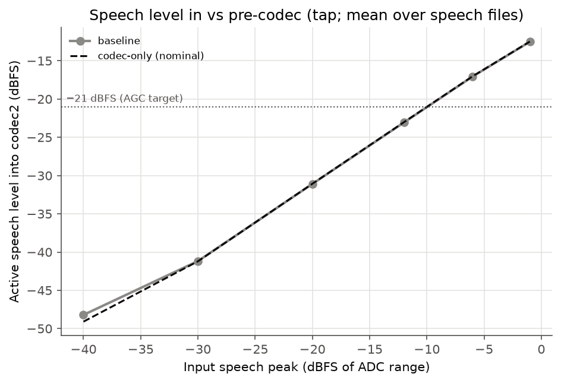

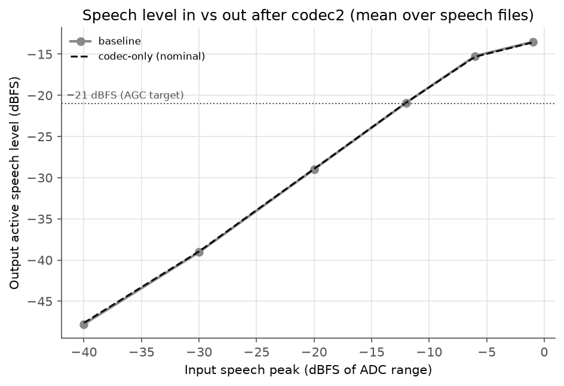

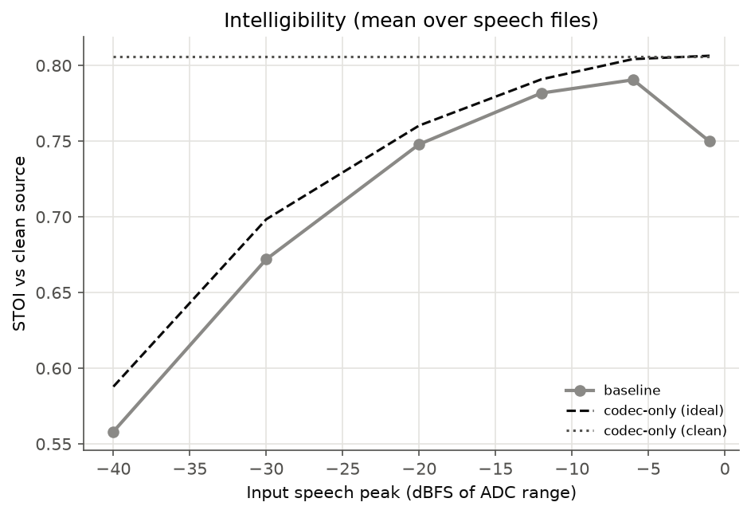

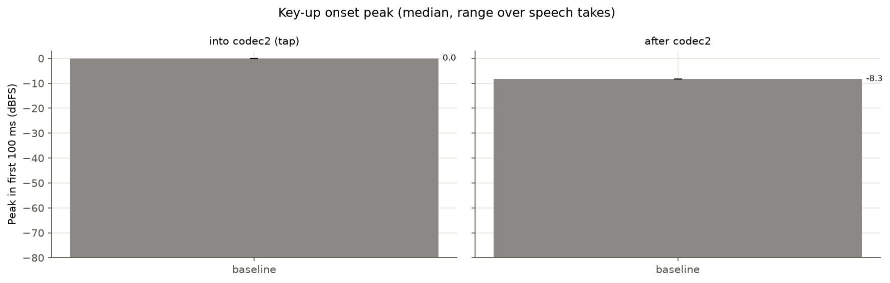

Pre-codec active level (dBFS, tap), mean over speech files, Δ vs baseline in brackets:

| variant | -40 dBFS | -30 dBFS | -20 dBFS | -12 dBFS | -6 dBFS | -1 dBFS |
|---|---|---|---|---|---|---|
| baseline | -48.2 | -41.2 | -31.1 | -23.1 | -17.1 | -12.5 |
| codec-only (nominal) | -49.1 | -41.2 | -31.1 | -23.0 | -17.0 | -12.5 |
| codec-only (ideal) | -24.0 | -21.3 | -21.0 | -21.0 | -21.0 | -21.0 |

Output active level (dBFS), mean over speech files, Δ vs baseline in brackets:

| variant | -40 dBFS | -30 dBFS | -20 dBFS | -12 dBFS | -6 dBFS | -1 dBFS |
|---|---|---|---|---|---|---|
| baseline | -47.8 | -39.0 | -29.0 | -20.9 | -15.2 | -13.5 |
| codec-only (nominal) | -47.6 | -39.0 | -28.9 | -20.9 | -15.3 | -13.6 |
| codec-only (ideal) | -23.0 | -18.8 | -18.8 | -19.0 | -18.9 | -18.8 |

STOI, mean over speech files, Δ vs baseline in brackets:

| variant | -40 dBFS | -30 dBFS | -20 dBFS | -12 dBFS | -6 dBFS | -1 dBFS |
|---|---|---|---|---|---|---|
| baseline | 0.558 | 0.672 | 0.748 | 0.782 | 0.790 | 0.750 |
| codec-only (nominal) | 0.589 | 0.699 | 0.758 | 0.791 | 0.795 | 0.761 |
| codec-only (ideal) | 0.588 | 0.698 | 0.760 | 0.791 | 0.804 | 0.806 |

Pre-codec clip, % of the samples codec2 receives at int16 full scale, measured at the tap (in brackets, the integer-chain model as a cross-check, where it applies):

| variant | -40 dBFS | -30 dBFS | -20 dBFS | -12 dBFS | -6 dBFS | -1 dBFS |
|---|---|---|---|---|---|---|
| baseline | 0.00 (0.00) | 0.00 (0.00) | 0.00 (0.00) | 0.00 (0.00) | 0.00 (0.00) | 0.77 (0.74) |
| codec-only (nominal) | 0.00 (0.00) | 0.00 (0.00) | 0.00 (0.00) | 0.00 (0.00) | 0.00 (0.00) | 0.78 (0.74) |

## Static level curve (tones)

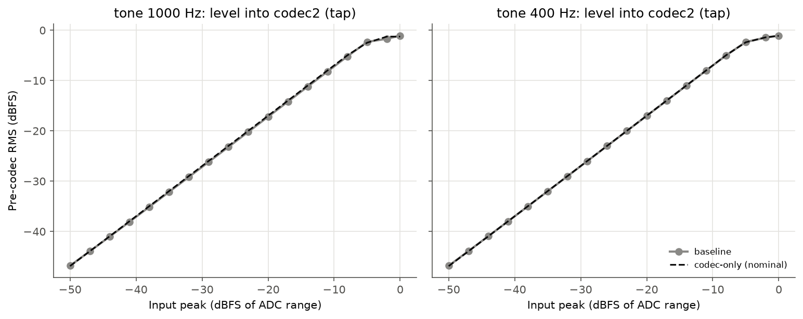

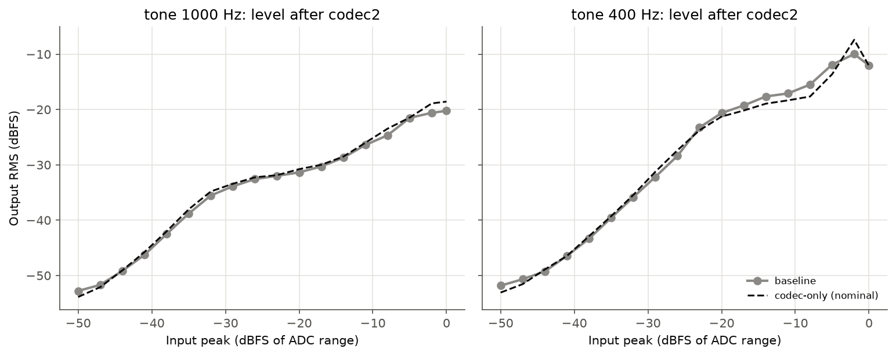

tone 1000 Hz: pre-codec RMS (dBFS, tap) by input peak (dBFS of ADC range).

| variant | -50 | -47 | -44 | -41 | -38 | -35 | -32 | -29 | -26 | -23 | -20 | -17 | -14 | -11 | -8 | -5 | -2 | +0 |
|---|---|---|---|---|---|---|---|---|---|---|---|---|---|---|---|---|---|---|
| baseline | -46.8 | -43.9 | -41.0 | -38.1 | -35.1 | -32.1 | -29.2 | -26.2 | -23.2 | -20.2 | -17.2 | -14.2 | -11.2 | -8.2 | -5.2 | -2.3 | -1.7 | -1.1 |
| codec-only (nominal) | -46.9 | -43.9 | -41.0 | -38.0 | -35.0 | -32.0 | -29.0 | -26.0 | -23.0 | -20.0 | -17.0 | -14.0 | -11.0 | -8.0 | -5.0 | -2.5 | -1.2 | -1.2 |

tone 1000 Hz: output RMS after codec2 (dBFS) by input peak (dBFS of ADC range). codec2 alone loses level on pure tones, so read the output against the codec-only row.

| variant | -50 | -47 | -44 | -41 | -38 | -35 | -32 | -29 | -26 | -23 | -20 | -17 | -14 | -11 | -8 | -5 | -2 | +0 |
|---|---|---|---|---|---|---|---|---|---|---|---|---|---|---|---|---|---|---|
| baseline | -52.8 | -51.7 | -49.2 | -46.3 | -42.5 | -38.8 | -35.6 | -33.9 | -32.6 | -32.0 | -31.4 | -30.3 | -28.7 | -26.4 | -24.7 | -21.5 | -20.6 | -20.2 |
| codec-only (nominal) | -53.9 | -52.1 | -49.1 | -45.8 | -42.0 | -38.1 | -34.8 | -33.4 | -32.3 | -31.9 | -30.8 | -30.0 | -28.5 | -26.0 | -23.5 | -21.5 | -18.9 | -18.6 |

tone 400 Hz: pre-codec RMS (dBFS, tap) by input peak (dBFS of ADC range).

| variant | -50 | -47 | -44 | -41 | -38 | -35 | -32 | -29 | -26 | -23 | -20 | -17 | -14 | -11 | -8 | -5 | -2 | +0 |
|---|---|---|---|---|---|---|---|---|---|---|---|---|---|---|---|---|---|---|
| baseline | -46.8 | -43.9 | -40.9 | -38.0 | -35.0 | -32.0 | -29.0 | -26.0 | -23.0 | -20.0 | -17.0 | -14.0 | -11.0 | -8.0 | -5.0 | -2.3 | -1.5 | -1.1 |
| codec-only (nominal) | -46.9 | -43.9 | -41.0 | -38.0 | -35.0 | -32.0 | -29.0 | -26.0 | -23.0 | -20.0 | -17.0 | -14.0 | -11.0 | -8.0 | -5.0 | -2.4 | -1.4 | -1.1 |

tone 400 Hz: output RMS after codec2 (dBFS) by input peak (dBFS of ADC range). codec2 alone loses level on pure tones, so read the output against the codec-only row.

| variant | -50 | -47 | -44 | -41 | -38 | -35 | -32 | -29 | -26 | -23 | -20 | -17 | -14 | -11 | -8 | -5 | -2 | +0 |
|---|---|---|---|---|---|---|---|---|---|---|---|---|---|---|---|---|---|---|
| baseline | -51.8 | -50.7 | -49.3 | -46.4 | -43.4 | -39.6 | -35.9 | -32.2 | -28.4 | -23.3 | -20.6 | -19.3 | -17.6 | -17.1 | -15.5 | -11.9 | -10.0 | -12.0 |
| codec-only (nominal) | -53.1 | -51.6 | -48.9 | -46.5 | -42.9 | -39.3 | -35.5 | -31.3 | -27.4 | -23.8 | -21.3 | -20.2 | -18.9 | -18.3 | -17.7 | -13.6 | -7.4 | -12.1 |

## Level step (AGC dynamics)

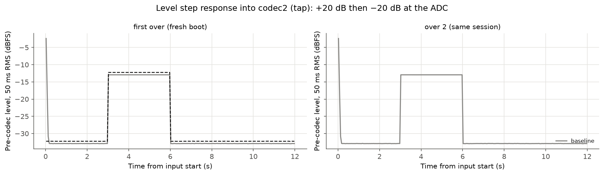

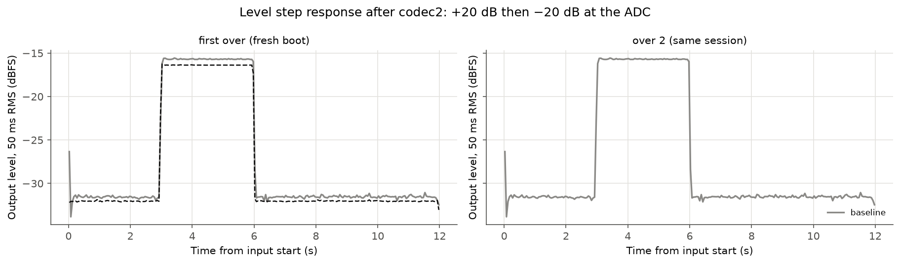

Settled levels are medians of the 50 ms envelope; attack and release are the time to stay within 2 dB of the settled level after each step; rise is the output step for the +20 dB input step (20 dB for a linear chain).

| variant | over | where | before dBFS | loud dBFS | after dBFS | rise dB | attack s | overshoot dB | release s | dip dB | release dB/s |
|---|---|---|---|---|---|---|---|---|---|---|---|
| baseline | 1 | pre-codec | -32.9 | -12.9 | -32.9 | 20.0 | 0.00 | 0.0 | 0.00 | 0.0 | — |
| baseline | 1 | output | -31.6 | -15.7 | -31.5 | 15.9 | 0.00 | 0.1 | 0.05 | 0.6 | — |
| codec-only (nominal) | 1 | pre-codec | -32.2 | -12.2 | -32.2 | 20.0 | 0.00 | 0.0 | 0.00 | 0.0 | — |
| codec-only (nominal) | 1 | output | -32.0 | -16.4 | -32.0 | 15.7 | 0.00 | 0.1 | 0.00 | 0.0 | — |
| baseline | 2 | pre-codec | -32.9 | -12.9 | -32.9 | 20.0 | 0.00 | 0.0 | 0.00 | 0.0 | — |
| baseline | 2 | output | -31.6 | -15.7 | -31.5 | 15.9 | 0.00 | 0.1 | 0.05 | 0.6 | — |

## Listening-condition intelligibility

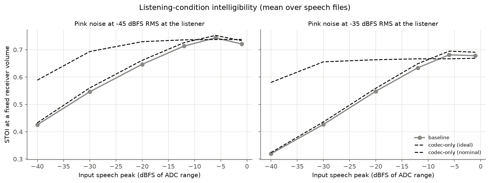

The speech sweep's decoded audio at its own level (a fixed receiver volume, no normalisation) with pink noise added at the listener, STOI against the clean source. Worst: the lowest mean STOI over the input and noise levels; deficit: codec-only (ideal) minus the variant in the same cell, at its largest.

| variant | mean STOI | Δ | worst STOI | at input / noise dBFS | Δ | worst deficit vs ideal |
|---|---|---|---|---|---|---|
| baseline | 0.590 |  | 0.320 | -40 / -35 |  | 0.261 |

Noise -45 dBFS: STOI by input peak, Δ vs baseline in brackets:

| variant | -40 dBFS | -30 dBFS | -20 dBFS | -12 dBFS | -6 dBFS | -1 dBFS |
|---|---|---|---|---|---|---|
| baseline | 0.425 | 0.546 | 0.647 | 0.713 | 0.744 | 0.721 |
| codec-only (ideal) | 0.589 | 0.693 | 0.730 | 0.736 | 0.738 | 0.738 |
| codec-only (nominal) | 0.433 | 0.560 | 0.661 | 0.726 | 0.752 | 0.733 |

Noise -35 dBFS: STOI by input peak, Δ vs baseline in brackets:

| variant | -40 dBFS | -30 dBFS | -20 dBFS | -12 dBFS | -6 dBFS | -1 dBFS |
|---|---|---|---|---|---|---|
| baseline | 0.320 | 0.427 | 0.548 | 0.634 | 0.681 | 0.678 |
| codec-only (ideal) | 0.580 | 0.656 | 0.663 | 0.667 | 0.667 | 0.669 |
| codec-only (nominal) | 0.324 | 0.436 | 0.559 | 0.649 | 0.695 | 0.691 |

## Silence and gate

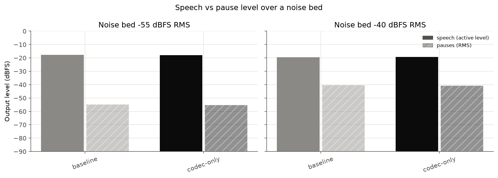

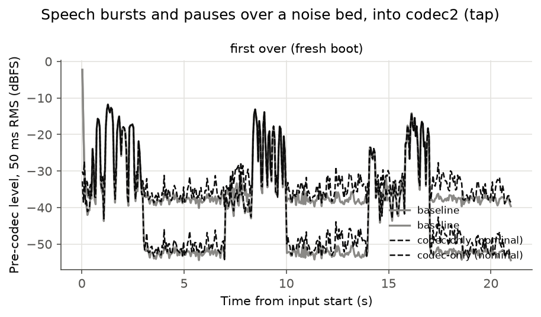

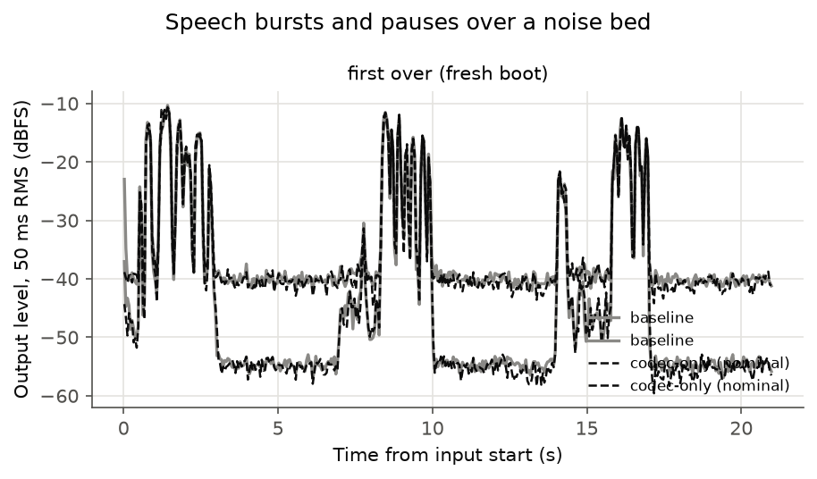

Pause level is the RMS in the pauses, 0.3 s in from each edge; drift is the last second of a pause against its first (positive: the noise is pumped up during the pause); trend is the last pause against the first.

| variant | noise dBFS | where | speech dBFS | pause dBFS | speech/pause dB | drift dB | worst drift dB | trend dB |
|---|---|---|---|---|---|---|---|---|
| baseline | -55 | pre-codec | -16.2 | -52.3 | 36.0 | -0.2 | 0.2 | 0.1 |
| baseline | -55 | output | -17.7 | -54.6 | 37.0 | -0.1 | 0.1 | 0.0 |
| codec-only (nominal) | -55 | pre-codec | -20.9 | -49.3 | 28.4 | -0.1 | 1.7 | 1.9 |
| codec-only (nominal) | -55 | output | -17.8 | -55.2 | 37.3 | -0.3 | 0.8 | -0.6 |
| baseline | -40 | pre-codec | -16.4 | -37.6 | 21.3 | -0.2 | 0.2 | 0.2 |
| baseline | -40 | output | -19.6 | -40.2 | 20.6 | -0.2 | 0.0 | -0.1 |
| codec-only (nominal) | -40 | pre-codec | -21.1 | -34.4 | 13.4 | 0.0 | 1.9 | 1.9 |
| codec-only (nominal) | -40 | output | -19.2 | -40.7 | 21.4 | 0.1 | 0.9 | -0.4 |

