# M17 microphone chain: emulator campaign

OpenRTX `v0.4.5-54-gf50482756` (private/mic-exp), profile **mduv3x0** (oversample 8, gain 32, 12-bit ADC, noise 2.0 LSB RMS). Run 2026-11-15T22:45:19+00:00 to 2026-11-15T22:48:48+00:00, suite `0dd602b9be`.

How the bench works, what each metric means and its limits: [METHODS.md](METHODS.md). Raw tables are in `data/`, provenance in `run.json`.

Variants:

- **full**: `-DMIC_EXP_PRIME_DC` `-DMIC_EXP_KEEP_SUM` `-DMIC_EXP_HPF` `-DMIC_EXP_AGC`

## Headline

Δ columns are the variant minus baseline. Spread: active speech level, max − min over the input levels (lower is a steadier level), into codec2 (pre-codec, from the tap) and after it. Attack and release are from the pre-codec envelope. STOI deficit: codec-only (ideal) STOI minus the variant's, mean over takes (lower is better). Step and gate figures are described under their tests.

| variant | pre-codec spread dB | Δ | spread dB | Δ | STOI | Δ | STOI deficit | Δ | listening STOI worst | Δ | listening deficit worst | Δ | pre-codec onset dBFS | Δ | onset dBFS | Δ | pre-codec clip max % | attack s | release s | speech/pause dB | Δ | pause drift dB | Δ |
|---|---|---|---|---|---|---|---|---|---|---|---|---|---|---|---|---|---|---|---|---|---|---|---|
| full | 12.1 |  | 7.9 |  | 0.719 |  | 0.022 |  | 0.534 |  | 0.059 |  | -48.3 |  | -45.3 |  | 0.00 | 0.25 | 4.50 | 26.4 |  | 3.1 |  |

## Speech level sweep

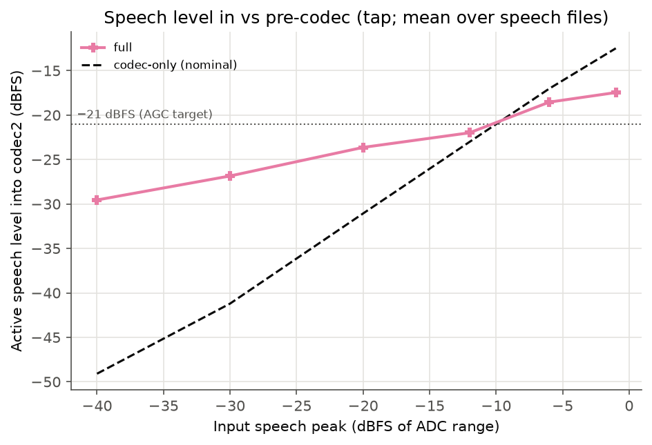

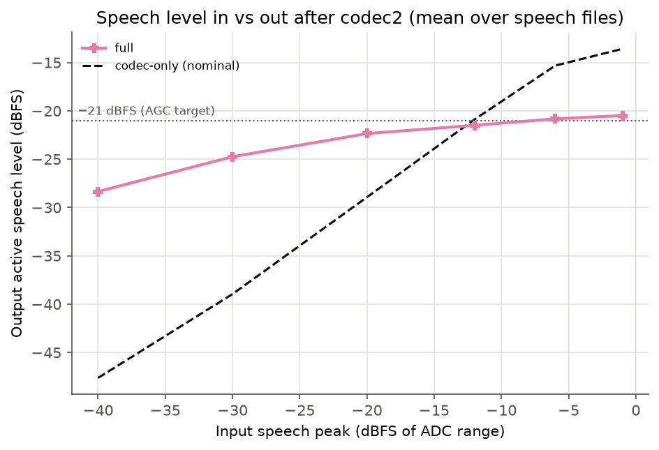

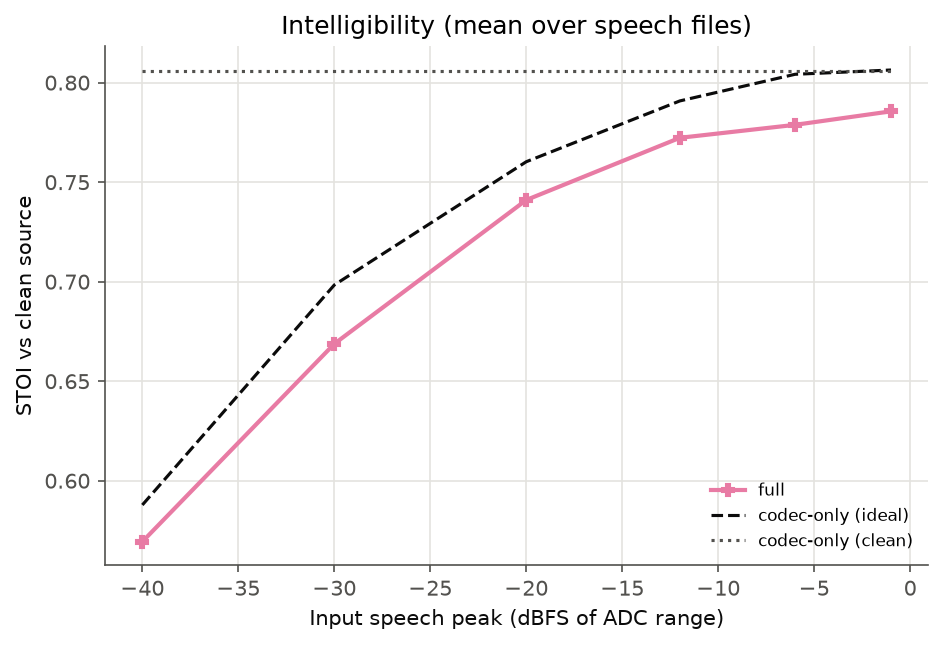

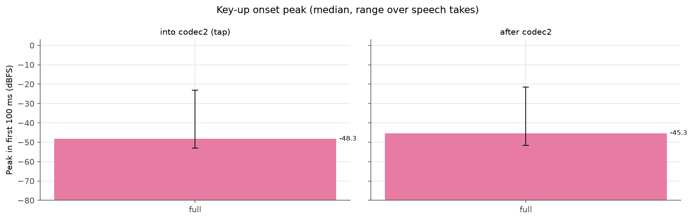

Pre-codec active level (dBFS, tap), mean over speech files, Δ vs baseline in brackets:

| variant | -40 dBFS | -30 dBFS | -20 dBFS | -12 dBFS | -6 dBFS | -1 dBFS |
|---|---|---|---|---|---|---|
| full | -29.6 | -26.8 | -23.6 | -22.0 | -18.5 | -17.5 |
| codec-only (nominal) | -49.1 | -41.2 | -31.1 | -23.0 | -17.0 | -12.5 |
| codec-only (ideal) | -24.0 | -21.3 | -21.0 | -21.0 | -21.0 | -21.0 |

Output active level (dBFS), mean over speech files, Δ vs baseline in brackets:

| variant | -40 dBFS | -30 dBFS | -20 dBFS | -12 dBFS | -6 dBFS | -1 dBFS |
|---|---|---|---|---|---|---|
| full | -28.3 | -24.7 | -22.3 | -21.5 | -20.8 | -20.5 |
| codec-only (nominal) | -47.6 | -39.0 | -28.9 | -20.9 | -15.3 | -13.6 |
| codec-only (ideal) | -23.0 | -18.8 | -18.8 | -19.0 | -18.9 | -18.8 |

STOI, mean over speech files, Δ vs baseline in brackets:

| variant | -40 dBFS | -30 dBFS | -20 dBFS | -12 dBFS | -6 dBFS | -1 dBFS |
|---|---|---|---|---|---|---|
| full | 0.569 | 0.669 | 0.741 | 0.772 | 0.779 | 0.786 |
| codec-only (nominal) | 0.589 | 0.699 | 0.758 | 0.791 | 0.795 | 0.761 |
| codec-only (ideal) | 0.588 | 0.698 | 0.760 | 0.791 | 0.804 | 0.806 |

Pre-codec clip, % of the samples codec2 receives at int16 full scale, measured at the tap (in brackets, the integer-chain model as a cross-check, where it applies):

| variant | -40 dBFS | -30 dBFS | -20 dBFS | -12 dBFS | -6 dBFS | -1 dBFS |
|---|---|---|---|---|---|---|
| full | 0.00 | 0.00 | 0.00 | 0.00 | 0.00 | 0.00 |
| codec-only (nominal) | 0.00 (0.00) | 0.00 (0.00) | 0.00 (0.00) | 0.00 (0.00) | 0.00 (0.00) | 0.78 (0.74) |

## Static level curve (tones)

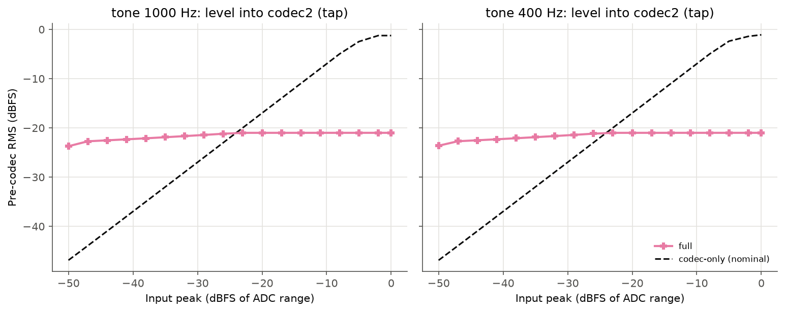

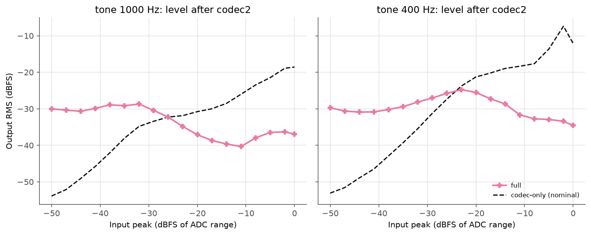

tone 1000 Hz: pre-codec RMS (dBFS, tap) by input peak (dBFS of ADC range).

| variant | -50 | -47 | -44 | -41 | -38 | -35 | -32 | -29 | -26 | -23 | -20 | -17 | -14 | -11 | -8 | -5 | -2 | +0 |
|---|---|---|---|---|---|---|---|---|---|---|---|---|---|---|---|---|---|---|
| full | -23.7 | -22.7 | -22.5 | -22.3 | -22.1 | -21.9 | -21.7 | -21.4 | -21.2 | -21.0 | -21.0 | -21.0 | -21.0 | -21.0 | -21.0 | -21.0 | -21.0 | -21.0 |
| codec-only (nominal) | -46.9 | -43.9 | -41.0 | -38.0 | -35.0 | -32.0 | -29.0 | -26.0 | -23.0 | -20.0 | -17.0 | -14.0 | -11.0 | -8.0 | -5.0 | -2.5 | -1.2 | -1.2 |

tone 1000 Hz: output RMS after codec2 (dBFS) by input peak (dBFS of ADC range). codec2 alone loses level on pure tones, so read the output against the codec-only row.

| variant | -50 | -47 | -44 | -41 | -38 | -35 | -32 | -29 | -26 | -23 | -20 | -17 | -14 | -11 | -8 | -5 | -2 | +0 |
|---|---|---|---|---|---|---|---|---|---|---|---|---|---|---|---|---|---|---|
| full | -30.0 | -30.4 | -30.7 | -29.9 | -28.9 | -29.1 | -28.7 | -30.4 | -32.3 | -34.8 | -37.1 | -38.7 | -39.6 | -40.3 | -37.9 | -36.5 | -36.3 | -36.9 |
| codec-only (nominal) | -53.9 | -52.1 | -49.1 | -45.8 | -42.0 | -38.1 | -34.8 | -33.4 | -32.3 | -31.9 | -30.8 | -30.0 | -28.5 | -26.0 | -23.5 | -21.5 | -18.9 | -18.6 |

tone 400 Hz: pre-codec RMS (dBFS, tap) by input peak (dBFS of ADC range).

| variant | -50 | -47 | -44 | -41 | -38 | -35 | -32 | -29 | -26 | -23 | -20 | -17 | -14 | -11 | -8 | -5 | -2 | +0 |
|---|---|---|---|---|---|---|---|---|---|---|---|---|---|---|---|---|---|---|
| full | -23.6 | -22.7 | -22.5 | -22.3 | -22.1 | -21.9 | -21.7 | -21.4 | -21.2 | -21.0 | -21.0 | -21.0 | -21.0 | -21.0 | -21.0 | -21.0 | -21.0 | -21.0 |
| codec-only (nominal) | -46.9 | -43.9 | -41.0 | -38.0 | -35.0 | -32.0 | -29.0 | -26.0 | -23.0 | -20.0 | -17.0 | -14.0 | -11.0 | -8.0 | -5.0 | -2.4 | -1.4 | -1.1 |

tone 400 Hz: output RMS after codec2 (dBFS) by input peak (dBFS of ADC range). codec2 alone loses level on pure tones, so read the output against the codec-only row.

| variant | -50 | -47 | -44 | -41 | -38 | -35 | -32 | -29 | -26 | -23 | -20 | -17 | -14 | -11 | -8 | -5 | -2 | +0 |
|---|---|---|---|---|---|---|---|---|---|---|---|---|---|---|---|---|---|---|
| full | -29.7 | -30.6 | -30.9 | -30.8 | -30.2 | -29.4 | -28.2 | -27.0 | -25.8 | -24.7 | -25.5 | -27.3 | -28.7 | -31.6 | -32.7 | -32.9 | -33.4 | -34.6 |
| codec-only (nominal) | -53.1 | -51.6 | -48.9 | -46.5 | -42.9 | -39.3 | -35.5 | -31.3 | -27.4 | -23.8 | -21.3 | -20.2 | -18.9 | -18.3 | -17.7 | -13.6 | -7.4 | -12.1 |

## Level step (AGC dynamics)

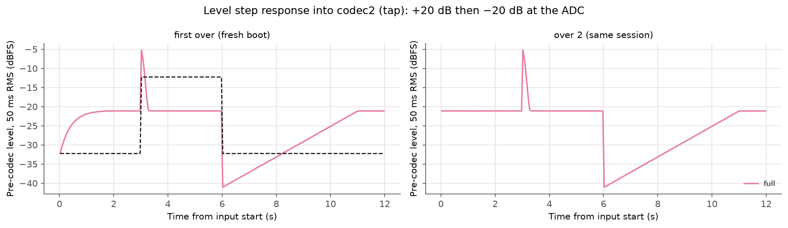

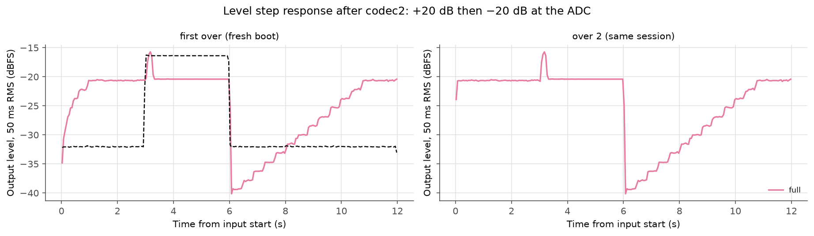

Settled levels are medians of the 50 ms envelope; attack and release are the time to stay within 2 dB of the settled level after each step; rise is the output step for the +20 dB input step (20 dB for a linear chain).

| variant | over | where | before dBFS | loud dBFS | after dBFS | rise dB | attack s | overshoot dB | release s | dip dB | release dB/s |
|---|---|---|---|---|---|---|---|---|---|---|---|
| full | 1 | pre-codec | -21.1 | -21.1 | -21.1 | 0.0 | 0.25 | 15.9 | 4.50 | 19.9 | 4.0 |
| full | 1 | output | -20.6 | -20.4 | -20.7 | 0.2 | 0.25 | 4.7 | 4.35 | 19.5 | 4.0 |
| codec-only (nominal) | 1 | pre-codec | -32.2 | -12.2 | -32.2 | 20.0 | 0.00 | 0.0 | 0.00 | 0.0 | — |
| codec-only (nominal) | 1 | output | -32.0 | -16.4 | -32.0 | 15.7 | 0.00 | 0.1 | 0.00 | 0.0 | — |
| full | 2 | pre-codec | -21.1 | -21.1 | -21.1 | 0.0 | 0.25 | 15.9 | 4.50 | 19.9 | 4.0 |
| full | 2 | output | -20.6 | -20.4 | -20.7 | 0.2 | 0.25 | 4.7 | 4.35 | 19.5 | 4.0 |

## Listening-condition intelligibility

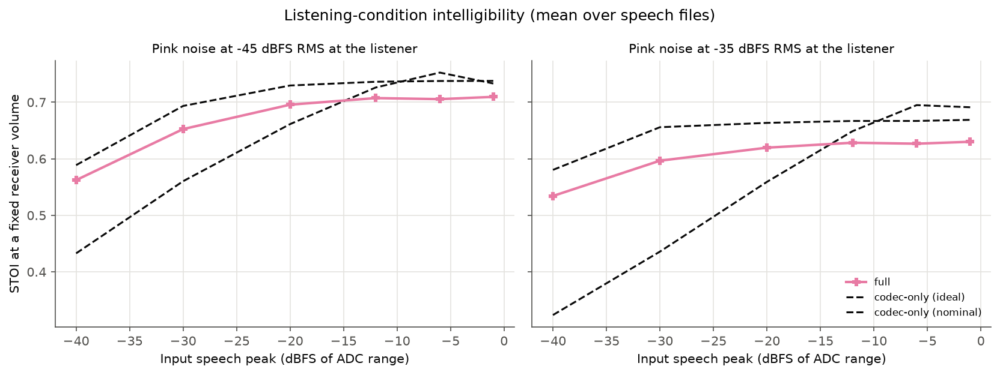

The speech sweep's decoded audio at its own level (a fixed receiver volume, no normalisation) with pink noise added at the listener, STOI against the clean source. Worst: the lowest mean STOI over the input and noise levels; deficit: codec-only (ideal) minus the variant in the same cell, at its largest.

| variant | mean STOI | Δ | worst STOI | at input / noise dBFS | Δ | worst deficit vs ideal |
|---|---|---|---|---|---|---|
| full | 0.639 |  | 0.534 | -40 / -35 |  | 0.059 |

Noise -45 dBFS: STOI by input peak, Δ vs baseline in brackets:

| variant | -40 dBFS | -30 dBFS | -20 dBFS | -12 dBFS | -6 dBFS | -1 dBFS |
|---|---|---|---|---|---|---|
| full | 0.562 | 0.652 | 0.696 | 0.707 | 0.705 | 0.709 |
| codec-only (ideal) | 0.589 | 0.693 | 0.730 | 0.736 | 0.738 | 0.738 |
| codec-only (nominal) | 0.433 | 0.560 | 0.661 | 0.726 | 0.752 | 0.733 |

Noise -35 dBFS: STOI by input peak, Δ vs baseline in brackets:

| variant | -40 dBFS | -30 dBFS | -20 dBFS | -12 dBFS | -6 dBFS | -1 dBFS |
|---|---|---|---|---|---|---|
| full | 0.534 | 0.597 | 0.620 | 0.628 | 0.627 | 0.630 |
| codec-only (ideal) | 0.580 | 0.656 | 0.663 | 0.667 | 0.667 | 0.669 |
| codec-only (nominal) | 0.324 | 0.436 | 0.559 | 0.649 | 0.695 | 0.691 |

## Silence and gate

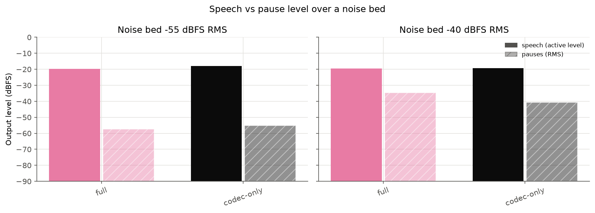

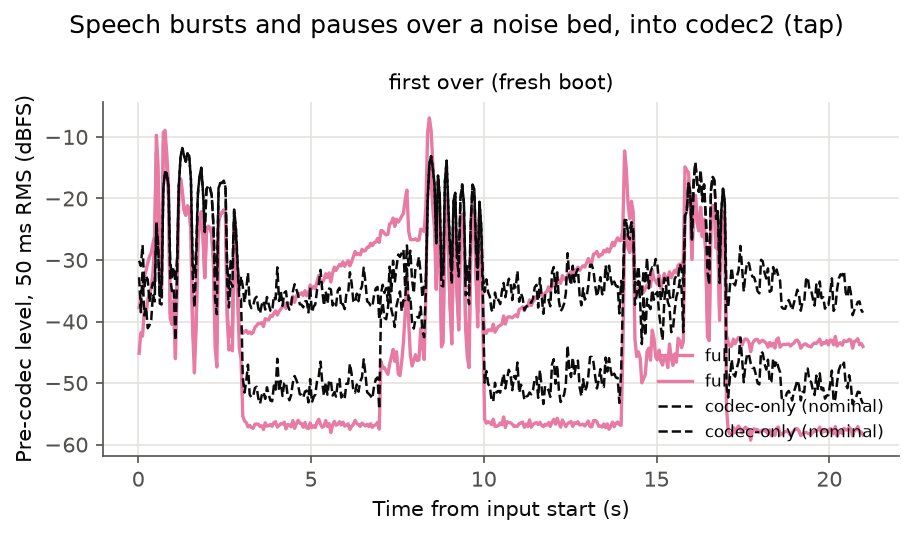

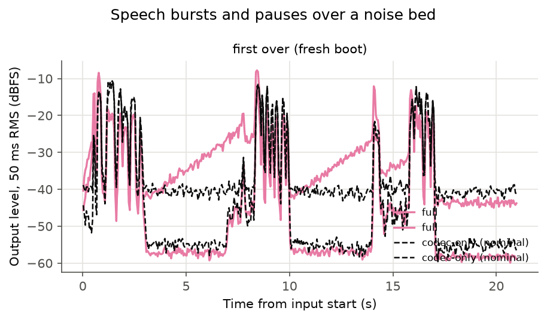

Pause level is the RMS in the pauses, 0.3 s in from each edge; drift is the last second of a pause against its first (positive: the noise is pumped up during the pause); trend is the last pause against the first.

| variant | noise dBFS | where | speech dBFS | pause dBFS | speech/pause dB | drift dB | worst drift dB | trend dB |
|---|---|---|---|---|---|---|---|---|
| full | -55 | pre-codec | -20.0 | -57.1 | 37.1 | 0.0 | 0.1 | -1.0 |
| full | -55 | output | -19.7 | -57.4 | 37.7 | -0.1 | 0.0 | -1.1 |
| codec-only (nominal) | -55 | pre-codec | -20.9 | -49.3 | 28.4 | -0.1 | 1.7 | 1.9 |
| codec-only (nominal) | -55 | output | -17.8 | -55.2 | 37.3 | -0.3 | 0.8 | -0.6 |
| full | -40 | pre-codec | -20.2 | -34.4 | 14.2 | 6.4 | 9.6 | -10.6 |
| full | -40 | output | -19.5 | -34.6 | 15.0 | 6.4 | 9.7 | -10.6 |
| codec-only (nominal) | -40 | pre-codec | -21.1 | -34.4 | 13.4 | 0.0 | 1.9 | 1.9 |
| codec-only (nominal) | -40 | output | -19.2 | -40.7 | 21.4 | 0.1 | 0.9 | -0.4 |

