# M17 microphone chain: emulator campaign

OpenRTX `v0.4.5-54-gf50482756` (private/mic-exp), profile **mduv3x0** (oversample 8, gain 32, 12-bit ADC, noise 2.0 LSB RMS). Run 2026-11-15T22:27:36+00:00 to 2026-11-15T22:55:49+00:00, suite `0dd602b9be`.

How the bench works, what each metric means and its limits: [METHODS.md](METHODS.md). Raw tables are in `data/`, provenance in `run.json`.

Variants:

- **baseline**: no extra defines
- **prime_dc**: `-DMIC_EXP_PRIME_DC`
- **keep_sum**: `-DMIC_EXP_KEEP_SUM`
- **hpf**: `-DMIC_EXP_HPF`
- **agc**: `-DMIC_EXP_AGC`
- **full**: `-DMIC_EXP_PRIME_DC` `-DMIC_EXP_KEEP_SUM` `-DMIC_EXP_HPF` `-DMIC_EXP_AGC`
- **agc_slow**: `-DMIC_EXP_AGC` `-DMIC_EXP_AGC_FASTDOWN=0.0f` `-DMIC_EXP_AGC_ATTACK=0.1f`
- **agc_mid**: `-DMIC_EXP_AGC` `-DMIC_EXP_AGC_FASTDOWN=0.0f` `-DMIC_EXP_AGC_ATTACK=0.3f` `-DMIC_EXP_AGC_KNEE=-3.0f`

## Headline

Δ columns are the variant minus baseline. Spread: active speech level, max − min over the input levels (lower is a steadier level), into codec2 (pre-codec, from the tap) and after it. Attack and release are from the pre-codec envelope. STOI deficit: codec-only (ideal) STOI minus the variant's, mean over takes (lower is better). Step and gate figures are described under their tests.

| variant | pre-codec spread dB | Δ | spread dB | Δ | STOI | Δ | STOI deficit | Δ | listening STOI worst | Δ | listening deficit worst | Δ | pre-codec onset dBFS | Δ | onset dBFS | Δ | pre-codec clip max % | attack s | release s | speech/pause dB | Δ | pause drift dB | Δ |
|---|---|---|---|---|---|---|---|---|---|---|---|---|---|---|---|---|---|---|---|---|---|---|---|
| baseline | 35.7 |  | 34.3 |  | 0.717 |  | 0.025 |  | 0.320 |  | 0.261 |  | 0.0 |  | -8.3 |  | 1.81 | 0.00 | 0.00 | 28.8 |  | -0.2 |  |
| prime_dc | 36.6 | +1.0 | 34.2 | -0.1 | 0.719 | +0.002 | 0.022 | -0.002 | 0.320 | +0.001 | 0.260 | -0.001 | -42.7 | -42.7 | -47.2 | -38.9 | 1.80 | 0.00 | 0.00 | 28.7 | -0.0 | -0.1 | +0.1 |
| keep_sum | 35.6 | -0.1 | 34.2 | -0.0 | 0.721 | +0.005 | 0.020 | -0.005 | 0.316 | -0.003 | 0.264 | +0.003 | 0.0 | +0.0 | -8.3 | +0.0 | 1.80 | 0.00 | 0.00 | 28.8 | +0.0 | -0.1 | +0.0 |
| hpf | 37.5 | +1.8 | 34.3 | +0.1 | 0.721 | +0.004 | 0.021 | -0.004 | 0.317 | -0.003 | 0.264 | +0.003 | 0.0 | +0.0 | -11.5 | -3.2 | 1.66 | 0.00 | 0.00 | 29.0 | +0.2 | -0.1 | +0.1 |
| agc | 8.6 | -27.1 | 7.3 | -27.0 | 0.710 | -0.007 | 0.031 | +0.007 | 0.501 | +0.182 | 0.079 | -0.182 | -1.0 | -1.0 | -8.3 | +0.0 | 0.00 | 0.15 | 4.50 | 24.8 | -4.0 | 3.8 | +3.9 |
| full | 12.1 | -23.6 | 7.9 | -26.4 | 0.719 | +0.003 | 0.022 | -0.003 | 0.534 | +0.215 | 0.059 | -0.202 | -48.3 | -48.3 | -45.3 | -37.0 | 0.00 | 0.25 | 4.50 | 26.4 | -2.4 | 3.1 | +3.3 |
| agc_slow | 17.0 | -18.7 | 14.0 | -20.3 | 0.702 | -0.015 | 0.039 | +0.015 | 0.510 | +0.190 | 0.071 | -0.190 | -1.0 | -1.0 | -8.3 | +0.0 | 0.00 | did not settle | 3.45 | 27.4 | -1.3 | 3.5 | +3.7 |
| agc_mid | 13.3 | -22.3 | 10.8 | -23.5 | 0.713 | -0.004 | 0.028 | +0.004 | 0.515 | +0.196 | 0.065 | -0.196 | -1.0 | -1.0 | -8.3 | +0.0 | 0.00 | 1.20 | 4.50 | 28.4 | -0.4 | 3.8 | +3.9 |

## Speech level sweep

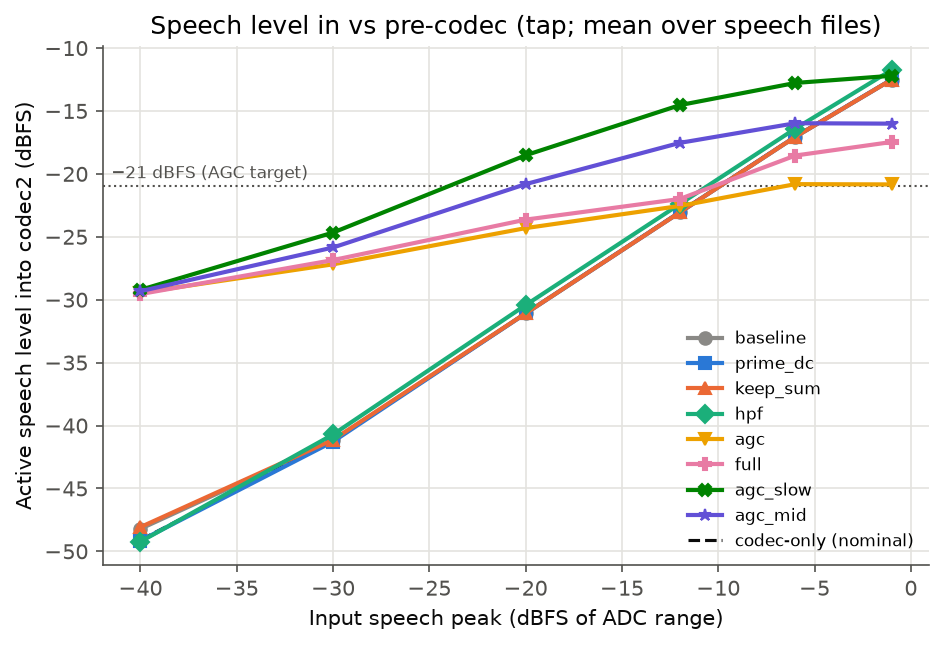

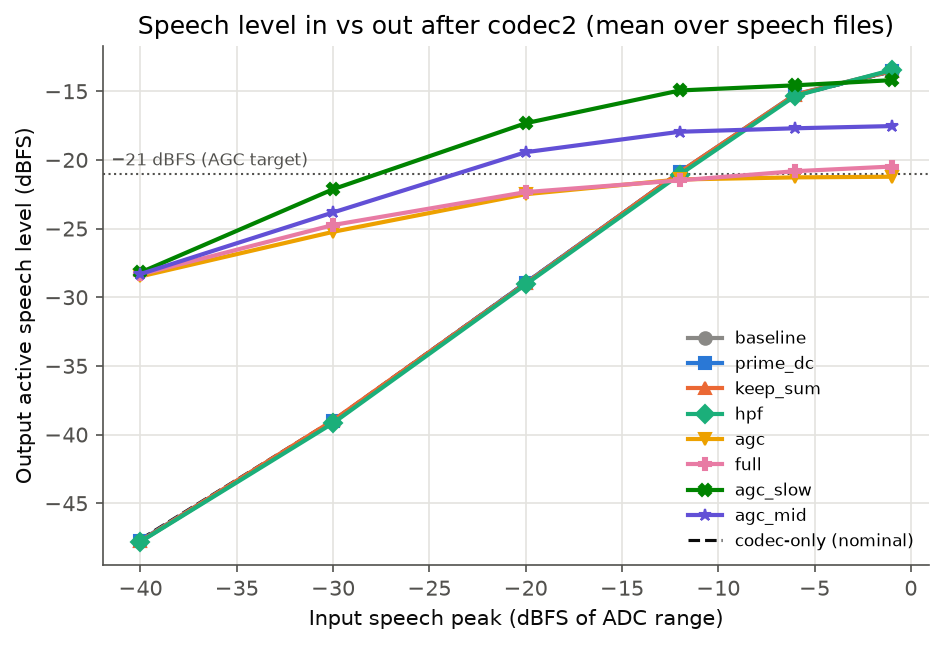

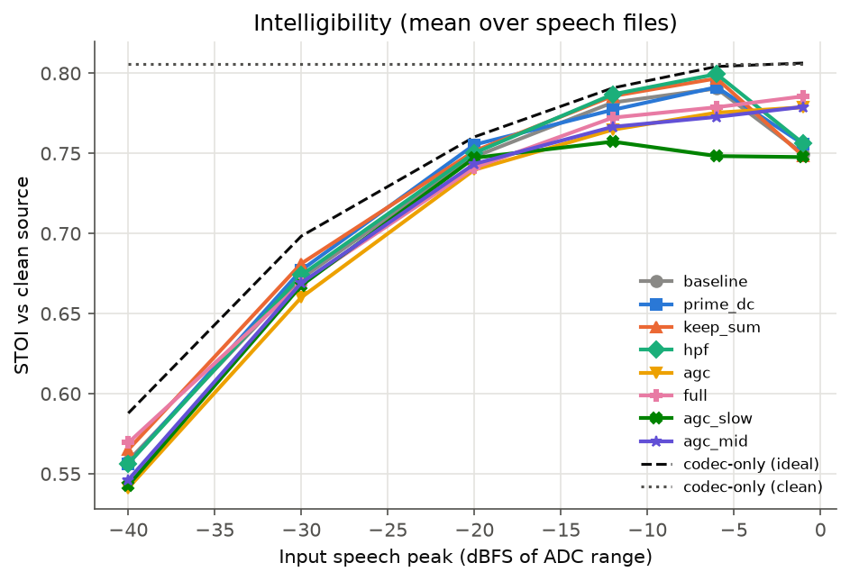

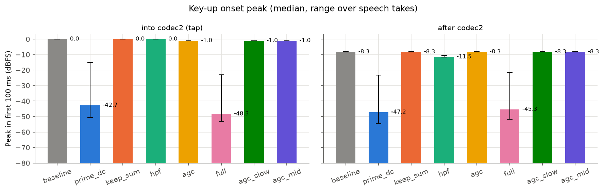

Pre-codec active level (dBFS, tap), mean over speech files, Δ vs baseline in brackets:

| variant | -40 dBFS | -30 dBFS | -20 dBFS | -12 dBFS | -6 dBFS | -1 dBFS |
|---|---|---|---|---|---|---|
| baseline | -48.2 | -41.2 | -31.1 | -23.1 | -17.1 | -12.5 |
| prime_dc | -49.2 (-0.9) | -41.3 (-0.1) | -31.1 (+0.0) | -23.1 (+0.0) | -17.0 (+0.0) | -12.5 (+0.0) |
| keep_sum | -48.1 (+0.1) | -41.1 (+0.0) | -31.1 (+0.0) | -23.1 (+0.0) | -17.1 (+0.0) | -12.5 (+0.0) |
| hpf | -49.2 (-1.0) | -40.7 (+0.5) | -30.4 (+0.7) | -22.4 (+0.7) | -16.4 (+0.7) | -11.7 (+0.8) |
| agc | -29.4 (+18.8) | -27.2 (+14.0) | -24.3 (+6.8) | -22.5 (+0.5) | -20.8 (-3.8) | -20.8 (-8.3) |
| full | -29.6 (+18.7) | -26.8 (+14.3) | -23.6 (+7.5) | -22.0 (+1.1) | -18.5 (-1.5) | -17.5 (-5.0) |
| agc_slow | -29.2 (+19.0) | -24.7 (+16.5) | -18.5 (+12.6) | -14.5 (+8.5) | -12.8 (+4.3) | -12.2 (+0.3) |
| agc_mid | -29.3 (+18.9) | -25.9 (+15.3) | -20.8 (+10.3) | -17.5 (+5.5) | -16.0 (+1.1) | -16.0 (-3.5) |
| codec-only (nominal) | -49.1 | -41.2 | -31.1 | -23.0 | -17.0 | -12.5 |
| codec-only (ideal) | -24.0 | -21.3 | -21.0 | -21.0 | -21.0 | -21.0 |

Output active level (dBFS), mean over speech files, Δ vs baseline in brackets:

| variant | -40 dBFS | -30 dBFS | -20 dBFS | -12 dBFS | -6 dBFS | -1 dBFS |
|---|---|---|---|---|---|---|
| baseline | -47.8 | -39.0 | -29.0 | -20.9 | -15.2 | -13.5 |
| prime_dc | -47.7 (+0.1) | -39.0 (+0.0) | -29.0 (+0.0) | -20.9 (+0.0) | -15.3 (-0.0) | -13.5 (-0.0) |
| keep_sum | -47.8 (+0.0) | -39.0 (+0.1) | -29.0 (-0.0) | -20.9 (+0.0) | -15.2 (-0.0) | -13.5 (-0.0) |
| hpf | -47.8 (-0.0) | -39.2 (-0.1) | -29.1 (-0.1) | -21.1 (-0.2) | -15.3 (-0.1) | -13.5 (+0.1) |
| agc | -28.5 (+19.3) | -25.2 (+13.8) | -22.5 (+6.5) | -21.4 (-0.5) | -21.3 (-6.0) | -21.2 (-7.7) |
| full | -28.3 (+19.4) | -24.7 (+14.3) | -22.3 (+6.6) | -21.5 (-0.6) | -20.8 (-5.6) | -20.5 (-7.0) |
| agc_slow | -28.2 (+19.6) | -22.1 (+16.9) | -17.3 (+11.7) | -14.9 (+6.0) | -14.6 (+0.7) | -14.2 (-0.7) |
| agc_mid | -28.3 (+19.5) | -23.8 (+15.2) | -19.4 (+9.5) | -17.9 (+3.0) | -17.7 (-2.5) | -17.5 (-4.0) |
| codec-only (nominal) | -47.6 | -39.0 | -28.9 | -20.9 | -15.3 | -13.6 |
| codec-only (ideal) | -23.0 | -18.8 | -18.8 | -19.0 | -18.9 | -18.8 |

STOI, mean over speech files, Δ vs baseline in brackets:

| variant | -40 dBFS | -30 dBFS | -20 dBFS | -12 dBFS | -6 dBFS | -1 dBFS |
|---|---|---|---|---|---|---|
| baseline | 0.558 | 0.672 | 0.748 | 0.782 | 0.790 | 0.750 |
| prime_dc | 0.556 (-0.002) | 0.677 (+0.005) | 0.755 (+0.008) | 0.777 (-0.005) | 0.791 (+0.001) | 0.756 (+0.006) |
| keep_sum | 0.565 (+0.007) | 0.681 (+0.009) | 0.751 (+0.004) | 0.786 (+0.004) | 0.797 (+0.006) | 0.748 (-0.001) |
| hpf | 0.556 (-0.002) | 0.674 (+0.002) | 0.750 (+0.002) | 0.787 (+0.005) | 0.799 (+0.009) | 0.756 (+0.006) |
| agc | 0.541 (-0.017) | 0.660 (-0.012) | 0.740 (-0.008) | 0.765 (-0.017) | 0.775 (-0.015) | 0.779 (+0.029) |
| full | 0.569 (+0.011) | 0.669 (-0.003) | 0.741 (-0.007) | 0.772 (-0.009) | 0.779 (-0.012) | 0.786 (+0.036) |
| agc_slow | 0.543 (-0.015) | 0.668 (-0.004) | 0.747 (-0.001) | 0.757 (-0.024) | 0.748 (-0.042) | 0.748 (-0.002) |
| agc_mid | 0.546 (-0.012) | 0.669 (-0.003) | 0.743 (-0.004) | 0.767 (-0.015) | 0.773 (-0.018) | 0.779 (+0.029) |
| codec-only (nominal) | 0.589 | 0.699 | 0.758 | 0.791 | 0.795 | 0.761 |
| codec-only (ideal) | 0.588 | 0.698 | 0.760 | 0.791 | 0.804 | 0.806 |

Pre-codec clip, % of the samples codec2 receives at int16 full scale, measured at the tap (in brackets, the integer-chain model as a cross-check, where it applies):

| variant | -40 dBFS | -30 dBFS | -20 dBFS | -12 dBFS | -6 dBFS | -1 dBFS |
|---|---|---|---|---|---|---|
| baseline | 0.00 (0.00) | 0.00 (0.00) | 0.00 (0.00) | 0.00 (0.00) | 0.00 (0.00) | 0.77 (0.74) |
| prime_dc | 0.00 (0.00) | 0.00 (0.00) | 0.00 (0.00) | 0.00 (0.00) | 0.00 (0.00) | 0.77 (0.74) |
| keep_sum | 0.00 (0.00) | 0.00 (0.00) | 0.00 (0.00) | 0.00 (0.00) | 0.00 (0.00) | 0.77 (0.74) |
| hpf | 0.00 | 0.00 | 0.00 | 0.00 | 0.00 | 0.65 |
| agc | 0.00 | 0.00 | 0.00 | 0.00 | 0.00 | 0.00 |
| full | 0.00 | 0.00 | 0.00 | 0.00 | 0.00 | 0.00 |
| agc_slow | 0.00 | 0.00 | 0.00 | 0.00 | 0.00 | 0.00 |
| agc_mid | 0.00 | 0.00 | 0.00 | 0.00 | 0.00 | 0.00 |
| codec-only (nominal) | 0.00 (0.00) | 0.00 (0.00) | 0.00 (0.00) | 0.00 (0.00) | 0.00 (0.00) | 0.78 (0.74) |

## Static level curve (tones)

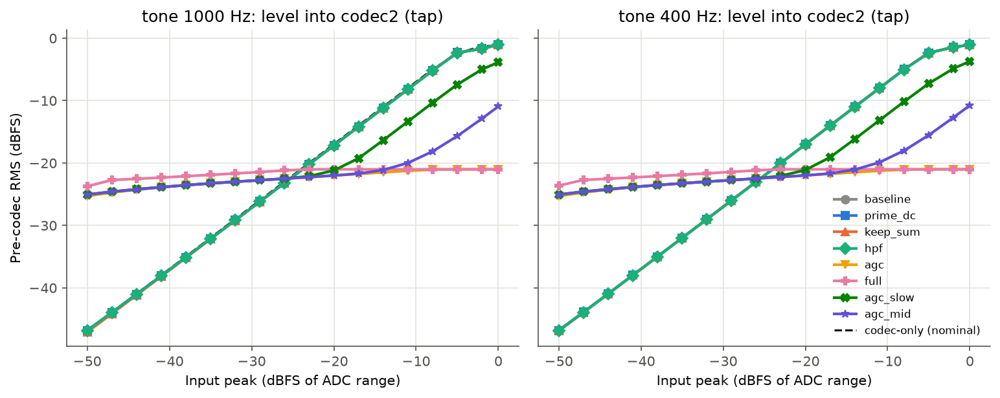

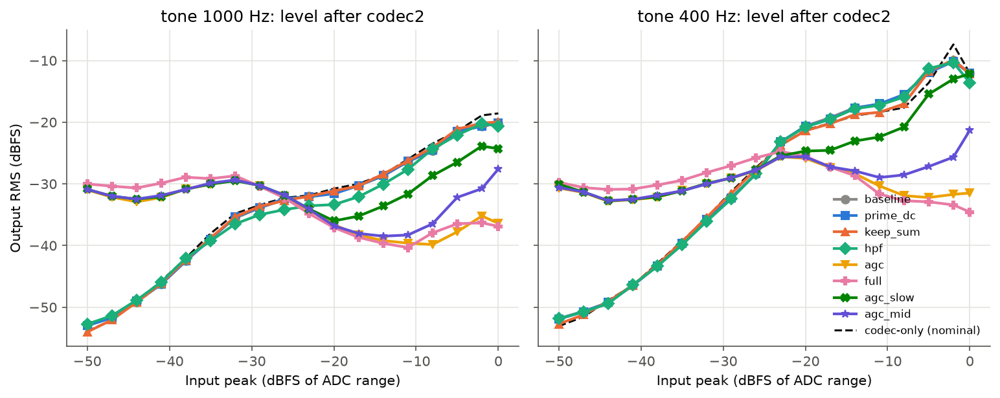

tone 1000 Hz: pre-codec RMS (dBFS, tap) by input peak (dBFS of ADC range).

| variant | -50 | -47 | -44 | -41 | -38 | -35 | -32 | -29 | -26 | -23 | -20 | -17 | -14 | -11 | -8 | -5 | -2 | +0 |
|---|---|---|---|---|---|---|---|---|---|---|---|---|---|---|---|---|---|---|
| baseline | -46.8 | -43.9 | -41.0 | -38.1 | -35.1 | -32.1 | -29.2 | -26.2 | -23.2 | -20.2 | -17.2 | -14.2 | -11.2 | -8.2 | -5.2 | -2.3 | -1.7 | -1.1 |
| prime_dc | -46.8 | -43.9 | -41.0 | -38.1 | -35.1 | -32.1 | -29.2 | -26.2 | -23.2 | -20.2 | -17.2 | -14.2 | -11.2 | -8.2 | -5.2 | -2.3 | -1.7 | -1.1 |
| keep_sum | -47.1 | -44.1 | -41.2 | -38.2 | -35.2 | -32.2 | -29.2 | -26.2 | -23.2 | -20.2 | -17.2 | -14.2 | -11.2 | -8.2 | -5.2 | -2.3 | -1.7 | -1.1 |
| hpf | -46.8 | -43.9 | -41.0 | -38.1 | -35.1 | -32.1 | -29.2 | -26.2 | -23.2 | -20.2 | -17.2 | -14.2 | -11.2 | -8.2 | -5.2 | -2.4 | -1.6 | -1.0 |
| agc | -25.3 | -24.7 | -24.3 | -23.9 | -23.5 | -23.3 | -23.0 | -22.7 | -22.5 | -22.3 | -22.0 | -21.7 | -21.5 | -21.2 | -21.1 | -21.0 | -21.0 | -21.0 |
| full | -23.7 | -22.7 | -22.5 | -22.3 | -22.1 | -21.9 | -21.7 | -21.4 | -21.2 | -21.0 | -21.0 | -21.0 | -21.0 | -21.0 | -21.0 | -21.0 | -21.0 | -21.0 |
| agc_slow | -25.0 | -24.6 | -24.2 | -23.9 | -23.5 | -23.3 | -23.0 | -22.7 | -22.5 | -22.1 | -21.2 | -19.2 | -16.3 | -13.4 | -10.3 | -7.4 | -5.0 | -3.8 |
| agc_mid | -25.1 | -24.6 | -24.2 | -23.9 | -23.5 | -23.3 | -23.0 | -22.7 | -22.5 | -22.3 | -22.0 | -21.7 | -21.1 | -20.0 | -18.1 | -15.7 | -12.9 | -10.9 |
| codec-only (nominal) | -46.9 | -43.9 | -41.0 | -38.0 | -35.0 | -32.0 | -29.0 | -26.0 | -23.0 | -20.0 | -17.0 | -14.0 | -11.0 | -8.0 | -5.0 | -2.5 | -1.2 | -1.2 |

tone 1000 Hz: output RMS after codec2 (dBFS) by input peak (dBFS of ADC range). codec2 alone loses level on pure tones, so read the output against the codec-only row.

| variant | -50 | -47 | -44 | -41 | -38 | -35 | -32 | -29 | -26 | -23 | -20 | -17 | -14 | -11 | -8 | -5 | -2 | +0 |
|---|---|---|---|---|---|---|---|---|---|---|---|---|---|---|---|---|---|---|
| baseline | -52.8 | -51.7 | -49.2 | -46.3 | -42.5 | -38.8 | -35.6 | -33.9 | -32.6 | -32.0 | -31.4 | -30.3 | -28.7 | -26.4 | -24.7 | -21.5 | -20.6 | -20.2 |
| prime_dc | -53.0 | -51.7 | -49.0 | -46.2 | -42.5 | -39.0 | -35.4 | -33.9 | -32.4 | -32.1 | -31.6 | -30.3 | -28.7 | -26.4 | -24.5 | -21.5 | -20.7 | -20.1 |
| keep_sum | -54.0 | -52.1 | -49.2 | -46.1 | -42.3 | -38.8 | -35.3 | -33.6 | -32.7 | -32.0 | -31.2 | -30.3 | -28.4 | -26.3 | -24.1 | -21.1 | -20.1 | -20.0 |
| hpf | -52.7 | -51.4 | -48.9 | -45.9 | -42.0 | -39.3 | -36.5 | -35.0 | -34.2 | -33.6 | -33.4 | -32.1 | -30.1 | -27.7 | -24.4 | -22.1 | -20.3 | -20.6 |
| agc | -31.0 | -32.2 | -32.9 | -32.2 | -30.8 | -30.1 | -29.4 | -30.3 | -32.0 | -34.3 | -36.6 | -38.3 | -39.2 | -39.6 | -39.8 | -37.8 | -35.2 | -36.4 |
| full | -30.0 | -30.4 | -30.7 | -29.9 | -28.9 | -29.1 | -28.7 | -30.4 | -32.3 | -34.8 | -37.1 | -38.7 | -39.6 | -40.3 | -37.9 | -36.5 | -36.3 | -36.9 |
| agc_slow | -30.9 | -32.0 | -32.5 | -32.1 | -30.9 | -30.0 | -29.5 | -30.3 | -31.8 | -34.1 | -36.0 | -35.2 | -33.6 | -31.7 | -28.7 | -26.5 | -23.9 | -24.3 |
| agc_mid | -30.9 | -32.0 | -32.5 | -31.9 | -30.9 | -29.9 | -29.4 | -30.3 | -31.8 | -34.1 | -36.8 | -38.0 | -38.5 | -38.3 | -36.5 | -32.2 | -30.8 | -27.6 |
| codec-only (nominal) | -53.9 | -52.1 | -49.1 | -45.8 | -42.0 | -38.1 | -34.8 | -33.4 | -32.3 | -31.9 | -30.8 | -30.0 | -28.5 | -26.0 | -23.5 | -21.5 | -18.9 | -18.6 |

tone 400 Hz: pre-codec RMS (dBFS, tap) by input peak (dBFS of ADC range).

| variant | -50 | -47 | -44 | -41 | -38 | -35 | -32 | -29 | -26 | -23 | -20 | -17 | -14 | -11 | -8 | -5 | -2 | +0 |
|---|---|---|---|---|---|---|---|---|---|---|---|---|---|---|---|---|---|---|
| baseline | -46.8 | -43.9 | -40.9 | -38.0 | -35.0 | -32.0 | -29.0 | -26.0 | -23.0 | -20.0 | -17.0 | -14.0 | -11.0 | -8.0 | -5.0 | -2.3 | -1.5 | -1.1 |
| prime_dc | -46.8 | -43.9 | -40.9 | -38.0 | -35.0 | -32.0 | -29.0 | -26.0 | -23.0 | -20.0 | -17.0 | -14.0 | -11.0 | -8.0 | -5.0 | -2.3 | -1.5 | -1.1 |
| keep_sum | -46.9 | -44.0 | -41.0 | -38.0 | -35.0 | -32.0 | -29.0 | -26.0 | -23.0 | -20.0 | -17.0 | -14.0 | -11.0 | -8.0 | -5.0 | -2.3 | -1.5 | -1.1 |
| hpf | -46.8 | -43.9 | -41.0 | -38.0 | -35.0 | -32.0 | -29.0 | -26.0 | -23.0 | -20.0 | -17.0 | -14.0 | -11.0 | -8.0 | -5.0 | -2.4 | -1.4 | -1.1 |
| agc | -25.3 | -24.7 | -24.3 | -23.9 | -23.5 | -23.2 | -23.0 | -22.7 | -22.5 | -22.2 | -22.0 | -21.7 | -21.5 | -21.2 | -21.1 | -21.0 | -21.0 | -21.0 |
| full | -23.6 | -22.7 | -22.5 | -22.3 | -22.1 | -21.9 | -21.7 | -21.4 | -21.2 | -21.0 | -21.0 | -21.0 | -21.0 | -21.0 | -21.0 | -21.0 | -21.0 | -21.0 |
| agc_slow | -25.0 | -24.6 | -24.2 | -23.8 | -23.5 | -23.2 | -23.0 | -22.7 | -22.5 | -22.1 | -21.1 | -19.1 | -16.2 | -13.2 | -10.2 | -7.3 | -4.9 | -3.7 |
| agc_mid | -25.1 | -24.6 | -24.2 | -23.8 | -23.5 | -23.2 | -23.0 | -22.7 | -22.5 | -22.2 | -22.0 | -21.7 | -21.1 | -19.9 | -18.0 | -15.5 | -12.7 | -10.7 |
| codec-only (nominal) | -46.9 | -43.9 | -41.0 | -38.0 | -35.0 | -32.0 | -29.0 | -26.0 | -23.0 | -20.0 | -17.0 | -14.0 | -11.0 | -8.0 | -5.0 | -2.4 | -1.4 | -1.1 |

tone 400 Hz: output RMS after codec2 (dBFS) by input peak (dBFS of ADC range). codec2 alone loses level on pure tones, so read the output against the codec-only row.

| variant | -50 | -47 | -44 | -41 | -38 | -35 | -32 | -29 | -26 | -23 | -20 | -17 | -14 | -11 | -8 | -5 | -2 | +0 |
|---|---|---|---|---|---|---|---|---|---|---|---|---|---|---|---|---|---|---|
| baseline | -51.8 | -50.7 | -49.3 | -46.4 | -43.4 | -39.6 | -35.9 | -32.2 | -28.4 | -23.3 | -20.6 | -19.3 | -17.6 | -17.1 | -15.5 | -11.9 | -10.0 | -12.0 |
| prime_dc | -51.9 | -50.7 | -49.2 | -46.5 | -43.3 | -39.6 | -35.7 | -32.3 | -28.4 | -23.2 | -20.7 | -19.5 | -17.7 | -17.0 | -15.5 | -11.9 | -10.2 | -12.1 |
| keep_sum | -52.7 | -51.2 | -49.1 | -46.4 | -43.1 | -39.4 | -35.4 | -31.5 | -27.7 | -23.7 | -21.4 | -20.3 | -18.8 | -18.4 | -17.0 | -11.8 | -9.9 | -12.2 |
| hpf | -51.9 | -50.8 | -49.4 | -46.4 | -43.4 | -39.9 | -36.1 | -32.4 | -28.3 | -23.2 | -20.8 | -19.5 | -17.8 | -17.2 | -15.9 | -11.3 | -10.3 | -13.6 |
| agc | -30.7 | -31.4 | -32.8 | -32.6 | -32.2 | -31.1 | -30.0 | -29.0 | -27.9 | -25.6 | -25.9 | -27.3 | -28.3 | -30.3 | -31.9 | -32.2 | -31.7 | -31.5 |
| full | -29.7 | -30.6 | -30.9 | -30.8 | -30.2 | -29.4 | -28.2 | -27.0 | -25.8 | -24.7 | -25.5 | -27.3 | -28.7 | -31.6 | -32.7 | -32.9 | -33.4 | -34.6 |
| agc_slow | -30.1 | -31.3 | -32.8 | -32.5 | -32.1 | -31.2 | -29.9 | -29.1 | -27.7 | -25.5 | -24.7 | -24.6 | -23.1 | -22.4 | -20.8 | -15.5 | -13.0 | -12.1 |
| agc_mid | -30.6 | -31.3 | -32.7 | -32.5 | -31.8 | -31.1 | -30.0 | -29.0 | -27.8 | -25.6 | -25.6 | -27.2 | -27.9 | -29.0 | -28.5 | -27.2 | -25.7 | -21.3 |
| codec-only (nominal) | -53.1 | -51.6 | -48.9 | -46.5 | -42.9 | -39.3 | -35.5 | -31.3 | -27.4 | -23.8 | -21.3 | -20.2 | -18.9 | -18.3 | -17.7 | -13.6 | -7.4 | -12.1 |

## Level step (AGC dynamics)

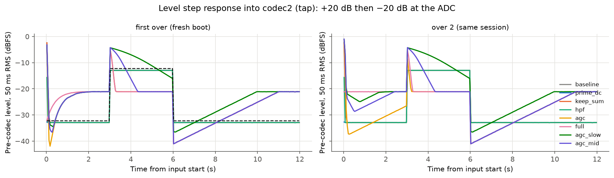

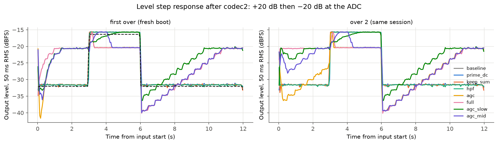

Settled levels are medians of the 50 ms envelope; attack and release are the time to stay within 2 dB of the settled level after each step; rise is the output step for the +20 dB input step (20 dB for a linear chain).

| variant | over | where | before dBFS | loud dBFS | after dBFS | rise dB | attack s | overshoot dB | release s | dip dB | release dB/s |
|---|---|---|---|---|---|---|---|---|---|---|---|
| baseline | 1 | pre-codec | -32.9 | -12.9 | -32.9 | 20.0 | 0.00 | 0.0 | 0.00 | 0.0 | — |
| baseline | 1 | output | -31.6 | -15.7 | -31.5 | 15.9 | 0.00 | 0.1 | 0.05 | 0.6 | — |
| prime_dc | 1 | pre-codec | -32.9 | -12.9 | -32.9 | 20.0 | 0.00 | 0.0 | 0.00 | 0.0 | — |
| prime_dc | 1 | output | -31.6 | -15.7 | -31.5 | 15.9 | 0.00 | 0.1 | 0.05 | 0.6 | — |
| keep_sum | 1 | pre-codec | -32.9 | -12.9 | -32.9 | 20.0 | 0.00 | 0.0 | 0.00 | 0.0 | — |
| keep_sum | 1 | output | -31.6 | -15.7 | -31.5 | 15.9 | 0.00 | 0.1 | 0.00 | 0.7 | — |
| hpf | 1 | pre-codec | -32.9 | -12.9 | -32.9 | 20.0 | 0.00 | 0.0 | 0.00 | 0.0 | — |
| hpf | 1 | output | -31.6 | -15.7 | -31.6 | 15.9 | 0.00 | 0.1 | 0.05 | 0.5 | — |
| agc | 1 | pre-codec | -21.1 | -21.1 | -21.1 | 0.0 | 0.25 | 16.0 | 4.50 | 19.9 | 4.0 |
| agc | 1 | output | -20.7 | -20.4 | -20.6 | 0.3 | 0.25 | 4.7 | 4.30 | 18.9 | 4.0 |
| full | 1 | pre-codec | -21.1 | -21.1 | -21.1 | 0.0 | 0.25 | 15.9 | 4.50 | 19.9 | 4.0 |
| full | 1 | output | -20.6 | -20.4 | -20.7 | 0.2 | 0.25 | 4.7 | 4.35 | 19.5 | 4.0 |
| agc_slow | 1 | pre-codec | -21.1 | -13.4 | -21.1 | 7.7 | did not settle | 9.1 | 3.45 | 15.4 | 4.0 |
| agc_slow | 1 | output | -20.6 | -15.7 | -20.6 | 4.9 | 0.65 | -1.1 | 3.30 | 15.8 | 4.0 |
| agc_mid | 1 | pre-codec | -21.1 | -21.1 | -21.1 | 0.0 | 1.20 | 16.9 | 4.50 | 19.9 | 4.0 |
| agc_mid | 1 | output | -20.6 | -20.4 | -20.6 | 0.2 | 1.20 | 4.8 | 4.30 | 19.3 | 4.0 |
| codec-only (nominal) | 1 | pre-codec | -32.2 | -12.2 | -32.2 | 20.0 | 0.00 | 0.0 | 0.00 | 0.0 | — |
| codec-only (nominal) | 1 | output | -32.0 | -16.4 | -32.0 | 15.7 | 0.00 | 0.1 | 0.00 | 0.0 | — |
| baseline | 2 | pre-codec | -32.9 | -12.9 | -32.9 | 20.0 | 0.00 | 0.0 | 0.00 | 0.0 | — |
| baseline | 2 | output | -31.6 | -15.7 | -31.5 | 15.9 | 0.00 | 0.1 | 0.05 | 0.6 | — |
| prime_dc | 2 | pre-codec | -32.9 | -12.9 | -32.9 | 20.0 | 0.00 | 0.0 | 0.00 | 0.0 | — |
| prime_dc | 2 | output | -31.6 | -15.7 | -31.5 | 15.9 | 0.00 | 0.1 | 0.05 | 0.6 | — |
| keep_sum | 2 | pre-codec | -32.9 | -12.9 | -32.9 | 20.0 | 0.00 | 0.0 | 0.00 | 0.0 | — |
| keep_sum | 2 | output | -31.6 | -15.7 | -31.5 | 15.9 | 0.00 | 0.1 | 0.00 | 0.7 | — |
| hpf | 2 | pre-codec | -32.9 | -12.9 | -32.9 | 20.0 | 0.00 | 0.0 | 0.00 | 0.0 | — |
| hpf | 2 | output | -31.6 | -15.7 | -31.6 | 15.9 | 0.00 | 0.1 | 0.05 | 0.5 | — |
| agc | 2 | pre-codec | -28.6 | -21.1 | -21.1 | 7.5 | 0.15 | 12.6 | 4.50 | 19.9 | 4.0 |
| agc | 2 | output | -28.0 | -20.4 | -20.6 | 7.7 | 0.20 | 4.6 | 4.30 | 18.8 | 4.0 |
| full | 2 | pre-codec | -21.1 | -21.1 | -21.1 | 0.0 | 0.25 | 15.9 | 4.50 | 19.9 | 4.0 |
| full | 2 | output | -20.6 | -20.4 | -20.7 | 0.2 | 0.25 | 4.7 | 4.35 | 19.5 | 4.0 |
| agc_slow | 2 | pre-codec | -21.1 | -13.4 | -21.1 | 7.7 | did not settle | 9.1 | 3.45 | 15.4 | 4.0 |
| agc_slow | 2 | output | -20.6 | -15.7 | -20.6 | 4.9 | 0.65 | -1.1 | 3.30 | 15.8 | 4.0 |
| agc_mid | 2 | pre-codec | -21.1 | -21.1 | -21.1 | 0.0 | 1.20 | 16.9 | 4.50 | 19.9 | 4.0 |
| agc_mid | 2 | output | -20.7 | -20.4 | -20.6 | 0.3 | 1.20 | 4.7 | 4.30 | 18.9 | 4.0 |

## Listening-condition intelligibility

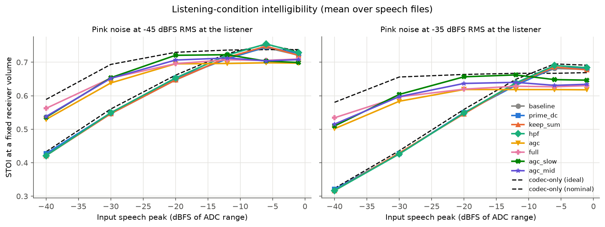

The speech sweep's decoded audio at its own level (a fixed receiver volume, no normalisation) with pink noise added at the listener, STOI against the clean source. Worst: the lowest mean STOI over the input and noise levels; deficit: codec-only (ideal) minus the variant in the same cell, at its largest.

| variant | mean STOI | Δ | worst STOI | at input / noise dBFS | Δ | worst deficit vs ideal |
|---|---|---|---|---|---|---|
| baseline | 0.590 |  | 0.320 | -40 / -35 |  | 0.261 |
| prime_dc | 0.592 | +0.002 | 0.320 | -40 / -35 | +0.001 | 0.260 |
| keep_sum | 0.591 | +0.000 | 0.316 | -40 / -35 | -0.003 | 0.264 |
| hpf | 0.594 | +0.004 | 0.317 | -40 / -35 | -0.003 | 0.264 |
| agc | 0.626 | +0.036 | 0.501 | -40 / -35 | +0.182 | 0.079 |
| full | 0.639 | +0.049 | 0.534 | -40 / -35 | +0.215 | 0.059 |
| agc_slow | 0.647 | +0.056 | 0.510 | -40 / -35 | +0.190 | 0.071 |
| agc_mid | 0.640 | +0.049 | 0.515 | -40 / -35 | +0.196 | 0.065 |

Noise -45 dBFS: STOI by input peak, Δ vs baseline in brackets:

| variant | -40 dBFS | -30 dBFS | -20 dBFS | -12 dBFS | -6 dBFS | -1 dBFS |
|---|---|---|---|---|---|---|
| baseline | 0.425 | 0.546 | 0.647 | 0.713 | 0.744 | 0.721 |
| prime_dc | 0.427 (+0.002) | 0.549 (+0.002) | 0.652 (+0.005) | 0.710 (-0.004) | 0.746 (+0.002) | 0.726 (+0.005) |
| keep_sum | 0.421 (-0.004) | 0.546 (+0.000) | 0.647 (+0.000) | 0.714 (+0.001) | 0.748 (+0.004) | 0.720 (-0.001) |
| hpf | 0.421 (-0.004) | 0.549 (+0.003) | 0.653 (+0.006) | 0.721 (+0.008) | 0.755 (+0.011) | 0.729 (+0.008) |
| agc | 0.529 (+0.104) | 0.638 (+0.092) | 0.695 (+0.048) | 0.696 (-0.017) | 0.698 (-0.045) | 0.697 (-0.024) |
| full | 0.562 (+0.137) | 0.652 (+0.106) | 0.696 (+0.049) | 0.707 (-0.006) | 0.705 (-0.038) | 0.709 (-0.012) |
| agc_slow | 0.536 (+0.110) | 0.654 (+0.107) | 0.721 (+0.074) | 0.722 (+0.009) | 0.703 (-0.040) | 0.699 (-0.022) |
| agc_mid | 0.538 (+0.113) | 0.652 (+0.105) | 0.706 (+0.060) | 0.713 (-0.001) | 0.704 (-0.040) | 0.708 (-0.013) |
| codec-only (ideal) | 0.589 | 0.693 | 0.730 | 0.736 | 0.738 | 0.738 |
| codec-only (nominal) | 0.433 | 0.560 | 0.661 | 0.726 | 0.752 | 0.733 |

Noise -35 dBFS: STOI by input peak, Δ vs baseline in brackets:

| variant | -40 dBFS | -30 dBFS | -20 dBFS | -12 dBFS | -6 dBFS | -1 dBFS |
|---|---|---|---|---|---|---|
| baseline | 0.320 | 0.427 | 0.548 | 0.634 | 0.681 | 0.678 |
| prime_dc | 0.320 (+0.001) | 0.427 (+0.001) | 0.549 (+0.001) | 0.631 (-0.003) | 0.684 (+0.003) | 0.682 (+0.004) |
| keep_sum | 0.316 (-0.003) | 0.429 (+0.002) | 0.546 (-0.002) | 0.636 (+0.002) | 0.685 (+0.004) | 0.677 (-0.001) |
| hpf | 0.317 (-0.003) | 0.426 (-0.001) | 0.548 (+0.000) | 0.638 (+0.004) | 0.690 (+0.009) | 0.684 (+0.005) |
| agc | 0.501 (+0.182) | 0.583 (+0.157) | 0.619 (+0.070) | 0.618 (-0.016) | 0.618 (-0.063) | 0.618 (-0.061) |
| full | 0.534 (+0.215) | 0.597 (+0.170) | 0.620 (+0.072) | 0.628 (-0.006) | 0.627 (-0.055) | 0.630 (-0.048) |
| agc_slow | 0.510 (+0.190) | 0.604 (+0.177) | 0.656 (+0.108) | 0.662 (+0.028) | 0.648 (-0.033) | 0.646 (-0.032) |
| agc_mid | 0.515 (+0.196) | 0.597 (+0.171) | 0.637 (+0.089) | 0.640 (+0.006) | 0.631 (-0.051) | 0.634 (-0.044) |
| codec-only (ideal) | 0.580 | 0.656 | 0.663 | 0.667 | 0.667 | 0.669 |
| codec-only (nominal) | 0.324 | 0.436 | 0.559 | 0.649 | 0.695 | 0.691 |

## Silence and gate

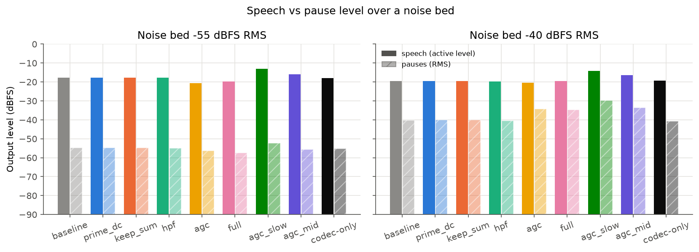

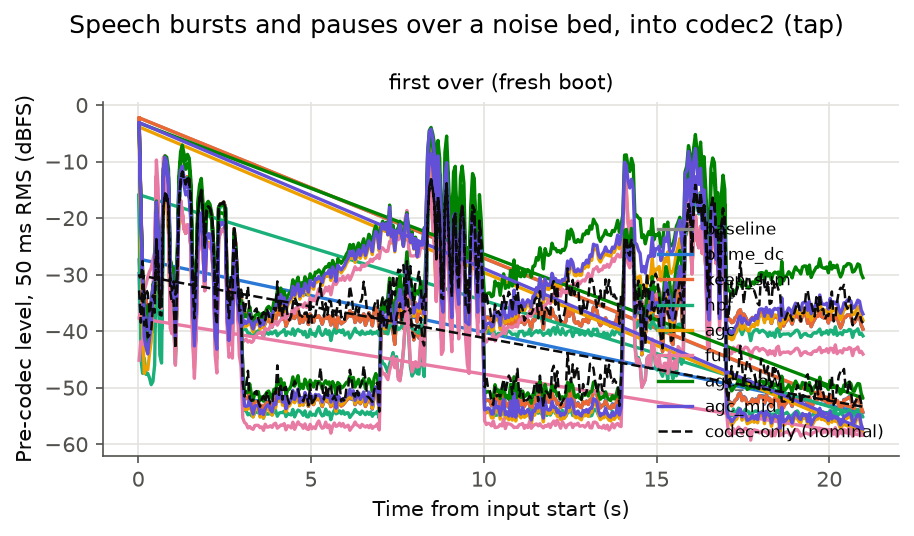

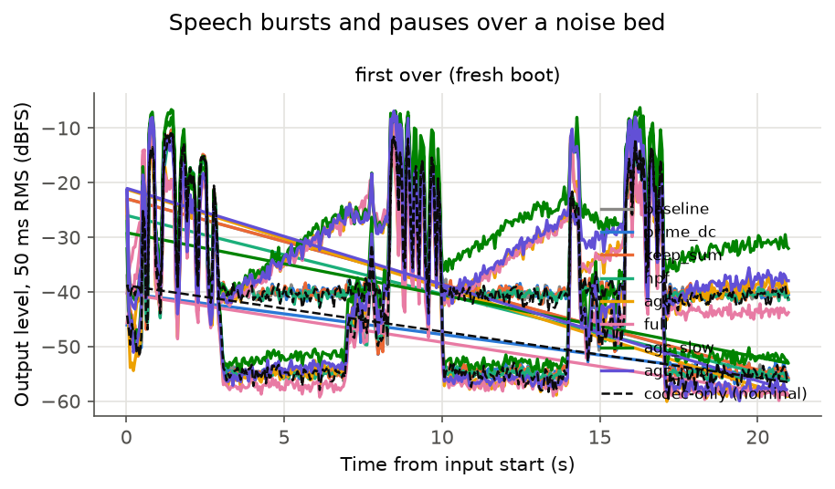

Pause level is the RMS in the pauses, 0.3 s in from each edge; drift is the last second of a pause against its first (positive: the noise is pumped up during the pause); trend is the last pause against the first.

| variant | noise dBFS | where | speech dBFS | pause dBFS | speech/pause dB | drift dB | worst drift dB | trend dB |
|---|---|---|---|---|---|---|---|---|
| baseline | -55 | pre-codec | -16.2 | -52.3 | 36.0 | -0.2 | 0.2 | 0.1 |
| baseline | -55 | output | -17.7 | -54.6 | 37.0 | -0.1 | 0.1 | 0.0 |
| prime_dc | -55 | pre-codec | -20.9 | -52.3 | 31.4 | -0.2 | 0.2 | 0.1 |
| prime_dc | -55 | output | -17.7 | -54.6 | 37.0 | -0.1 | 0.1 | 0.1 |
| keep_sum | -55 | pre-codec | -16.2 | -52.3 | 36.1 | -0.2 | 0.2 | 0.1 |
| keep_sum | -55 | output | -17.7 | -54.8 | 37.0 | -0.1 | 0.1 | -0.1 |
| hpf | -55 | pre-codec | -19.2 | -54.5 | 35.3 | 0.0 | 0.1 | 0.0 |
| hpf | -55 | output | -17.8 | -55.0 | 37.2 | -0.2 | 0.0 | 0.0 |
| agc | -55 | pre-codec | -18.9 | -54.0 | 35.1 | 0.2 | 1.4 | -3.1 |
| agc | -55 | output | -20.5 | -56.3 | 35.8 | 0.3 | 1.4 | -3.1 |
| full | -55 | pre-codec | -20.0 | -57.1 | 37.1 | 0.0 | 0.1 | -1.0 |
| full | -55 | output | -19.7 | -57.4 | 37.7 | -0.1 | 0.0 | -1.1 |
| agc_slow | -55 | pre-codec | -13.7 | -50.0 | 36.3 | 0.2 | 1.4 | 0.0 |
| agc_slow | -55 | output | -13.0 | -52.3 | 39.3 | 0.3 | 1.4 | 0.1 |
| agc_mid | -55 | pre-codec | -15.9 | -53.4 | 37.5 | 0.3 | 1.5 | -3.1 |
| agc_mid | -55 | output | -16.0 | -55.7 | 39.7 | 0.4 | 1.6 | -3.3 |
| codec-only (nominal) | -55 | pre-codec | -20.9 | -49.3 | 28.4 | -0.1 | 1.7 | 1.9 |
| codec-only (nominal) | -55 | output | -17.8 | -55.2 | 37.3 | -0.3 | 0.8 | -0.6 |
| baseline | -40 | pre-codec | -16.4 | -37.6 | 21.3 | -0.2 | 0.2 | 0.2 |
| baseline | -40 | output | -19.6 | -40.2 | 20.6 | -0.2 | 0.0 | -0.1 |
| prime_dc | -40 | pre-codec | -21.2 | -37.6 | 16.4 | -0.2 | 0.2 | 0.2 |
| prime_dc | -40 | output | -19.6 | -40.1 | 20.5 | 0.0 | 0.2 | -0.2 |
| keep_sum | -40 | pre-codec | -16.4 | -37.6 | 21.3 | -0.2 | 0.2 | 0.2 |
| keep_sum | -40 | output | -19.5 | -40.1 | 20.6 | -0.1 | 0.1 | -0.1 |
| hpf | -40 | pre-codec | -21.4 | -40.3 | 18.8 | 0.0 | 0.0 | 0.0 |
| hpf | -40 | output | -19.7 | -40.4 | 20.8 | 0.1 | 0.2 | 0.0 |
| agc | -40 | pre-codec | -19.2 | -31.8 | 12.5 | 7.1 | 9.7 | -6.6 |
| agc | -40 | output | -20.4 | -34.1 | 13.8 | 7.3 | 9.7 | -6.8 |
| full | -40 | pre-codec | -20.2 | -34.4 | 14.2 | 6.4 | 9.6 | -10.6 |
| full | -40 | output | -19.5 | -34.6 | 15.0 | 6.4 | 9.7 | -10.6 |
| agc_slow | -40 | pre-codec | -13.2 | -27.4 | 14.2 | 6.6 | 9.7 | -0.7 |
| agc_slow | -40 | output | -14.2 | -29.8 | 15.6 | 6.7 | 9.8 | -0.9 |
| agc_mid | -40 | pre-codec | -15.2 | -31.1 | 15.9 | 7.1 | 9.7 | -6.0 |
| agc_mid | -40 | output | -16.4 | -33.5 | 17.1 | 7.2 | 9.5 | -6.1 |
| codec-only (nominal) | -40 | pre-codec | -21.1 | -34.4 | 13.4 | 0.0 | 1.9 | 1.9 |
| codec-only (nominal) | -40 | output | -19.2 | -40.7 | 21.4 | 0.1 | 0.9 | -0.4 |

